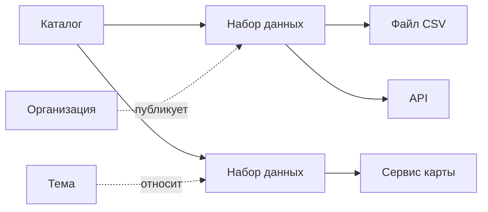

# Анатомия каталога

У портала на CKAN, научного репозитория и геопортала разные слова в интерфейсе. Устройство одно и то же: каталог содержит наборы, у набора есть описание и один или несколько способов получить данные.

## Набор и способ получения

**Набор данных** — то, что человек видит как одну карточку: бюджет города, слой кадастра, таблица показателя, данные к статье.

**Способ получения** — конкретный файл, ссылка, API или картографический сервис. У одного набора их может быть несколько: CSV для человека, API для программы, файл за прошлый год. В словаре DCAT такой способ называют дистрибутивом.

В разных типах каталогов карточка называется по-разному, суть та же:

- геопортал — слой и сервис карты;
- каталог показателей — показатель или таблица с разрезами;
- каталог микроданных — обследование и его файлы;
- научный репозиторий — запись с постоянным идентификатором.

Рядом с набором живут организация-издатель, тема, теги, лицензия и контакт. Без организации и лицензии набор можно скачать и нельзя понять, можно ли его использовать.

## Где лежат байты

Три рабочих варианта.

- Каталог хранит файл сам.
- Каталог только ссылается на файл у источника.
- Каталог собирает чужие описания и уводит человека на исходный портал.

Ссылка дешевле. Она же чаще ломается. Научной статье нужна копия у репозитория, а не надежда, что ведомственный сайт не переедет. Подробнее — в главе [о хранилище](../04-features/05-data-storage.md).

## Два входа

Человеку нужны поиск, фильтры и карточка набора. Программе нужны адрес поиска, файл со всеми описаниями и постоянные адреса. Карточка без второго входа видна только тем, кто уже зашёл на сайт.

Какие бывают программные входы и как проверить, что они открыты, — в главе [«API и массовая выгрузка»](../04-features/04-access-interfaces.md).

## Источники

- [DCAT 3](https://www.w3.org/TR/vocab-dcat-3/) — набор, дистрибутив, каталог
- [API и массовая выгрузка](../04-features/04-access-interfaces.md)
