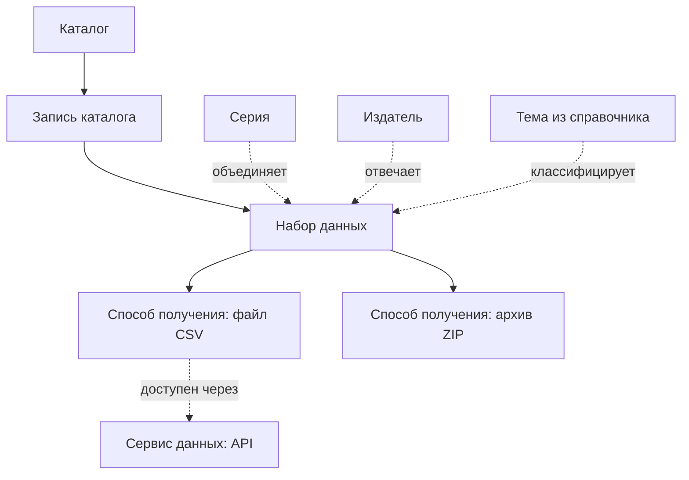

# Анатомия каталога

Портал на CKAN, научный репозиторий и геопортал называют свои части по-разному, но устроены одинаково. В каталоге лежат записи о наборах данных. У набора есть описание, ответственный и один или несколько способов получить сами данные. Вокруг наборов — организации, темы и группы, а внутри программы — база описаний, поисковый индекс и хранилище файлов.

Если различать эти части, можно сравнить любые два каталога, прочитать их программный интерфейс и понять, чего не хватает своему. Глава описывает устройство словами DCAT — словаря W3C для описания каталогов. На нём построено большинство порталов открытых данных, а остальные стандарты на него легко переложить. В конце разобрана одна живая карточка: в ней видны почти все части и типичные поломки между ними.

## Общая схема



Схема читается сверху вниз: каталог ведёт записи, запись описывает набор, набор отдаётся одним или несколькими способами. Пунктир — связи, которые есть не в каждом каталоге.

## Набор данных

**Набор данных** — то, что пользователь видит как одну карточку и использует как одно целое: бюджет города, слой кадастра, ряд показателя, данные к статье. Что считать набором, решает владелец каталога, и решения сильно различаются: у центрального банка набор — временной ряд, в каталоге спутниковых снимков — коллекция из тысяч файлов. Разбор — в главе [о единицах публикации](../02-data/02-formats-and-units.md#что-считать-набором).

Карточка набора отвечает на шесть вопросов. По ним удобно читать любую карточку, даже на незнакомом языке.

| Вопрос | Поля | Без чего нельзя |
|--------|------|-----------------|
| Что это | название, описание, ключевые слова, тема | название и понятное описание |
| Кто отвечает | издатель, контакт, автор | издатель и способ связаться |
| О чём и за какое время | период, территория, частота обновления | период — для любых данных, которые меняются |
| На каких условиях | лицензия, ограничения доступа | лицензия |
| Как получить | список способов получения | хотя бы один рабочий |
| Как сослаться | постоянный идентификатор, версия, строка цитирования | постоянный адрес |

Какие поля обязательны всем, а какие нужны только отдельным отраслям, разобрано в главе [о полноте метаданных](../04-features/03-metadata-depth.md).

**Тема и тег — разные вещи.** Тема берётся из общего справочника: у порталов Европы это список тем Бюро публикаций ЕС, у геопорталов — тематические категории ISO 19115. Тег — свободное слово, которое вписал публикатор. По теме наборы разных порталов складываются в одну полку на общем портале. Теги так не складываются: «транспорт», «Транспорт» и «transport» для программы — три разных слова.

**Издатель и организация в программе — тоже не одно и то же.** **Издатель** — тот, кто отвечает за данные по существу и юридически. Организация в программе — учётная запись, внутри которой сотрудники редактируют наборы. Обычно они совпадают. Расходятся, когда наборы за ведомство заводит оператор портала или когда каталог собирает чужие описания: организация тогда — «сборщик», а издатель — исходное ведомство.

## Запись о наборе и две пары дат

**Запись каталога** — сведения не о данных, а о том, как набор попал в каталог: когда его внесли и когда последний раз правили описание. В DCAT для этого есть отдельный класс, и спецификация объясняет его именно на датах. Дата выпуска набора — когда издатель впервые сделал данные доступными. Дата внесения записи — когда о наборе узнал этот каталог.

Большинство программ эти пары дат не различает. Тогда в поле «обновлено» стоит дата последней правки описания, а не данных. Исправили опечатку в названии — и набор пятилетней давности выглядит свежим. Собрали описания с другого портала — и у всех наборов сегодняшняя дата. Поэтому свежесть данных проверяют по самому файлу и по полю периода, а не по дате на карточке.

## Способ получения

**Способ получения** — конкретный файл, ссылка, API или картографический сервис, через который отдают набор. В DCAT его называют дистрибутивом. У одного набора их может быть несколько: CSV для человека, Parquet для аналитика, API для программы.

У дистрибутива свои поля: формат, размер, контрольная сумма, иногда своя лицензия и своя дата изменения. Две ссылки DCAT различает принципиально:

- **прямая ссылка на файл** (`downloadURL`) — по ней программа одним запросом получает данные;
- **адрес доступа** (`accessURL`) — страница или сервис, через которые данные можно получить, но не обязательно одним запросом.

Если в поле прямой ссылки стоит страница сайта ведомства, человек ещё разберётся, а программа скачает HTML вместо таблицы. Это одна из частых причин, почему поисковик данных показывает набор, но не может определить его формат и размер.

**Сервис данных** — программный интерфейс, через который данные набора получают по частям: отфильтровать строки, запросить объекты на карте. В DCAT 2 он стал отдельной сущностью: у сервиса есть свой адрес и описание, а дистрибутив ссылается на него. Так удобно описывать картографический сервис, который отдаёт сотню слоёв, или API к таблицам, общий для всего портала.

## Серии и версии

Две связи между наборами каталоги путают чаще всего.

**Серия** объединяет однотипные наборы, которые выходят по очереди: исполнение бюджета за каждый месяц, перепись раз в десять лет. Отдельный класс для серии появился только в DCAT 3 (2024 год), поэтому большинство порталов серий не знает и заводит каждый выпуск отдельной карточкой. На греческом национальном портале data.gov.gr в октябре 2026 года исполнение государственного бюджета — 131 отдельный набор, по одному на месяц с 2014 года, без общей группы. Весь ряд человек находит только поиском по названию. Где граница между серией и раздуванием счётчика — в главе [об антипаттернах](../09-practices/02-anti-patterns.md#дробление-ради-счётчика).

**Версия** — зафиксированное состояние набора, на которое можно сослаться. Научным репозиториям версии нужны обязательно: статья ссылается на данные, которые были у авторов, а не на последнюю выгрузку. В InvenioRDM, на котором работает Zenodo, для этого три уровня. Родительская запись объединяет все версии и хранит общее для них: права доступа, принадлежность к сообществам. У каждой версии своя запись со своими файлами и своим идентификатором. Мелкие правки описания внутри версии сохраняются как ревизии и новой версии не создают. Порталы открытых данных чаще просто заменяют файл, и прошлое состояние пропадает. Подробнее — в главе [об идентификаторах и версиях](../04-features/06-identifiers-and-doi.md).

## Организации, группы и сам каталог

Над наборами каталоги строят ещё один уровень.

- **Организации** отвечают на вопрос «кто отвечает». В CKAN набор обычно принадлежит ровно одной организации, и от неё зависят права на редактирование.
- **Группы, коллекции, сообщества** отвечают на вопрос «что лежит вместе». В CKAN набор может состоять в нескольких группах. В Dataverse коллекции вкладываются друг в друга: университет — факультет — лаборатория. В InvenioRDM сообщество курирует записи: принимает их или отклоняет.
- **Каталог** — тоже сущность со своим описанием: кто его ведёт, каким справочником тем пользуется, на каких условиях можно брать сами описания. Каталог может включать другие каталоги. Так устроены федерации порталов и STAC, где каталоги вкладываются друг в друга, как папки.

Структуру организаций и групп стоит продумать до запуска. Их короткие имена часто входят в адреса страниц. Документация Dataverse прямо предупреждает: если изменить короткое имя коллекции, старые ссылки на неё сломаются.

## Одни и те же части под разными именами

| Где | Набор | Способ получения | Как группируют | Что важно знать |
|-----|-------|------------------|----------------|-----------------|
| DCAT | Dataset; серия — DatasetSeries | Distribution; сервис — DataService | каталог, тема из справочника | общий язык для обмена описаниями между порталами |
| CKAN | dataset, в API — package | resource: загруженный файл или ссылка | организация, группы, теги | слово package осталось от ранних версий и означает то же, что dataset |
| Dataverse | dataset | файл | вложенные коллекции | коллекция может содержать и наборы, и другие коллекции |
| InvenioRDM, Zenodo | запись (record) | файл | сообщества | у каждой версии своя запись, общая родительская — на все версии |
| Геопортал по ISO 19115 | запись метаданных о слое или сервисе | онлайн-ресурс в разделе о распространении | ключевые слова, тематическая категория | у одного слоя часто три способа: картинка WMS, объекты WFS, файл |
| STAC | коллекция, внутри — элементы (items) | ассет: файл снимка или другой файл | каталоги и подкаталоги | по спецификации STAC коллекция соответствует набору в DCAT |

Каталоги показателей и микроданных укладываются в ту же схему, но с другим главным объектом: показатель с разрезами вместо файла, обследование с переменными вместо таблицы. О них — главы [о каталогах показателей](../03-types/05-indicator-catalogs.md) и [о микроданных](../03-types/06-microdata-catalogs.md).

## Где лежат байты

Каталог может хранить файл сам, только ссылаться на файл у источника или собирать чужие описания и уводить человека на исходный портал. Ссылка дешевле, но чаще ломается. Научной статье нужна копия у репозитория, а не надежда, что ведомственный сайт не переедет.

«Файл у каталога» не значит «на его сервере». Загруженные на data.gov.gr файлы открываются по адресу портала, а отдаются из облачного хранилища Microsoft Azure. Для пользователя разницы нет. Для владельца это строка в бюджете и вопрос, кто отвечает за резервные копии. Варианты хранения и их поддержка в платформах — в главе [о хранилище](../04-features/05-data-storage.md).

## Что внутри программы

Снаружи каталог — сайт. Внутри почти у любой серверной платформы одни и те же части:

- **база описаний** — карточки, пользователи, права; обычно это PostgreSQL;
- **поисковый индекс** — отдельная копия описаний, устроенная для быстрого поиска и фильтров. Если индекс разошёлся с базой, набор существует, но не находится. После переноса и обновлений индекс пересобирают;
- **хранилище файлов** — диск сервера или облачное хранилище;
- **хранилище таблиц** — отдельная база, куда загружены строки таблиц, чтобы показывать их в браузере и отдавать по API;
- **фоновые задачи** — сбор чужих каталогов, загрузка таблиц, проверка ссылок, сборка архивов. Их ставят в очередь и выполняют отдельно от сайта;
- **веб-интерфейс и API** — то, что видят люди и программы.

| Платформа | База описаний | Поисковый индекс | Файлы | Что ещё |
|-----------|---------------|------------------|-------|---------|
| CKAN 2.12 | PostgreSQL | Solr 9 или 8 | диск сервера, облако — через расширение | Redis; хранилище таблиц DataStore — по желанию, отдельная база PostgreSQL |
| Dataverse | PostgreSQL | Solr | диск или облачное хранилище | сервер приложений Payara |
| InvenioRDM | PostgreSQL 15 и новее | OpenSearch 2.12 и новее | сетевой диск, S3 и другие | Redis или memcached для кэша, RabbitMQ или Redis для очереди задач |
| Статический сайт | нет | нет или небольшой индекс, который скачивается в браузер | файлы рядом со страницами | генератор, который собирает сайт |

Каждая часть — отдельная программа, которую обновляют, резервируют и проверяют. Число частей — хорошая первая оценка того, сколько стоит сопровождение. Подробнее — в главе [о развёртывании и сопровождении](../04-features/09-deployment-and-operations.md).

## Два входа

Человеку нужны поиск, фильтры, карточка и кнопка «Скачать». Программе — то же самое в машинном виде. Тем же машинным входом пользуются другие каталоги, которые забирают описания по расписанию, и поисковики данных. Хороший каталог отдаёт каждую часть обоими способами.

| Человек видит | Программа читает | Как это сделано в CKAN |
|---------------|------------------|------------------------|
| поиск и фильтры | поисковый API | ядро: `/api/3/action/package_search` |
| карточку набора | запись в JSON или DCAT | ядро: `package_show`; DCAT — расширение ckanext-dcat, адрес карточки с окончанием `.ttl`, `.rdf` или `.jsonld` |
| кнопку «Скачать» | прямую ссылку на файл | ядро: адрес у ресурса |
| таблицу с предпросмотром | API к строкам таблицы | ядро, плагин DataStore: `datastore_search` |
| список всех наборов | файл со всеми описаниями | расширение ckanext-dcat: `/catalog.ttl` |
| набор в выдаче поисковика | разметку schema.org на странице, карту сайта | разметка — тоже расширение ckanext-dcat |

Оба входа должны говорить одно и то же, а расходятся они часто: на странице есть файл, которого нет в выгрузке, или в выгрузке нет лицензии, которая видна на странице. Человек видит одно, агрегатор — другое. Какие бывают программные входы и как проверить, что они открыты, — в главе [«API и массовая выгрузка»](../04-features/04-access-interfaces.md).

## Разбор живой карточки

Возьмём набор «Метеорологические данные станции Парнита» на data.gov.gr — национальном портале открытых данных Греции на CKAN 2.11 (проверено 12 октября 2026 года). Карточка простая, зато в ней видны почти все части из этой главы.

- **Набор.** Издатель — национальная метеослужба Греции; в программе набор принадлежит организации с тем же названием. Тема — «Окружающая среда» из справочника тем ЕС, тегов восемь, на греческом и английском. Лицензия CC BY 4.0, частота обновления — «непрерывно». Набор отмечен как набор высокой ценности по регламенту ЕС 2023/138, категория «Метеорология».
- **Два способа получения.** Первый — файл CSV на 18 МБ с измерениями каждые пять минут. Он загружен в хранилище таблиц, поэтому строки можно запросить через API. Второй — архив ZIP «Все данные», который портал собирает сам расширением ckanext-downloadall: внутри тот же файл и описание набора `datapackage.json`.
- **Сервис данных.** В выгрузке DCAT у файла CSV указан сервис доступа — API хранилища таблиц со своим адресом. Это та самая связка «дистрибутив — сервис данных».
- **Даты.** В выгрузке DCAT дата выпуска набора — 13 мая 2026 года, дата изменения — 11 октября. Обе взяты из записи каталога: когда карточку создали и когда её последний раз меняли.

Если сравнить части между собой, находится пять расхождений.

1. **Два входа говорят разное.** На странице два способа получения, в выгрузке DCAT — один: архива там нет. Человек увидит ZIP, сборщик европейского портала — нет.
2. **Производный файл отстаёт.** CSV на 11 октября 2026 года содержит измерения по этот день, а архив «Все данные» — только по 14 августа. Причина описана в документации расширения: небольшой архив пересобирается, когда меняют карточку, а не когда обновляется файл. Кто скачал «всё одним архивом», получил данные двухмесячной давности.
3. **Описание и содержимое расходятся.** В карточке период начинается 7 апреля 2026 года, а первая строка файла — 1 апреля.
4. **Словаря полей нет.** В хранилище таблиц все 57 колонок записаны как текст, включая температуру и давление, и ни у одной нет описания. Названия вроде `Temp_Dry_5min` понятны метеорологу, остальным — нет. Пропуски обозначены косыми чертами `/////`, и об этом нигде не сказано.
5. **Для поисковиков ничего нет.** Разметки schema.org на странице нет, карты сайта у портала тоже нет.

На странице ни одно из этих расхождений не видно. Все пять находятся за десять минут, если открыть машинную версию той же карточки.

## Как разобрать любой каталог

Возьмите один набор и посмотрите на него тремя способами: страница, запись в API, выгрузка описаний. Для CKAN подставьте адрес портала и имя набора из адреса его страницы:

```bash
# запись о наборе в JSON: поля, ресурсы, организация
curl "https://portal.example/api/3/action/package_show?id=имя-набора"
# тот же набор в DCAT, если установлено расширение ckanext-dcat
curl "https://portal.example/dataset/имя-набора.ttl"
# первые строки и типы колонок, если файл загружен в DataStore
curl "https://portal.example/api/3/action/datastore_search?resource_id=ID-ресурса&limit=5"
```

У других платформ запись о наборе лежит по похожим адресам: у Dataverse — `/api/datasets/:persistentId/?persistentId=doi:…`, у InvenioRDM и Zenodo — `/api/records/ID-записи`. Каталог STAC сам по себе состоит из файлов JSON, и его можно читать прямо в браузере.

Дальше ответьте на пять вопросов:

1. Сколько способов получения и все ли они открываются?
2. Прямая ссылка ведёт на файл или на страницу?
3. Совпадает ли состав страницы и выгрузки?
4. Какая дата стоит на карточке — данных или записи?
5. Есть ли словарь полей и совпадает ли период в описании с содержимым?

## Что из этого следует для своего каталога

- Решите, что у вас набор, а что серия, до того как заводить первые карточки. Переделывать сотни отдельных выпусков в серию потом дорого.
- Проверяйте, различает ли платформа прямую ссылку и страницу доступа, даты данных и даты записи. Если нет, договоритесь, какое поле что означает, и запишите это в правила публикации.
- Продумайте организации и группы заранее: их имена уходят в адреса страниц.
- Проверяйте производные файлы — архивы «всё сразу», предпросмотры, копии в хранилище таблиц — так же, как исходные. Они устаревают незаметно.
- Помните, что каждая внутренняя часть программы — отдельная статья расходов на сопровождение.

## Источники

- W3C, [DCAT 3](https://www.w3.org/TR/vocab-dcat-3/), рекомендация от 22 августа 2024 года — каталог, запись каталога, набор, серия, дистрибутив, сервис данных, прямая ссылка и адрес доступа
- CKAN: [руководство пользователя](https://docs.ckan.org/en/2.12/user-guide.html) — наборы, ресурсы, организации, слово package; [установка из исходного кода](https://docs.ckan.org/en/2.12/maintaining/installing/install-from-source.html) — PostgreSQL, Solr, Redis, DataStore; проверено 12 октября 2026 года
- Dataverse: [управление коллекциями](https://guides.dataverse.org/en/latest/user/dataverse-management.html) — вложенные коллекции, смена короткого имени ломает ссылки; [требования к установке](https://guides.dataverse.org/en/latest/installation/prerequisites.html) — Payara, PostgreSQL, Solr
- InvenioRDM: [модель записей](https://github.com/inveniosoftware/docs-invenio-rdm/blob/master/docs/maintenance/architecture/records.md) — родительская запись, версии, черновики, ревизии; [требования к установке](https://github.com/inveniosoftware/docs-invenio-rdm/blob/master/docs/install/requirements.md) — PostgreSQL, OpenSearch, Redis, RabbitMQ, хранилища
- STAC, [обзор спецификации](https://github.com/radiantearth/stac-spec/blob/master/overview.md) — каталог, коллекция, элемент, ассет; соответствие коллекции набору DCAT
- [ckanext-downloadall](https://github.com/SDM-TIB/ckanext-downloadall) — когда пересобирается архив «Все данные»
- data.gov.gr, [Метеорологические данные станции Парнита](https://data.gov.gr/dataset/emy-station-189): [запись в API](https://data.gov.gr/api/3/action/package_show?id=emy-station-189), [выгрузка DCAT](https://data.gov.gr/dataset/emy-station-189.ttl); проверено 12 октября 2026 года
- [Внутреннее хранилище](../04-features/05-data-storage.md), [API и массовая выгрузка](../04-features/04-access-interfaces.md)
