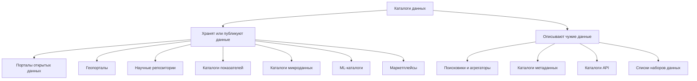

# Как классифицировать каталоги

Одного ярлыка мало. Портал города на CKAN и портал города на ArcGIS Hub оба «про данные муниципалитета», но устроены по-разному. Книга различает каталоги по пяти вопросам.

| Вопрос | Варианты ответа |
|--------|-----------------|
| Что публикуют | файлы и реестры, слои карт, данные исследований, показатели, микроданные, описания чужих данных |
| Кто владелец и на каком уровне | центр, регион, город, наука, бизнес, некоммерческая или международная организация, сообщество |
| Где лежат данные | в самом каталоге, по ссылке у источника, или каталог только собирает чужие описания |
| Кто может получить данные | все, часть по запросу, за плату |
| Как сделан каталог | свободная платформа, облачный сервис, обычный сайт, сервер протокола, своя разработка |

Первый вопрос задаёт тип. Остальные объясняют, почему два каталога одного типа всё равно нельзя выбирать одинаково. Уровень владельца и способ создания разобраны в частях [о платформах](../05-platforms/01-software-classes.md) и [о выборе](../06-choice/05-build-or-buy.md).

## Типы по содержимому

Если сайт делает два дела сразу, тип выбирают по тому, что видит человек в первую очередь. Карта и каталог слоёв — геопортал, даже если рядом лежит несколько таблиц. Список наборов со встроенной картой — портал открытых данных. Так же стоит выбирать платформу: не «максимально универсальную», а под главный продукт.

Дальше каждая глава устроена одинаково: что это, кто создаёт, что публикует, какие стандарты и платформы, живые примеры, типичные сбои и чем тип отличается от соседнего. Сводка — в главе [о сравнении и гибридах](./11-comparison-and-hybrids.md).

## Источники

- [Мир каталогов в цифрах](../01-basics/04-catalogs-in-numbers.md)
- [Карта возможностей](../04-features/01-capability-map.md)
