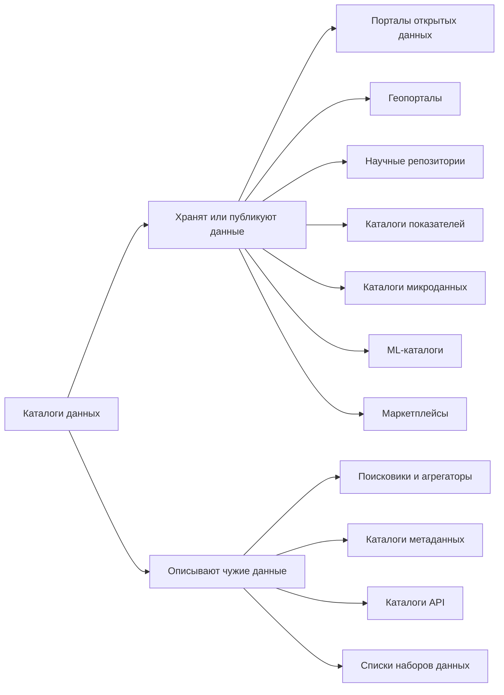
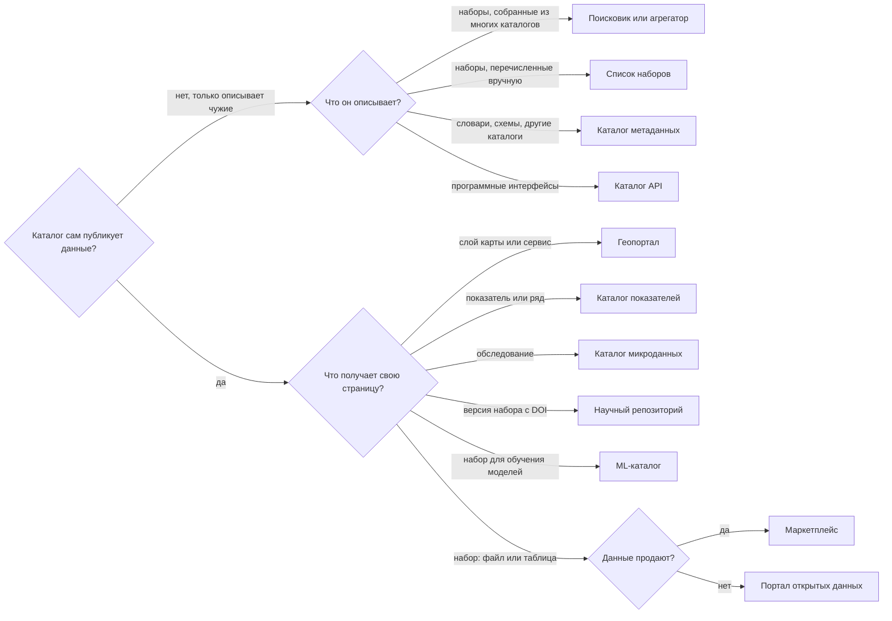

# Как классифицировать каталоги

Каталог данных описывают ответами на пять вопросов: что в нём публикуют, кто его ведёт, где лежат сами данные, кто может их получить и на чём он сделан. Ответ на первый вопрос — тип каталога. От типа зависят стандарт описания и круг подходящих платформ. Остальные четыре ответа объясняют, почему два каталога одного типа всё равно выбирают и сопровождают по-разному.

Классификация нужна не для порядка на полке. По ней находят каталоги, с которыми стоит себя сравнивать, стандарт, которого ждут агрегаторы, класс платформы и типичные сбои. Портал открытых данных города на CKAN и геопортал того же города на ArcGIS Hub оба «про данные муниципалитета». Но стандарты у них разные, платформы разные, и описания они отдают в разные федерации. Если назвать оба сайта одним словом, сравнивать придётся несравнимое.

## Пять вопросов

| Вопрос | Варианты ответа | Что из ответа следует |
|--------|-----------------|-----------------------|
| Что публикуют | файлы и реестры, слои карт, данные исследований, показатели, микроданные, наборы для машинного обучения, данные на продажу, описания чужих данных | тип каталога, стандарт описания, класс платформы |
| Кто ведёт и на каком уровне | центральная власть, регион, город, университет или научная организация, бизнес, некоммерческая или международная организация, сообщество | бюджет и команда, обязательства по закону, кому каталог отдаёт описания дальше |
| Где лежат данные | в самом каталоге, по ссылке у источника, каталог только собирает чужие описания | можно ли выдать DOI, кто отвечает за мёртвые ссылки, нужно ли своё хранилище |
| Кто может получить данные | все без условий, после регистрации, по заявке, за плату; описание открыто, а данные закрыты | роли и порядок выдачи, нужен ли учёт заявок, что писать в лицензии |
| На чём сделан | облачный сервис, готовая платформа на своём сервере, картографический сервер или сервер протокола, сайт на CMS, своя разработка | кто обновляет программу, можно ли добавить функцию, сколько стоит уйти |

Ответы не зависят друг от друга. Научный репозиторий бывает у университета и у правительства, открытый и с заявками, на своём сервере и в облаке. Поэтому классификацию удобнее записывать строкой, а не одним словом: «геопортал района, слои на собственном картографическом сервере, открытый доступ, облачный ArcGIS Hub». Каждая часть строки отсылает к своей главе книги. Как записать такую строку для своего каталога, показано [в конце главы](#как-записать-классификацию-своего-каталога).

Цифры в главе — по выгрузке реестра dataportals-registry (выпуск 1.27.0 от 15 октября 2026 года), в нём 43 614 каталогов. Реестр — один из источников и сам иногда ошибается в отнесении к типу. Его ограничения разобраны в главе [«Мир каталогов в цифрах»](../01-basics/04-catalogs-in-numbers.md#чего-числа-не-показывают).

## Что публикуют: тип каталога



Две ветви различаются главным. Каталоги левой ветви сами публикуют данные. Каталоги правой ведут к чужим данным и отвечают только за описание. Внутри ветви тип определяет главная единица — то, что получает в каталоге свою страницу и свой постоянный адрес.

| Тип | Главная единица | Стандарт описания | Пример |
|-----|-----------------|-------------------|--------|
| [Портал открытых данных](./02-open-data-portals.md) | набор: файл или таблица | DCAT | [data.gouv.fr](https://www.data.gouv.fr) |
| [Геопортал](./03-geoportals.md) | слой и картографический сервис | ISO 19115, CSW | [Geoportal.de](https://www.geoportal.de) |
| [Научный репозиторий](./04-scientific-repositories.md) | версия набора с DOI | DataCite | [Zenodo](https://zenodo.org), [PANGAEA](https://www.pangaea.de) |
| [Каталог показателей](./05-indicator-catalogs.md) | показатель и временной ряд | SDMX | [портал данных ЕЦБ](https://data.ecb.europa.eu) |
| [Каталог микроданных](./06-microdata-catalogs.md) | обследование и его файлы | DDI | [библиотека микроданных Всемирного банка](https://microdata.worldbank.org) |
| [ML-каталог](./07-ml-catalogs.md) | набор для обучения и проверки моделей | Croissant | [Hugging Face Datasets](https://huggingface.co/datasets) |
| [Маркетплейс](./10-other-types.md#маркетплейсы-данных) | товар: набор или подписка по договору | общего нет | [AWS Data Exchange](https://aws.amazon.com/data-exchange/) |
| [Поисковик или агрегатор](./09-search-engines-aggregators.md) | запись о чужом наборе | то, что собирает: DCAT, schema.org, DataCite | [data.europa.eu](https://data.europa.eu) |
| [Каталог метаданных](./08-metadata-catalogs.md) | словарь, схема, описание другого каталога | SKOS, SDMX, ISO/IEC 11179 | [re3data](https://www.re3data.org/) |
| [Каталог API](./10-other-types.md#каталоги-api) | программный интерфейс | OpenAPI | [api.gov.uk](https://www.api.gov.uk) |
| [Список наборов](./10-other-types.md#списки-наборов) | ссылка на файл | чаще никакого | [awesome-public-datasets](https://github.com/awesomedata/awesome-public-datasets) |

Четыре крупных типа — геопорталы, научные репозитории, порталы открытых данных и каталоги показателей — дают 97,5% записей реестра. Остальные семь типов вместе — около тысячи каталогов. Малый тип от этого не становится неважным: каталогов микроданных всего 326, но без них нет доступа к обследованиям, на которых держится социальная статистика.

### Как определить тип

Смотрите не на название сайта и не на кнопки главной страницы, а на то, что в каталоге получает собственный адрес. Если у ряда «курс евро к доллару» есть своя страница с графиком и API, а файлов по годам нет, это каталог показателей, даже если сайт называется порталом открытых данных.



Если сайт делает два дела сразу, тип выбирают по тому, что человек видит и делает первым. Карта и каталог слоёв — геопортал, даже если рядом лежит несколько таблиц. Список наборов со встроенной картой — портал открытых данных. Так же стоит выбирать и платформу: не «максимально универсальную», а под главный продукт. Сайты, которые честно делают два дела, и хабы из нескольких каталогов разобраны в главе [о сравнении и гибридах](./11-comparison-and-hybrids.md).

## Кто ведёт и на каком уровне

От владельца зависят деньги, команда и обязательства. Он же часто решает, на какой платформе окажется каталог и куда уйдут его описания: город отдаёт их региону, регион — стране, страна — европейскому или другому общему порталу.

Владельцы в реестре распределены так: местные органы власти — 40%, университеты и научные организации — 22%, центральные органы власти — 14%, региональные — 12%. Бизнесу принадлежит 4% каталогов, некоммерческим организациям — 3%, международным — 3%. У каждого типа свой главный владелец.

| Тип | Кто ведёт чаще всего |
|-----|----------------------|
| Геопортал | местные органы власти — 58%, региональные — 14% |
| Портал открытых данных | местные органы власти — 48%, центральные — 19%, региональные — 14% |
| Научный репозиторий | университеты и научные организации — 85% |
| Каталог показателей | центральные органы власти — 46%, региональные — 19%, международные организации — 11% |
| Каталог микроданных | центральные органы власти — 55%, университеты и научные организации — 32% |

Что меняется от уровня к уровню:

- **Город.** Наборов мало, людей — один-два. Платформу часто выбирает не город: в России её нередко задаёт государственная платформа сайтов Gosweb, в Польше — рынок, где больше половины гмин работает на e-mapa. Важнее отдать описания наверх, чем завести свою витрину. Разбор — в [примере муниципалитета](../06-choice/08-worked-examples.md#муниципалитет-не-заводить-свой-портал).
- **Регион.** Собирает каталоги городов и отдаёт описания стране. Для него сбор и выгрузка — две обязательные функции.
- **Страна.** Ведёт национальный каталог своего типа и отвечает по закону: директива INSPIRE для геоданных, директива ЕС об открытых данных и регламент о наборах высокой ценности, национальные перечни. В реестре около 600 каталогов отмечены как национальные, хотя отметка расставлена не везде последовательно.
- **Университет или научная организация.** Требования приходят от грантодателей и журналов: DOI, версии, цитирование, сбор описаний по OAI-PMH.
- **Международная организация.** Публикует данные о странах, у которых своих каталогов почти нет, и часто держит несколько каталогов разных типов под одной вывеской.
- **Бизнес.** Открывает данные ради продукта или продаёт их и закрывает доступ, когда это перестаёт окупаться. Так data.world в июле 2026 года закрыл открытое сообщество: подробнее в главе [об облачных хранилищах и хабах](../08-beyond-portals/04-cloud-storage-and-hubs.md).
- **Сообщество и некоммерческие организации.** Иногда делают каталог раньше государства, как «Хаб открытых данных» hubofdata.ru в 2010–2011 годах, но держатся на энтузиастах.

Владелец не задаёт тип. 15% каталогов университетов и научных организаций — геопорталы, а не научные репозитории. Владелец не задаёт и охват: международная организация публикует данные о странах, а университет — о территории, где шло исследование.

## Где лежат данные

Этот вопрос делит каталоги на три группы.

- **Хранит у себя.** Файл загружен в каталог и живёт, пока жив каталог. Это обычный режим научного репозитория. DOI честнее всего выдавать именно здесь: идентификатор обещает, что по нему найдётся тот же файл и через десять лет, а сдержать обещание может только тот, кто файл хранит.
- **Ссылается на источник.** Каталог хранит описание и адрес, а файл лежит на сайте ведомства или на картографическом сервере. Так устроены многие порталы открытых данных и большинство геопорталов. Риск — мёртвые ссылки: при полной выгрузке data.gov.uk в 2023 году не открывались около 10% ссылок на файлы, к 2026 году — больше четверти.
- **Собирает чужие описания.** Агрегатор и поисковик за данные не отвечают, но отвечают за то, чтобы не показывать мёртвое и не размножать один набор, который есть у города, региона и страны.

Отдельный случай — сервер протокола: THREDDS, ERDDAP, сервер STAC. Данные отдаются по запросу, и каталог с хранилищем здесь совпадают.

Ответ часто зависит не от типа, а от платформы и от решения владельца. CKAN умеет и хранить файл, и ссылаться на чужой. Zenodo рассчитан на то, что файл лежит у него. ArcGIS Hub показывает слои, которые живут на серверах ArcGIS. Варианты и когда какой выбирать — в главе [о хранилище данных](../04-features/05-data-storage.md).

## Кто может получить данные

Удобную схему предлагает re3data, реестр научных репозиториев. Он задаёт не один вопрос о доступе, а три:

1. Открыт ли сам каталог: можно ли искать и читать описания.
2. Открыты ли данные. Варианты: открыты, закрыты до определённой даты (эмбарго), выдаются с ограничениями, закрыты совсем.
3. Кто может загружать данные: все, только свои или никто со стороны.

Ограничения он перечисляет отдельно: плата, регистрация, членство в организации. Схема годится не только для науки. Портал может быть открыт для чтения и закрыт для загрузки, и это два разных решения с разными последствиями для ролей и проверки публикаций.

В реестре dataportals-registry 97% каталогов отмечены только как открытые. У 1,4% часть данных открыта, часть выдаётся с ограничениями, у 1,2% доступ только ограниченный. Но по типам разница огромная:

| Тип | Доля каталогов с ограниченным доступом хотя бы к части данных |
|-----|------:|
| Маркетплейс | 91% |
| Каталог микроданных | 49% |
| Каталог API | 14% |
| Каталог метаданных | 10% |
| Научный репозиторий | 6% |
| Каталог показателей | 4% |
| Портал открытых данных, геопортал | меньше 1% |

Ограниченный доступ бывает признаком типа, а не недостатком. Половина каталогов микроданных выдаёт часть файлов по заявке, потому что в обследованиях сведения о людях. Описание при этом остаётся открытым: человек должен знать, что данные существуют, чтобы их запросить. Так устроены UK Data Service и каталог закрытых данных государственного сектора Ирландии, разобранные в главе [о каталогах метаданных](./08-metadata-catalogs.md#открытые-описания-закрытых-данных). У портала открытых данных закрытый доступ, наоборот, — признак беды.

Доступ и лицензия — разные вопросы. Доступ отвечает, можно ли получить данные. Лицензия — что с ними можно делать. Данные бывают общедоступны, но не открыты: смотреть можно, а скачать и использовать повторно нельзя. Примеры — в разделе [«Общедоступно, но не открыто»](./03-geoportals.md#общедоступно-но-не-открыто) главы о геопорталах, правила — в главе [о лицензиях и доступе](../07-publishing/04-licenses-and-access.md).

## На чём сделан

Класс программы отвечает на вопрос, кто её обновляет, можно ли добавить функцию и сколько стоит уйти. Подробно классы разобраны в главе [о классах программного обеспечения](../05-platforms/01-software-classes.md). Здесь — как они распределены.

| Класс | Доля каталогов | Чаще всего |
|-------|---------------:|------------|
| Облачный сервис | 30% | ArcGIS Hub (около 3,5 тысячи), e-mapa (около 1,9 тысячи), OpenDataSoft, Figshare |
| Готовая платформа на своём сервере или у подрядчика | 30% | CKAN, GeoNode, GeoNetwork, DSpace, Dataverse, PxWeb, NADA |
| Картографический сервер, сервер протокола или отраслевая система | 20% | ArcGIS Server (около 4,7 тысячи), GeoServer (около 1,5 тысячи), GBIF IPT, THREDDS, ERDDAP |
| Своя разработка | 16% | — |
| Сайт на CMS | 4% | Gosweb, WordPress, Drupal |

По специализированной платформе тип угадывается почти наверняка. CKAN — это 1 906 порталов открытых данных и всего 39 научных репозиториев. DSpace и Dataverse встречаются почти только среди научных репозиториев, GeoNode — только среди геопорталов. Универсальная программа о типе не говорит ничего: WordPress встречается в девяти типах из одиннадцати. Обратное не работает: тип сужает выбор платформы, но не выбирает её. Как от типа и нужных функций перейти к конкретной платформе, разобрано в главе [«От функций к платформе»](../06-choice/03-from-features-to-platform.md).

## Другие признаки

Есть признаки, которые не меняют тип, но нужны, когда ищете, с кем себя сравнивать.

**Широта темы.** re3data делит репозитории на дисциплинарные, институциональные, междисциплинарные, проектные, государственные и прочие. Один репозиторий может попасть сразу в несколько групп. PANGAEA — дисциплинарный, науки о Земле. Harvard Dataverse — институциональный и междисциплинарный одновременно. Zenodo отнесён к прочим. Деление годится и за пределами науки. Отраслевой каталог живёт по стандартам своей области: данные о биоразнообразии описывают в Darwin Core и публикуют через GBIF IPT, океанографические данные отдают серверы ERDDAP. Общий портал страны с ними не конкурирует, а собирает их описания.

**Территория.** Мир, группа стран, страна, регион, город. Охват не совпадает с владельцем: Всемирный банк публикует обследования десятков стран, GBIF привязывает наблюдение к стране, где оно сделано, а не к стране того, кто его прислал.

**Официальный статус.** Национальный каталог своего типа — тот, куда по закону или по договорённости собирают данные страны. Его сравнивают с национальными каталогами других стран, а не с порталом соседнего министерства.

**Состояние.** Работает, заброшен, выведен из эксплуатации, оставлен как архив. В реестре 868 каталогов не открываются как действующие, 98 официально выведены. Сравнивать себя с мёртвым каталогом бессмысленно, но учиться на нём стоит: почему каталоги закрываются и как их спасают, разобрано в главе [об архивации](../09-practices/04-archiving.md).

**Ради чего ведут описания.** Этот признак объясняет, почему у каталогов одного типа такая разная глубина описания. В 2021 году И. Бегтин выделил пять моделей работы с метаданными:

- научная — делать правильно и неспешно, по стандартам своей дисциплины, чтобы было удобно исследователям этой области;
- архивная — сохранить так, чтобы через 10–20 лет данные можно было понять и использовать снова;
- общественно-государственная — быстро открыть как можно больше; доступность важнее качества, описания минимальные;
- технологическая — связать информационные системы и навязать правила обмена, как делают порталы справочников;
- коммерческая — помочь командам аналитиков обмениваться данными и не терять наработки; это мир корпоративных каталогов.

Научные репозитории и архивы микроданных живут по первым двум моделям, порталы открытых данных — по третьей. Отсюда разница в подробности описаний. Что из этого обязательно для вашего каталога, разобрано в главе [о полноте метаданных](../04-features/03-metadata-depth.md).

## Пограничные случаи: каталог ли это

Сайт можно считать каталогом данных, если выполнены три условия:

1. У набора есть описание: хотя бы название, источник и способ получить данные.
2. Наборы можно найти — поиском, списком или через программный интерфейс.
3. Данные можно получить или хотя бы узнать, как их запросить.

Без первого условия это файловый архив или раздел сайта с вложениями. Без третьего — витрина, на которой данные можно посмотреть, но не забрать; такой случай разобран в антипаттерне [«Дашборд вместо данных»](../09-practices/02-anti-patterns.md#дашборд-вместо-данных). Дальше — случаи, где ответ неочевиден.

**Репозиторий публикаций, в котором почти нет данных.** Университеты ведут на DSpace, ePrints или Pure архивы статей, диссертаций и книг, и иногда туда попадают наборы данных. В архиве открытого доступа СПбГУ в декабре 2024 года было 47 619 записей, из них 17 — наборы данных, то есть 0,03%. DSpace без настройки не фильтрует поиск по типу записи, поэтому, чтобы найти эти 17 наборов, пришлось выгрузить описания всех записей. Такой архив — научный репозиторий, но не репозиторий данных. Его стоит учитывать в перечнях, но не ждать от него того, что ждут от каталога данных. Почему такие архивы трудно собирать, разобрано в главе [о научных репозиториях](./04-scientific-repositories.md#почему-их-трудно-собирать).

**Картографический сервер без каталога.** ArcGIS Server и GeoServer отдают слои, но сами по себе описаний для поиска не ведут. Реестр учитывает их среди геопорталов: это около 6,1 тысячи записей. Книга считает их сервисами, на которые опирается геокаталог, а не каталогами. Подробнее — в главе [о геопорталах](./03-geoportals.md).

**Портал справочников.** Порталы нормативно-справочной информации похожи на порталы открытых данных: много наборов, выгрузка, API. Но у них один владелец, единые условия использования вместо лицензии на каждый набор, и сделаны они для обмена между государственными системами. Решающий вопрос — что человек делает на сайте: скачивает справочник как данные или сверяет по нему коды. Разбор — в разделе [«Порталы справочников»](./08-metadata-catalogs.md#порталы-справочников-пограничный-случай).

**Сайт открытого бюджета.** Если таблицы бюджета можно скачать с описанием и датой, это портал открытых данных одной темы. Если на сайте только отчёты в PDF и графики, это сайт с публикациями, а не каталог.

**Лента или интерфейс внутри каталога.** Ленты ATOM, точки доступа WMS, отдельный API — это способы получить набор, а не новые каталоги и не новые наборы. На data.europa.eu в 2024 году было больше 141 тысячи лент ATOM: так GeoNetwork отдаёт геоданные. Считать ли такой объект данными, решает не его форма, а то, нужен ли он тем, кто работает с данными. Что считать единицей публикации, разобрано в главе [о единицах публикации и форматах](../02-data/02-formats-and-units.md#что-считать-набором).

**Корпоративный каталог.** Collibra, DataHub и похожие системы описывают таблицы внутри компании и снаружи не видны. Это каталоги данных, но не публичные; книга о них не говорит, граница проведена в главе [«Что такое каталог данных»](../01-basics/01-what-is-a-data-catalog.md#чем-книга-не-занимается).

**Хаб.** Несколько каталогов разных типов под одной вывеской — не новый тип. Каждый каталог хаба классифицируют и оценивают отдельно, см. главу [о гибридах](./11-comparison-and-hybrids.md#гибриды).

## Типичные ошибки

- **Тип по движку.** «У нас CKAN, значит портал открытых данных». Для специализированных платформ это обычно верно, но на CKAN работают и научные репозитории, а на WordPress — каталоги девяти типов. Тип определяет содержимое, а не программа.
- **Тип по названию.** Слово «портал» или «геопортал» в названии ничего не гарантирует. Сайт статистической службы становится каталогом показателей, когда у каждой таблицы появляется свой адрес и выгрузка, как у Статистики Канады, хотя называется он по-прежнему сайтом службы.
- **Тип по владельцу.** Университет ведёт не только научный репозиторий, но и геопортал, и портал открытых данных. Министерство — не только портал открытых данных, но и каталог показателей.
- **Тип по самой заметной кнопке.** Карта на главной не делает сайт геопорталом, если она показывает уже опубликованные таблицы.
- **Тип по числу наборов.** Миллионы «наборов» часто оказываются нарезкой одной базы или отдельными записями наблюдений. Как это искажает картину, показано в главе [«Мир каталогов в цифрах»](../01-basics/04-catalogs-in-numbers.md#чего-числа-не-показывают).
- **Один тип на весь хаб.** Показатели и микроданные статистической службы — два каталога с двумя стандартами, даже если домен один.

## Как менялись классификации

Деление на типы — рабочий инструмент, и оно менялось вместе с тем, сколько каталогов удавалось найти.

- **2020.** Три большие семьи: порталы открытых данных, научные репозитории и корпоративные каталоги. Эта рамка до сих пор помогает быстро понять, с чем имеешь дело; она разобрана в главе [«Что такое каталог данных»](../01-basics/01-what-is-a-data-catalog.md#три-большие-семьи).
- **2023, февраль.** Каталог каталогов datacatalogs.ru собирал шесть категорий: порталы открытых данных, научные репозитории, базы статистических показателей, геопорталы, сайты открытого бюджета, порталы справочников и классификаторов.
- **2023, май.** В Common Data Index — девять типов: порталы открытых данных, геопорталы, научные репозитории, порталы микроданных и показателей, каталоги данных для машинного обучения, поисковики по данным, маркетплейсы и каталоги API. Порталы справочников туда не вошли: за пределами России похожих порталов почти нет, и тип состоял бы из одних российских сайтов.
- **2026.** В реестре dataportals-registry одиннадцать основных типов. Добавились каталоги метаданных и списки наборов, отдельно учтены общие исследовательские репозитории и неразобранные записи.

Тип заводят тогда, когда каталогов набирается достаточно и их приходится по-разному собирать, описывать и оценивать. Поэтому классификация книги — не окончательная. Если ваш каталог не ложится ни в один тип, опишите его ответами на пять вопросов: этого хватит, чтобы найти соседей и выбрать платформу.

## Как записать классификацию своего каталога

Ответьте на вопросы этой главы и запишите ответы в карточку. Её удобно положить рядом с карточками решений из главы [«Как обосновать решение»](../06-choice/04-justifying-decisions.md).

```text
Тип:                  что получает свою страницу
Владелец и уровень:   кто ведёт, город / регион / страна / наука / другое
Где лежат данные:     у себя / по ссылке / только описания
Доступ:               к описаниям, к данным, к загрузке
Класс ПО:             облако / готовая платформа / сервер / CMS / своя разработка
Тема и территория:    общий или отраслевой, какая территория
С кем сравнивать:     три-пять каталогов с теми же ответами
```

Три примера по разобранным в части VI цепочкам выбора:

| | Город | Университет | Статистическая служба |
|--|-------|-------------|-----------------------|
| Тип | портал открытых данных | научный репозиторий | два каталога: показатели и микроданные |
| Владелец | местные органы власти | университет | центральный орган власти |
| Где лежат данные | файлы в каталоге региона | файлы в самом репозитории | показатели в базе каталога, файлы обследований у себя |
| Доступ | всё открыто | описания открыты, часть файлов закрыта | показатели открыты, микроданные по заявке |
| Класс ПО | решает регион: готовая платформа | готовая платформа на своём сервере, рядом с архивом публикаций | две готовые платформы |
| С кем сравнивать | соседние города того же региона | репозитории других университетов в re3data | службы соседних стран |

Подробные решения — в главе [«Разобранные примеры»](../06-choice/08-worked-examples.md). Дальше по ответам выбирают нужные возможности и платформу: с этого начинается [маршрутная карта](../06-choice/01-route-map.mdx).

## Источники

- Выгрузка реестра dataportals-registry, [выпуск 1.27.0](https://github.com/datenoio/dataportals-registry/releases/tag/v1.27.0) от 15 октября 2026 года: типы, владельцы, режимы доступа, классы ПО и платформы по типам. Запросы — в [приложении](../12-appendices/02-using-the-registry.md).
- [Схема метаданных re3data 4.0](https://doi.org/10.48440/re3.014) и [её XML-схема](https://schema.re3data.org/4-0/re3dataV4-0.xsd): типы репозиториев, доступ к каталогу, данным и загрузке, виды ограничений. Записи [Zenodo](https://www.re3data.org/repository/r3d100010468), [Harvard Dataverse](https://www.re3data.org/repository/r3d100010051) и [PANGAEA](https://www.re3data.org/repository/r3d100010134) в re3data, проверено 12 октября 2026 года.
- GDS, [What's changing on data.gov.uk and why](https://dataingovernment.blog.gov.uk/2026/03/25/whats-changing-on-data-gov-uk-and-why/), 25 марта 2026 года; И. Бегтин, [Хорошие и плохие практики публикации данных](https://begtin.substack.com/p/2ef), ноябрь 2024 — нерабочие ссылки на data.gov.uk.
- И. Бегтин, Telegram: [три категории каталогов данных](https://t.me/begtin/2175), 14.10.2020; [пять моделей работы с метаданными](https://t.me/begtin/2817), 10.05.2021; [категории datacatalogs.ru](https://t.me/begtin/4603), 08.02.2023 (репост канала «Инфокультуры»); [порталы НСИ и типы Common Data Index](https://t.me/begtin/4892), 22.05.2023; [что считать набором данных: ряды, слои, ленты ATOM](https://t.me/begtin/6216), 25.11.2024; [репозиторий публикаций СПбГУ: 17 наборов из 47 619 записей](https://t.me/begtin/6302), 25.12.2024.
- [Мир каталогов в цифрах](../01-basics/04-catalogs-in-numbers.md), [Сравнение типов и гибриды](./11-comparison-and-hybrids.md), [Классы программного обеспечения](../05-platforms/01-software-classes.md), [Карта возможностей](../04-features/01-capability-map.md)
