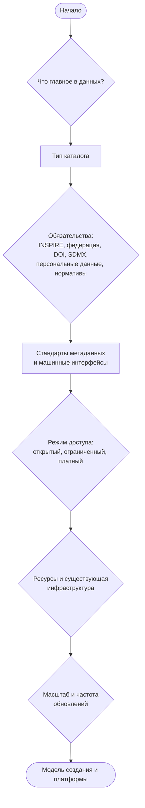
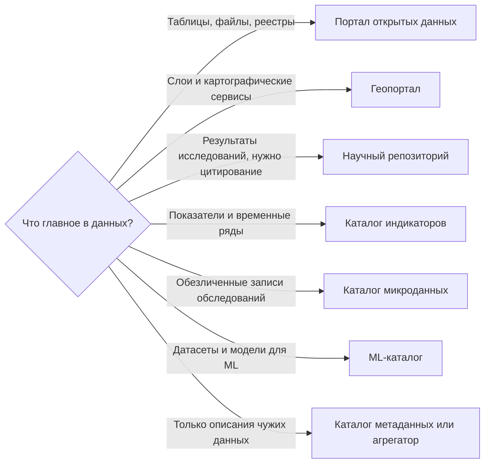
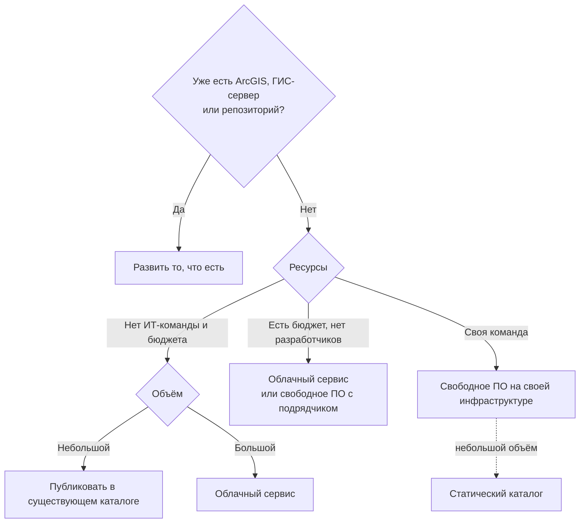

import RouteMap from '@site/src/components/RouteMap';

Глава отвечает на четвёртый вопрос книги: какой каталог данных выбрать под задачи его создателя. Выбор идёт в три этапа. Сначала по содержимому определяется **тип каталога**. Затем обязательства и режим доступа задают **стандарты и интерфейсы**. Наконец ресурсы, существующая инфраструктура и масштаб определяют **модель создания и платформы**. Если уже понятно, кто владелец — министерство, город, университет, служба, — стартовую строку даёт глава [«Типовые сценарии»](./06-scenarios.md). Маршрут ниже нужен, когда тип ещё не ясен или строка сценария не подошла.

## Пройти маршрут

Ответьте на восемь вопросов. Рекомендация — отправная точка для сравнения, а не окончательный выбор. У каждой платформы, каждого стандарта и каждого интерфейса в ответе есть короткое обоснование. Отмеченные возможности сопровождаются пометкой, лежат ли они в ядре платформы или в расширении. Подробный метод — от задач к функциям, от функций к платформе, с обоснованием каждого решения — описан в главах [«Принципы выбора набора функций»](./02-feature-selection.md), [«От функций к платформе»](./03-from-features-to-platform.md) и [«Как обосновать решение»](./04-justifying-decisions.md).

<RouteMap />

## Схема маршрута

### Шаг 1. Тип каталога по содержимому

### Шаг 2. Модель создания

## Как устроена логика

- Рекомендация совпадает со схемами выше.
- Один из вариантов ответа — «не создавать свой каталог». Для малых владельцев без ИТ-команды это часто лучший выбор.
- Варианты, которые стоит сравнить с рекомендацией, показываются рядом с ней.

## Источники

- [Принципы выбора набора функций](./02-feature-selection.md)
- [От функций к платформе](./03-from-features-to-platform.md)
- [Как обосновать решение](./04-justifying-decisions.md)
- [Чек-лист требований](./07-requirements-checklist.md)
- [Типовые сценарии](./06-scenarios.md)
