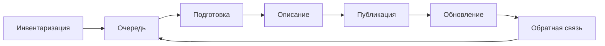

# Процесс публикации

Набор опубликован, когда посторонний человек находит карточку, открывает файл или видит, как его запросить, читает лицензию и может назвать, кто ответит за строки. Файл, выложенный один раз к отчёту, этого не делает: карточка есть, а обновлять её некому.

Порядок один и тот же для портала, статического сайта и репозитория. Меняется инструмент на шаге «публикация». Жизнь самого каталога — запуск, смена платформы, закрытие — разобрана в главе [о жизненном цикле](../09-practices/03-lifecycle.md).

Коротко:

- Сначала записывают, что у организации уже есть. Потом решают, что из этого публиковать и в каком порядке.
- Публикация — три проверки: карточка в поиске, файл или сервис открывается, описание есть в общей выгрузке.
- У набора назван человек, который ответит на ошибку в строках.
- Набор, на который уже могли сослаться, не снимают молча: адрес остаётся и объясняет, что случилось.
- Просьба о недостающем наборе возвращается в очередь.

## Когда набор можно считать опубликованным

| Что видно снаружи | Что должно быть правдой |
|-------------------|-------------------------|
| Карточка находится в поиске | в поиск попал выпущенный набор, а не черновик |
| У файла есть дата | дата относится к строкам и не старше обещанной частоты |
| Где-то написано «свободное использование» | лицензия стоит на наборе ссылкой и попадает в выгрузку |
| В подвале сайта есть `info@` | у набора названы имя и адрес того, кто ответит по существу |
| Набор исчез из каталога | прежний адрес открывается и объясняет, почему выпуска больше нет или чем его заменили |

Адрес, лицензия, открытый файл или честный отказ, дата и общая выгрузка уже стоят в [чек-листе требований](../06-choice/07-requirements-checklist.md). Ниже — порядок, которым к этому списку приходят.

## Семь шагов

Владелец данных отвечает за строки. Публикатор выкладывает файл и карточку. Редактор ведёт очередь и выгрузку. Полное разделение ролей и то, что ломается при пустой роли, — в таблице [ниже](#кто-за-что-отвечает).

| Шаг | Готово, когда | Кто закрывает шаг |
|-----|---------------|-------------------|
| Инвентаризация | есть список того, что организация уже производит, включая то, что публиковать нельзя | владельцы данных вместе с редактором каталога |
| Очередь | у каждого пункта записано, почему он раньше остальных, и список переживает год | редактор каталога |
| Подготовка | файл открывается без платной программы, колонки названы, люди обезличены, лицензия согласована | владелец данных и юрист |
| Описание | заполнен минимум карточки и поля, без которых набор вашей дисциплины нельзя понять | публикатор по образцу владельца |
| Публикация | набор в поиске, файл или сервис открывается, строка есть в общей выгрузке | публикатор; при проверке куратором — второй человек |
| Обновление | частота записана, просрочка видна, адрес при замене файла не меняется | владелец данных |
| Обратная связь | письмо об ошибке доходит до владельца, а просьба о новом наборе попадает в очередь | владелец данных и редактор |

### Инвентаризация

Инвентаризация — список того, что уже существует и у кого лежит: реестры, отчёты, слои, обследования, выгрузки учётной системы. Это список активов, а не план «что хочется выложить» и не сам каталог. Пустой список на этом шаге полезнее портала без данных: публиковать пока нечего.

Колонок хватает нескольких: название, где лежит сейчас, кто отвечает за строки, есть ли в данных люди, как часто строки меняются, требует ли закон или грант публикацию, просил ли кто-то этот набор. Для органа власти заготовка часто уже есть в учётной системе. Для университета — в плане управления данными гранта.

Федеральное ведомство США по меморандуму OMB M-25-05 от 15 января 2025 года ведёт такой список по всем активам данных, кроме систем национальной безопасности. Новый актив вносят не позднее чем через 90 дней после того, как его создали или нашли. Весь перечень сверяют по ходу работы и не реже раза в год. Файл публикуют в JSON по адресу `www.[agency].gov/data.json`, в схеме DCAT-US 3.0. Сам перечень скачивается целиком. Файл данных есть не у каждой записи: решение отдать данные принимают отдельно, а закрытый актив в перечне остаётся, с пометкой, как к нему проситься. Срок привести перечень к схеме 3.0 и включить в него все активы — 30 сентября 2026 года.

14 октября 2026 года файл Администрации общих служб (GSA) по адресу `www.gsa.gov/data.json` открывался и перенаправлял на `open.gsa.gov/data.json`. В нём 344 записи, схема объявлена как DCAT-US 3.0. У всех 344 заполнено контактное лицо: имя и почта. Открытых записей 310, закрытых от публикации — 33, с ограниченным доступом — одна. У закрытой записи «Concur - Reporting Authorization Model» нет файла, а в условиях доступа сказано, что к публичному выпуску набор не предназначен и нужно писать издателю. Так перечень отличается от витрины скачиваний: видно, что актив есть, и видно отказ.

Ссылка на лицензию при этом есть у 320 из 344 записей. У 24 открытых записей поле пустое. Перечень уже отделяет закрытое от открытого, а готовой публикацией он от этого не становится.

Срок сам по себе файл не переписывает. У Избирательной комиссии США `eac.gov/data.json` 14 октября 2026 года по-прежнему объявлен схемой DCAT-US 1.1 и содержит 11 записей. Как национальный каталог забирает такие файлы — в главе [«Когда портал не нужен»](../08-beyond-portals/01-when-portal-not-needed.md#файл-на-своём-сайте-вместо-портала).

### Очередь

Сначала то, что требуют закон, грант или вышестоящий портал, и то, о чём уже просят. Остальное может подождать. Очередь записывают, иначе каждый год начинают с нуля.

В ЕС вперёд очереди стоят [наборы высокой ценности](../02-data/01-what-is-published.md#что-обязаны-публиковать): шесть категорий, которые с 9 июня 2024 года отдают бесплатно, через API и массовой выгрузкой. В США план открытых данных ведомства должен описать, как житель просит поднять конкретный актив в очереди. Меморандум среди поводов называет уже идущий выпуск, прямую пользу для людей, частые запросы по закону о доступе к информации и данные, на которых проверяют расчёты и модели. Справочник, который никто не спрашивал, в этой очереди последний.

### Подготовка

Формат, который открывается без платной программы. Словарь полей. Обезличивание, если в данных есть люди. Лицензия, с которой согласен юрист. Как выбрать формат — в главе [о форматах](../02-data/02-formats-and-units.md), как выбрать лицензию — в главе [о лицензиях](./04-licenses-and-access.md). Форма и скрипт этот шаг не заменяют: они выкладывают то, что человек уже решил.

### Описание

Минимум из главы [о полноте метаданных](../04-features/03-metadata-depth.md): название, кто опубликовал, лицензия, дата, постоянный адрес. Плюс поля, без которых набор вашей дисциплины нельзя понять: период и территория, переменные обследования, система координат слоя. В российском паспорте набора по методическим рекомендациям 4.0 ответственное лицо и его контакты входят в сам бланк. Как устроен паспорт — в главе [о стандартах метаданных](./02-metadata-standards.md#паспорт-вместо-dcat). Международный сборщик этот бланк не читает. Человеку, который ищет, кому написать, поле всё равно нужно.

### Публикация

Набор виден в поиске, файл или сервис открывается, описание отдаётся в общей выгрузке. Черновик в поиск не попадает. Кто имеет право нажать «опубликовать», задают роли. В научном репозитории этот шаг часто делает второй человек: автор сдаёт набор, куратор выпускает. Как устроены черновик, роли и проверка — в главе [о доступе](../04-features/08-access-control-and-workflow.md#варианты-реализации).

Выложить карточку можно тремя способами.

| Способ | Когда его хватает |
|--------|-------------------|
| Форма на портале | наборов десятки, правят их два человека, в учётной системе этих полей нет |
| Скрипт из системы, где данные уже лежат | наборов сотни, карточка собирается из тех же полей, которые человек заполнил бы руками |
| Файл описаний, который забирает чужой каталог | своего портала нет или национальный каталог сам ходит за файлом |

Руководство data.gouv.fr советует программный интерфейс, когда набор обновляют регулярно, и форму, когда выкладывают редко. Скрипт не назначает лицензию и признак «можно публиковать»: эти поля в системе заполняет человек до запуска. У платформы udata, на которой работает data.gouv.fr, есть отдельная ловушка. Набор, созданный через API, станет публичным, если при каждом запросе не передать флаг закрытости. Черновик в скрипте задают явно.

### Обновление

У набора указано, как часто меняются строки. Рекомендации W3C «данные на вебе» прямо связывают это с процессом: публикация в вебе — часть выпуска новой версии, и за выпуск отвечает конкретный человек. Проверка короткая. Частота названа, и последний файл не старше даты, которую эта частота обещает. Каталог, который сам считает срок и пишет владельцу набора, — Humanitarian Data Exchange. Как устроен счёт — в главе [о хороших практиках](../09-practices/01-good-practices.md#файл).

В перечне GSA частота «раз в квартал» стоит у 121 записи. В файле это повторяющийся интервал `R/P3M`. У 112 из них дата в поле `modified` — 2020 год или раньше. Ещё у 89 записей частота не заполнена. Двадцать ссылок на файлы ведут на имя `www.asap.gsa.gov`, которое 14 октября 2026 года не открывалось. Среди них набор «Networx Business Volume FY2013, 3rd Qtr»: квартальная частота и дата изменения 12 июня 2019 года. Сам перечень при этом правят. Его собственная запись изменена 5 октября 2026 года. Обновление карточек отстало от обновления файла перечня.

Набор, на который уже могли сослаться, не удаляют молча. Руководство GSA по DCAT-US 3.0 говорит то же: снятие без объяснения выглядит как сокрытие. Срок хранения пишут заранее, в описании или в поле прав. У записи остаётся контакт, чтобы можно было спросить, почему набор сняли. Если устарел формат, до полного снятия пробуют выложить простой статичный файл. Три исхода, и у каждого адрес набора сохраняется.

- Файл заменяют, дата строк меняется.
- Выходит новая версия, старая остаётся находиться.
- Выпуск закрыт. На прежнем адресе написано, почему и чем пользоваться вместо него.

Молчаливое удаление разобрано среди [антипаттернов](../09-practices/02-anti-patterns.md#витрина-к-дате). Страница, которая остаётся на месте снятого набора с DOI, — в главе [об идентификаторах](../04-features/06-identifiers-and-doi.md#как-устроен-doi).

Пометка «закрыто» без проверки ссылки тоже дырявая. У 14 из 33 закрытых записей GSA в описании всё же указана ссылка на скачивание, хотя текст доступа говорит, что набор не для публичного выпуска.

### Обратная связь

Нужно место, куда написать об ошибке, и место, где попросить недостающий набор. Для портала органа власти это часть задачи. Письмо доходит до владельца данных.

Рекомендации W3C делят это на два шага. Способ написать легко найти на странице набора. Ответы видны следующим читателям, чтобы одну и ту же ошибку не присылали заново. На data.gouv.fr это обсуждение у карточки. Как портал отдаёт обсуждения в общей выгрузке — в главе [о хороших практиках](../09-practices/01-good-practices.md#каталог-который-забирают).

Просьба «опубликуйте вот это» без очереди остаётся в почте. Её записывают следующим пунктом очереди и отвечают, взяли её в работу или нет.

## Кто за что отвечает

| Роль | За что отвечает | Чего не делает | Если роли нет |
|------|-----------------|----------------|---------------|
| Владелец данных | содержимое, срок обновления, ответ на ошибку по существу | не выбирает платформу и не верстает карточку наугад | набор выложили один раз, на письмо некому ответить |
| Публикатор | выкладывает файл и заполняет карточку по образцу | не назначает лицензию в день выкладки | владелец правит портал сам, и карточки расходятся |
| Редактор каталога | карточки устроены одинаково, очередь не застревает, выгрузка жива | не подменяет владельца данных | каждый год инвентаризацию начинают с нуля |
| Юрист и специалист по персональным данным | лицензия и обезличивание до публикации | не появляются впервые после жалобы | лицензию пишет публикатор в день выкладки |
| Администратор платформы | сервер, обновления программы, роли, копии | не решает, какой набор публиковать | каталог открывается, пока не кончилась версия или место на диске |

В маленькой группе один человек может закрывать две соседние роли. Все пять он не закрывает: тот, кто отвечает за строки, не должен быть единственным, кто умеет поднять сервер. Так разделены координаторы открытых данных Нью-Йорка и команда самого портала. Как это записано — в главе [о жизненном цикле](../09-practices/03-lifecycle.md#запуск).

## Что меняет тип каталога

Семь шагов остаются. Тип двигает один или два из них.

| Тип | Какой шаг другой | Что меняется |
|-----|------------------|--------------|
| Портал открытых данных | инвентаризация и очередь | список того, что ведомство уже ведёт; впереди закон и просьбы |
| Научный репозиторий | публикация и обновление | набор выпускает второй человек; правка файла — новая версия |
| Геопортал | подготовка | система координат и описание ISO; в общий каталог кладут ссылку на это описание |
| Каталог показателей | обновление | ряд выходит по календарю, методика лежит рядом с рядом |
| Каталог микроданных | подготовка и публикация | уровень доступа решают до выкладки; описание открыто, даже когда файл закрыт, и написано, как его запросить |
| ML-каталог | подготовка и описание | деление на части и происхождение фиксируют до публикации |
| Публикация без портала | публикация | те же шаги, на последнем — страница и файл |

Руководство GSA для геоданных просит не переписывать подробное описание ISO внутрь DCAT. В записи каталога ставят ссылку на уже готовый файл метаданных и на словарь полей. Порог, с которого нужен свой портал, — в главе [«Когда портал не нужен»](../08-beyond-portals/01-when-portal-not-needed.md).

## Пример: наборы уже лежат в системе

**Контекст.** У регионального ведомства около двухсот наборов. Они уже есть в учётной системе: название, дата, подразделение. Национальный портал забирает описания в DCAT. Форму на своём портале заполняют сотрудники, у которых нет времени на вторую карточку. Каталог отстаёт от системы примерно на квартал.

**Варианты.** И дальше заполнять форму руками. Скрипт, который создаёт и обновляет карточку из учётной системы. Файл описаний на сайте ведомства, который забирает сборщик, как американский `data.json`.

**Критерии.** Каталог не отстаёт от системы на квартал. Лицензию и признак «можно публиковать» скрипт не назначает сам. На ошибку в строках отвечает человек.

**Решение.** Карточки создаёт и обновляет скрипт из полей системы. Лицензию, признак публикации и имя владельца в системе заполняет человек до запуска. Форма остаётся для наборов, которых в системе нет.

**Почему.** Ручная форма на двести наборов отстаёт в первый же квартал. Файл для сборщика закрывает задачу, когда своего портала нет или национальный каталог ходит за файлом на сайт ведомства. Здесь портал с ролями подразделений уже стоит, поэтому скрипт пишет в него напрямую: сборщик эти роли не ведёт. Скрипт без полей лицензии и владельца выложит пустые карточки быстрее, чем люди. Критерий «отвечает человек» такой скрипт проигрывает.

**Последствия.** В учётной системе появляются три поля, которых там могло не быть: лицензия, признак публикации, владелец. Сломанный скрипт молчит, поэтому у него тот же контроль срока, что у набора. Просрочка видна редактору.

**Когда пересмотреть.** Национальный портал сменит профиль, и скрипт начнёт отдавать файл, который тот не примет. Учётную систему заменят. Большая часть новых наборов перестанет проходить через систему, и форма снова станет основным путём.

Как записать свою карточку — в главе [«Как обосновать решение»](../06-choice/04-justifying-decisions.md).

## Один набор: расписание автобусов

Инвентаризация находит расписание в транспортной системе. В очереди оно выше альбома фотографий остановок: его уже просят, и его может ждать региональный портал. Подготовка: CSV с колонками из словаря, без объединённых ячеек, лицензия, с которой согласен юрист. Описание: название, перевозчик как издатель, период действия, лицензия ссылкой, дата строк, имя того, кто ответит за ошибку в маршруте. Публикация: карточка в поиске, файл открывается, строка есть в общей выгрузке. Обновление: при смене маршрута меняют файл и дату, адрес карточки остаётся. Обратная связь: сообщение «ошибка в расписании» уходит перевозчику. Та же рекомендация W3C разбирает остановки на похожем примере: частота записана и словами, и в поле, которое читает программа.

Если наборов таких двадцать и правят их два человека, хватит таблицы и статического сайта. Если наборов двести и правят двенадцать ведомств, нужна платформа с ролями. Порог — в главе [«Когда портал не нужен»](../08-beyond-portals/01-when-portal-not-needed.md).

## Как понять, что процесс живой

Это можно проверить снаружи, не собирая редакцию.

- У взятого наугад набора в карточке есть имя или команда и адрес, а не только ящик всего портала.
- Дата файла не старше обещанной частоты. Пустая частота значит, что для этого набора обновление не задано.
- Черновик поиском не находится.
- Адрес набора, который снимали, открывается и объясняет, что с ним стало.
- Есть куда попросить недостающий набор. У портала органа власти эта просьба видна как очередь или как публичное обсуждение.
- Сам перечень существует как документ — таблица или файл вроде `data.json`, — а не только как память редактора.

Тот же список, короче, — в [чек-листах](../12-appendices/04-checklists.md#перед-тем-как-назвать-набор-опубликованным).

## Источники

- [Data on the Web Best Practices, W3C](https://www.w3.org/TR/dwbp/), 31 января 2017 года — практика 21 (данные актуальны, частота названа, за выпуск отвечает человек), практика 22 (если данных нет, написано, как их получить), практики 29 и 30 (отзыв можно оставить, и он виден следующим читателям); пример с остановками и полем частоты
- OMB, [меморандум M-25-05](https://www.whitehouse.gov/wp-content/uploads/2025/01/M-25-05-Phase-2-Implementation-of-the-Foundations-for-Evidence-Based-Policymaking-Act-of-2018-Open-Government-Data-Access-and-Management-Guidance.pdf), 15 января 2025 года — инвентаризация всех активов, кроме систем национальной безопасности; новый актив не позднее 90 дней; сверка не реже раза в год; файл `data.json` в схеме DCAT-US 3.0; срок 30 сентября 2026 года; в плане открытых данных — способ просить поднять актив в очереди
- GSA, [DCAT-US v3.0 Implementation Guide](https://resources.data.gov/resources/dcat-us-3-implementation/), редакция 1.1 от 9 сентября 2026 года — контакт обязателен; снятие набора сопровождают объяснением; для геоданных в DCAT ставят ссылку на готовое описание ISO, а не переписывают его
- GSA, [How to get your Open Data on Data.gov](https://resources.data.gov/resources/data-gov-open-data-howto/) — национальный каталог забирает файл описаний, файлы ведомства остаются у ведомства
- [guides.data.gouv.fr: опубликовать набор](https://guides.data.gouv.fr/jeux-de-donnees/publier-un-jeu-de-donnees) — при регулярном обновлении карточка уходит через API, при редком хватает формы
- Проверка 14 октября 2026 года: [`www.gsa.gov/data.json`](https://www.gsa.gov/data.json) перенаправляет на [`open.gsa.gov/data.json`](https://open.gsa.gov/data.json), 344 записи, схема DCAT-US 3.0, контакт у всех 344, уровни доступа 310 / 33 / 1, лицензия у 320, квартальная частота у 121 и у 112 из них `modified` не новее 2020 года, частота пустая у 89, 20 ссылок на `www.asap.gsa.gov` (имя не открывается), запись самого перечня изменена 5 октября 2026 года; [`eac.gov/data.json`](https://www.eac.gov/data.json) — 11 записей, схема DCAT-US 1.1
- [Чек-лист требований](../06-choice/07-requirements-checklist.md), [хорошие практики](../09-practices/01-good-practices.md), [полнота метаданных](../04-features/03-metadata-depth.md), [лицензии](./04-licenses-and-access.md), [доступ и роли](../04-features/08-access-control-and-workflow.md)
