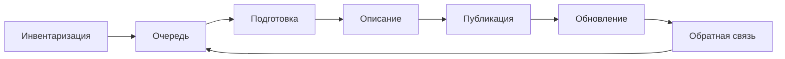

# Процесс публикации

Платформа не публикует данные сама. Публикует человек по понятному порядку. Если порядка нет, портал заполняют один раз к отчёту и бросают.

## Шаги

**Инвентаризация.** Список того, что организация уже производит: реестры, отчёты, слои, обследования. Не «что хочется выложить», а что существует.

**Очередь.** Сначала то, что требуют закон, грант или вышестоящий портал, и то, о чём уже просят. Остальное может подождать. Очередь записывают, иначе каждый год начинают с нуля.

**Подготовка.** Формат, который открывается без платной программы. Словарь полей. Обезличивание, если в данных есть люди. Лицензия, с которой согласен юрист, а не фраза «свободное использование» в подвале сайта.

**Описание.** Минимум из главы [о полноте метаданных](../04-features/03-metadata-depth.md): название, кто опубликовал, лицензия, дата, постоянный адрес. Плюс поля, без которых набор вашей дисциплины нельзя понять.

**Публикация.** Набор виден в поиске, файл или сервис открывается, описание отдаётся в общей выгрузке. Черновик в этот момент в поиск не попадает.

**Обновление.** У набора указано, как часто он меняется. Просрочка видна. Устаревший набор не удаляют молча: на адрес могли сослаться. Его помечают и либо заменяют файл, либо объясняют, что выпуск закрыт.

**Обратная связь.** Куда написать об ошибке и как попросить недостающий набор. Для портала органа власти это часть задачи, не украшение.

## Кто за что отвечает

Владелец данных отвечает за содержимое и срок обновления. Публикатор выкладывает и описывает. Редактор каталога следит, чтобы карточки были одинаково устроены. Юрист и специалист по персональным данным нужны до публикации, не после жалобы.

Ручная форма на портале уместна для десятков наборов. Сотни наборов, которые и так лежат в учётной системе, публикуют скриптом. Иначе каталог всегда отстаёт от системы на квартал.

## Что проверить перед тем, как назвать набор опубликованным

Адрес, лицензия, открытый файл или честный отказ, дата и общая выгрузка — в [чек-листе требований](../06-choice/07-requirements-checklist.md). К этому списку процесс добавляет два правила. Черновик в поиск не попадает. Набор, на который уже могли сослаться, не снимают молча: его помечают и либо заменяют файл, либо пишут, что выпуск закрыт.

## Источники

- [Чек-лист требований](../06-choice/07-requirements-checklist.md)
- [Хорошие практики](../09-practices/01-good-practices.md)
