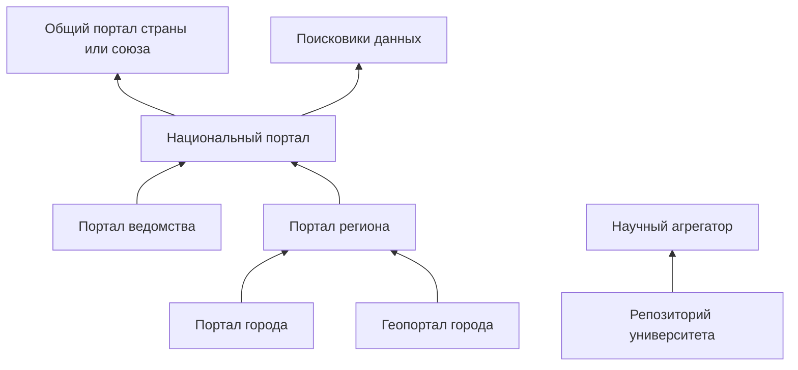

# Федерации и агрегация

Федерация — цепочка каталогов. Город публикует наборы, регион их забирает, страна забирает у региона, общий портал вроде data.europa.eu забирает у страны. Поисковики данных стоят сбоку и читают тех, кто отдаёт описания машинно.

Забор описаний по расписанию называют сбором, или харвестингом. Берут не файлы данных, а карточки: название, лицензия, адрес, дата. Файл человек или программа скачивает уже у источника.

## Что делает источник

- Отдаёт все описания по одному адресу: файл DCAT, API, CSW или OAI-PMH. Можно и постранично, если порядок записей устойчив и до конца списка можно дойти. Поисковая выдача по 10 штук, где порядок меняется от запроса к запросу, для сбора не годится.
- Не закрывает этот адрес капчей и регистрацией.
- Держит адрес набора постоянным. Если набор снят, карточка говорит об этом, а не исчезает без следа.
- Пишет лицензию на наборе. Агрегатор не имеет права её выдумать.

Профиль должен совпадать с тем, который ждёт верхний портал. «Почти DCAT» верхний портал пропускает молча, и город решает, что его данные «не взяли».

## Что делает тот, кто собирает

- Ходит по расписанию и не забирает каталог целиком каждые десять минут.
- Хранит адрес источника и дату сбора.
- Не плодит дубли: один набор с городского портала и его копия на региональном — одна запись со ссылкой на первоисточник.
- Убирает или помечает карточки, у которых источник больше не открывается.

У CKAN каркас сбора — расширение ckanext-harvest, сбор RDF — часть ckanext-dcat. У Piveau сбор DCAT — основная работа ядра: платформу Fraunhofer FOKUS построили вокруг сбора и проверки качества описаний, и на ней работает сам data.europa.eu. Подробности расширений — в главе [о CKAN](../05-platforms/03-ckan-and-extensions.md).

## Как это выглядит в жизни

**Европа.** Земельный портал Open.NRW собирает описания ведомств и городов Северного Рейна — Вестфалии. Национальный портал Германии GovData забирает Open.NRW вместе с другими землями: в октябре 2026 года у GovData около 10,6 тысячи наборов из Open.NRW. Описания идут в немецком профиле DCAT-AP.de. Общеевропейский data.europa.eu забирает GovData и другие национальные порталы, по умолчанию раз в сутки, и сам переводит названия и описания на все официальные языки ЕС.

**США.** Каждое федеральное ведомство публикует файл `data.json` по профилю DCAT-US, а сборщик data.gov забирает эти файлы. Состояние каждого источника видно на отдельном сайте harvest.data.gov. После переезда data.gov на собственную разработку в 2026 году сборщик остался отдельной программой, которая пишет в общую базу, а витрина её только читает.

**Геоданные ЕС.** Страны отдают описания слоёв через каталожные сервисы CSW по правилам INSPIRE. До 1 июля 2026 года их собирал отдельный геопортал INSPIRE, теперь он закрыт, и национальные геокаталоги собирает data.europa.eu, переводя карточки ISO в DCAT по профилю GeoDCAT-AP. Сами слои остаются в национальных сервисах. Подробнее — в главе [о геопорталах](../03-types/03-geoportals.md#inspire).

**Наука.** Репозитории университетов отдают описания по OAI-PMH в формате из руководств OpenAIRE, и OpenAIRE собирает их в общий граф научных результатов.

**Таиланд: одна платформа на все уровни.** Центральный каталог государственных данных gdcatalog.go.th работает на CKAN, в октябре 2026 года в нём около 25 тысяч наборов. Каталоги провинций — не отдельные сайты на разном ПО, а поддомены центрального на той же платформе, например ranong.gdcatalog.go.th. В центральном каталоге провинции видны как организации, геоданные показывает геопортал geo.gdcatalog.go.th на TerriaJS. Профили не расходятся, потому что источник и сборщик — одна система. Цена — регионы не выбирают себе платформу.

**Шотландия: сначала поиск, потом портал.** Национального портала у Шотландии долго не было. Вместо него правительство сделало поисковик find.data.gov.scot: он забирает описания с сайтов ведомств, советов и других держателей данных через их API, а где API нет — разбирает страницы. В октябре 2026 года в нём около 26,5 тысячи наборов из 70 источников от 922 владельцев, у каждого набора своя страница. Только в 2026 году заработал портал data.gov.scot, пока в бета-версии и с 290 наборами: на нём публикуют те, у кого нет своего места, а описания он отдаёт в DCAT и schema.org. Такой порядок полезен, когда данные уже разбросаны по сотне сайтов: поисковик быстро показывает, что есть, а портал нужен для остального.

## Протоколы сбора

| Протокол | Кто обычно отдаёт | Что получает сборщик |
|----------|-------------------|----------------------|
| Файл DCAT (RDF, `data.json`) | порталы открытых данных | все описания одним файлом |
| OAI-PMH | научные репозитории; data.europa.eu предпочитает его и для DCAT-AP | описания постранично, с возможностью забрать только изменённые с прошлого раза; список файлов — только если его содержит сам формат описаний |
| API CKAN | порталы на CKAN | описания в формате CKAN; data.europa.eu принимает его только от старых систем |
| CSW | геопорталы | описания слоёв в ISO 19115 / 19139 |
| SPARQL | порталы на графовых базах | ответ на запрос к описаниям |
| Разметка schema.org и карта сайта | любой сайт | описания со страниц; так читают поисковики данных |

Возможность забирать только изменения важна для больших каталогов: сборщик не перекачивает сто тысяч описаний каждую ночь.

## Как попасть в сбор

Верхний портал обычно просит заполнить короткую анкету. У data.europa.eu она публичная: адрес точки выгрузки, профиль описаний (DCAT-AP, формат CKAN или INSPIRE), протокол, формат дат по ISO 8601, нужен ли вход. Затем заявку отправляют через форму обратной связи. После подключения портал видит оценку качества своих описаний в MQA. Полезно пройти такую анкету до выбора платформы: она сразу показывает, чего не хватает.

## Где цепочка рвётся

Муниципалитет заводит свой портал, который регион не умеет читать. Регион копирует карточки руками. Национальный портал видит регион и не видит города. Поисковик видит три копии одного бюджета.

Чем длиннее цепочка, тем больше теряется по дороге. data.europa.eu — агрегатор агрегаторов: он собирает национальные порталы, которые сами собрали города и ведомства. На нём хорошо видно, где именно рвётся.

**Теряются лицензия и источник.** В августе 2024 года набор об экологически опасных предприятиях города Мальмё лежал на городском портале под лицензией CC0. Через национальный портал Швеции dataportal.se он доходил до data.europa.eu уже без лицензии и без ссылки на городскую страницу. К октябрю 2026 года город переехал на новый портал, лицензия CC0 теперь доходит, а ссылки на файлы ведут к Мальмё. Но страницы набора на городском портале в карточке по-прежнему нет: каталогом записан национальный портал Швеции. А старая карточка на data.europa.eu, на которую кто-то мог сослаться, при переезде города исчезла: её адрес отдаёт ошибку 404, потому что агрегатор строит адрес из адреса источника.

Это не единичный случай. По подсчёту И. Бегтина, в 2024 году лицензия была указана примерно у 150–180 тысяч из 1,8 миллиона наборов data.europa.eu, то есть не больше чем у 10%. В октябре 2026 года лицензия в виде ссылки на известный текст есть примерно у 775 тысяч наборов — меньше половины из 1,73 миллиона, которые в том же месяце показывал портал. Стало лучше, но больше половины наборов всё ещё доходят без машиночитаемой лицензии, а заметная часть «лицензий» — значения вроде «условия неизвестны».

Вывод для каждого звена: передавать лицензию и ссылку на страницу набора у источника (в DCAT это свойство `dcat:landingPage`) и не менять идентификатор набора при переезде.

**Один источник перевешивает страну.** В октябре 2026 года на data.europa.eu около 1,73 миллиона наборов, из них 850 тысяч — немецкие. 681 тысяча приходит из одного каталога — геокаталога GDI-DE, и почти 450 тысяч из них — планы застройки отдельных участков (Bebauungsplan), каждый как отдельный набор, обычно в виде сервисов WMS и WFS. Национальный портал GovData даёт ещё 169 тысяч. В 2024 году картина была та же: 609 из 726 тысяч немецких наборов шли из GDI-DE. Поэтому «в Германии половина данных Европы» говорит не об открытости, а о том, как геокаталог режет данные. Сравнивая страны в агрегаторе, смотрите на число источников и типы данных, а не на общий счёт.

**Видна только часть страны.** В июне 2024 года на data.europa.eu было 324 набора из Эстонии: портал собирал только национальный геопортал. К октябрю 2026 года подключили и национальный портал открытых данных, и наборов стало 8,7 тысячи, 8,3 тысячи из них — с этого портала. Сколько данных страны дошло наверх, зависит от того, какие каталоги она зарегистрировала. Проверить это можно фильтром «каталог» в поиске верхнего портала: если своего каталога там нет, его наборов нет тоже.

**Протокол не передаёт файлы.** OAI-PMH передаёт только описания: что представляет собой сам ресурс, спецификация прямо выводит за свои рамки. Обязательный формат описаний — простой Dublin Core, где нет поля для списка файлов. Поэтому научные агрегаторы, которые собирают репозитории по OAI-PMH, обычно хранят ссылку на страницу набора, а не на файлы. Репозиторию, который хочет, чтобы его данные можно было скачать прямо из поиска, стоит рядом с OAI-PMH отдавать DCAT или API со списком файлов.

**Свой формат сбора.** Российский data.gov.ru собирал перечни наборов, которые ведомства вели по собственной схеме из методических рекомендаций. Ни один зарубежный агрегатор этот формат не читает, поэтому цепочка обрывалась на первом же шаге за пределами страны. Подробнее — в [антипаттернах](../09-practices/02-anti-patterns.md).

Честнее не заводить нижний портал, если верхний уже принимает публикации организаций. Это обычный вывод для небольшого города, см. [пример муниципалитета](../06-choice/08-worked-examples.md).

## Источники

- [Экспорт метаданных](../04-features/02-metadata-export.md)
- [API и массовая выгрузка](../04-features/04-access-interfaces.md)
- [ckanext-harvest](https://github.com/ckan/ckanext-harvest), [ckanext-dcat](https://docs.ckan.org/projects/ckanext-dcat/en/latest/)
- [Piveau](https://doc.piveau.io/) и [проект data.europa.eu у Fraunhofer FOKUS](https://www.fokus.fraunhofer.de/en/dps/projects/data-europa-eu.html)
- [Как попасть в сбор data.europa.eu](https://dataeuropa.gitlab.io/data-provider-manual/how-to-publish/request-harvesting/) — анкета, протоколы, ежедневный сбор, машинный перевод
- [GovData](https://www.govdata.de/) и [профиль DCAT-AP.de](https://www.dcat-ap.de/); число наборов Open.NRW — запрос к API GovData, 11 октября 2026 года
- [DCAT-US](https://resources.data.gov/resources/dcat-us/), [harvest.data.gov](https://harvest.data.gov/), [приложение каталога data.gov](https://github.com/GSA/datagov-catalog)
- data.europa.eu, [INSPIRE datasets move to the European Data Portal](https://data.europa.eu/en/news-events/news/inspire-datasets-move-european-data-portal), 22.06.2026 — закрытие геопортала INSPIRE 1 июля 2026 года; [руководства OpenAIRE](https://guidelines.openaire.eu/)
- data.europa.eu: число наборов по странам, каталогам, ключевым словам и лицензиям — [API поиска](https://data.europa.eu/api/hub/search/search?filter=dataset&limit=0); наборы с лицензией-ссылкой — запрос к [точке SPARQL](https://data.europa.eu/sparql); карточка набора Мальмё и старый адрес карточки (404) — API поиска; всё 12 октября 2026 года
- [Каталог государственных данных Таиланда](https://gdcatalog.go.th/) (CKAN 2.9.2, API `package_search`), [каталог провинции Ранонг](https://ranong.gdcatalog.go.th/), [геопортал](https://geo.gdcatalog.go.th/), 12 октября 2026 года
- [find.data.gov.scot](https://find.data.gov.scot/) — счётчики на главной; [data.gov.scot, бета-версия](https://data.gov.scot/about/using-the-beta-service), 12 октября 2026 года
- [Спецификация OAI-PMH 2.0](https://www.openarchives.org/OAI/openarchivesprotocol.html) — природа ресурса вне рамок протокола, обязательный формат Dublin Core
- И. Бегтин, Telegram: [data.europa.eu как агрегатор агрегаторов: Мальмё и лицензии](https://t.me/begtin/5857), 04.08.2024; [GovData и геокаталог GDI-DE](https://t.me/begtin/5938), 20.08.2024; [Эстония в европейском портале](https://t.me/begtin/5681), 12.06.2024; [Таиланд](https://t.me/begtin/5917), 15.08.2024; [find.data.gov.scot](https://t.me/begtin/6146), 03.11.2024; [почему не собирать OAI-PMH](https://t.me/begtin/5551), 02.04.2024
