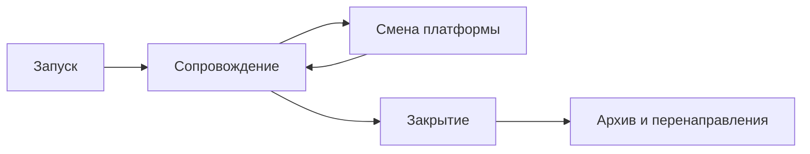

# Жизненный цикл каталога

Каталог запускают за недели и сопровождают годами. Большинство сбоев — не в день открытия, а когда кончился проект, сменилась платформа или ушёл единственный администратор.

## Запуск

Пилот на десяти настоящих наборах полезнее презентации на демонстрационных. До публичного адреса договариваются, кто обновляет данные и кто обновляет саму платформу. Это разные роли. Срок запуска разных способов — в главе [о развёртывании](../04-features/09-deployment-and-operations.md).

## Сопровождение

Раз в квартал имеет смысл смотреть не на число наборов, а на три вещи: открываются ли ссылки, заполнена ли лицензия, совпадает ли дата обновления с обещанной периодичностью. Платформу и расширения обновляют, пока это ещё соседняя версия. Через три пропущенных выпуска обновление превращается в перевнедрение.

## Смена платформы

Смена — главная причина мёртвых ссылок. До переноса делают выгрузку всех описаний и файлов и таблицу старых и новых адресов. После переноса старые адреса перенаправляют. Если перенаправить всё сразу нельзя, старую систему оставляют по отдельному адресу на переходный срок: так в апреле 2026 года сделал data.gov, переехав с CKAN на собственную разработку и оставив старый каталог на catalog-old.data.gov до осени. Как оценить цену ухода заранее, написано в главе [о способах создания](../06-choice/05-build-or-buy.md).

Переезжают в обе стороны, и ни одно направление само по себе не ошибка:

- **На CKAN.** Австралийский data.gov.au с 2019 года жил на смешанной схеме: поиск и витрину давала Magda, под ней стоял устаревший CKAN. В июне 2025 года портал свели к одному CKAN с Drupal для страниц, сохранили больше 100 тысяч наборов и сбор с тысячи источников, а программный интерфейс CKAN остался прежним. Греческий data.gov.gr в 2025–2026 годах перешёл на CKAN со своей разработки и за счёт сбора чужих каталогов вырос с сотни наборов до двадцати с лишним тысяч.
- **С CKAN.** Кроме data.gov, на собственный движок ушёл монгольский opendata.gov.mn, и вместе со старой платформой пропал программный интерфейс.
- **Без смены платформы.** Британский data.gov.uk в 2026 году стал National Data Library: новая витрина с отобранными коллекциями, а прежний каталог оставлен отдельным разделом, чтобы было с чем сравнивать.

Типичные провалы тоже повторяются. Словацкий портал при переезде на data.slovensko.sk в 2024 году сменил адреса наборов, и ссылки на них из европейского портала перестали работать. Малайзия, переводя data.gov.my на новый движок, оставила старый каталог по адресу archive.data.gov.my; в октябре 2026 года этот адрес уже не отвечает, так что временный архив оказался временным. Геопортал Архангельской области потерял слои, когда кончилась лицензия ArcGIS: каталог продолжал показывать карточки слоёв, которых больше не было. Российский data.gov.ru в 2023 году закрыли «для переноса на новую платформу» раньше, чем она появилась, и два года портала не было вовсе.

Отсюда три правила. Старую версию держат, пока новая не приняла все адреса. Программный интерфейс — такая же часть адреса, как страница набора: если он меняется, сборщики теряют каталог. Лицензия на коммерческую платформу — дата, к которой план переезда должен быть готов.

## Закрытие

Закрыть каталог нормально, если им никто не пользуется или платформу больше не на чем держать. Плохо закрывать его выключением сервера.

Перед выключением:

- [ ] Данные переданы в другой каталог или архив, либо явно сказано, что они сняты с публикации.
- [ ] Старые адреса либо перенаправляют, либо хотя бы год отвечают, куда переехал набор.
- [ ] Снимок описаний сохранён.
- [ ] Верхний портал и реестры, где каталог был зарегистрирован, уведомлены.

### Как снять снимок

«Снимок описаний сохранён» — это не скриншот главной страницы. Архивация каталога проходит четыре шага.

1. **Найти всё, что относится к каталогу.** Основной сайт, поддомены, старые версии вроде `old.` и `archive.`, отдельные сервисы карт и API. Старые версии сайта исчезают первыми: их держат «на всякий случай», а потом выключают незаметно.
2. **Расставить приоритеты.** Сначала то, что пропадёт раньше и чего нет больше нигде: файлы, которые лежат только здесь, сервисы на выключаемой платформе.
3. **Собрать.** Страницы сайта — веб-архивом в формате WARC, который читают Internet Archive и национальные библиотеки. Описания — выгрузкой через API или файлом DCAT. Файлы — скачать как есть, вместе со ссылками, откуда они взяты. Если данные отдаются только через API, нужна отдельная выгрузка: веб-архиватор API не обходит.
4. **Опубликовать или сдать на хранение.** Файлы WARC и выгрузки кладут в открытое хранилище, а их описание — в каталог, чтобы архив можно было найти. Минимум — сдать копию в холодное хранилище и записать, где она.

Посмотреть WARC без сервера можно в ReplayWeb.page. Для сайтов с динамической подгрузкой нужен краулер через браузер, например Browsertrix Crawler.

### Если закрывают не вы

Каталог могут закрыть те, кто им владеет, не спросив пользователей. Тогда данные переживают его только в чужих архивах. Российский data.gov.ru закрыли в 2023 году «для переноса на новую платформу». Полный снимок прежней версии — 24 тысячи наборов, 14 ГБ в сжатом виде — сохранился в Национальном цифровом архиве, который сделал его в феврале 2022 года. Новая версия 2025 года этих данных не вернула. Как исчезают каталоги, почему веб-архив сохраняет их плохо и как снять копию чужого каталога — в главе [«Архивация и спасение каталогов»](./04-archiving.md).

По выгрузке реестра от 9 октября 2026 года (выпуск 1.26.0 от 6 октября) не действуют 868 каталогов, выведены из эксплуатации 98. Доля неработающих сильно различается: около 0,9% у каталогов показателей и около 18% у каталогов микроданных. Вторая цифра — в основном наследие Nesstar: в 2015 году с версией 4.0 его объявили устаревшим, к 2022 году окончательно сняли. Урок не в том, что микроданные «не живут», а в том, что закрытие чужого продукта нужно встречать планом миграции, а не ожиданием. Так поступил канадский архив социальных обследований ODESI: выбрал Borealis на Dataverse, где есть описания DDI и DOI, и назначил выключение Nesstar только на время после завершения переноса.

## Источники

- Выгрузка реестра dataportals-registry, 9 октября 2026 года (выпуск 1.26.0 от 6 октября).
- [Объявление о новом каталоге data.gov](https://data.gov/blog/catalog-update/), 15 апреля 2026 года
- Link Digital, [перевод data.gov.au на CKAN](https://linkdigital.com.au/case-studies/upgrading-a-national-oecd-government-open-data-portal-to-a-full-ckan-environment/), 2025; GDS, [What's changing on data.gov.uk and why](https://dataingovernment.blog.gov.uk/2026/03/25/whats-changing-on-data-gov-uk-and-why/), 25 марта 2026 года
- И. Бегтин, Telegram: [data.gov.gr на CKAN](https://t.me/begtin/7588), 18.05.2026; [opendata.gov.mn](https://t.me/begtin/7737), 25.08.2026; [data.slovensko.sk](https://t.me/begtin/5703), 20.06.2024; [data.gov.my](https://t.me/begtin/5362), 19.01.2024; [геопортал Архангельской области](https://t.me/begtin/5952), 21.08.2024
- Nesstar: [история продукта](https://en.wikipedia.org/wiki/Nesstar), [перенос ODESI на Borealis](https://www.ocul.on.ca/odesi-migration)
- [Формат WARC](https://www.loc.gov/preservation/digital/formats/fdd/fdd000236.shtml) в описании Библиотеки Конгресса, [ReplayWeb.page](https://replayweb.page/), [Browsertrix Crawler](https://github.com/webrecorder/browsertrix-crawler), [APIBackuper](https://github.com/ruarxive/apibackuper) — выгрузка данных из API для архива
- И. Бегтин, [Как правильно архивировать цифровые ресурсы при архивационных кампаниях](https://begtin.substack.com/p/18), ноябрь 2021 — четыре стадии архивации; [Веб-архивация и её ограничения](https://begtin.substack.com/p/783), февраль 2025
- И. Бегтин, [Обновлённый портал data.gov.ru](https://begtin.substack.com/p/datagovru), июль 2025 — закрытие в 2023 году и архивная копия 2022 года
- [Скорость развёртывания и сопровождение](../04-features/09-deployment-and-operations.md)
- [Постоянные идентификаторы](../04-features/06-identifiers-and-doi.md)
