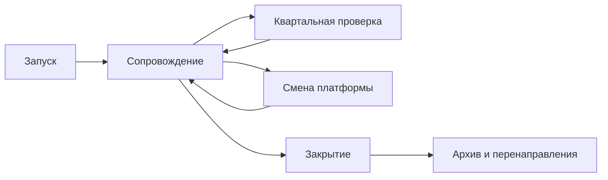

# Жизненный цикл каталога

Каталог запускают за недели и сопровождают годами. Большинство сбоев — не в день открытия, а когда кончился проект, сменилась платформа или ушёл единственный администратор.

## Запуск

Запуск — день, когда посторонний человек открывает настоящий набор, скачивает файл и видит, кто обновит его в следующем году. Публичный адрес — последний шаг этого дня. Срок установки разных способов — в главе [о развёртывании](../04-features/09-deployment-and-operations.md).

**Пилот — около десяти настоящих наборов, и среди них есть неудобный.** Неудобный набор — тот, у которого в источнике нет лицензии, файл большой или обновление обещано каждый день. На пилоте видно, кто допишет лицензию, кто заметит сломанную ссылку и читает ли верхний портал вашу выгрузку. Демонстрационные наборы поставщика на эти вопросы не отвечают. Что проверить на стенде — в главе [о выборе платформы](../06-choice/03-from-features-to-platform.md#шаг-4-проверка-на-живых-данных).

**За данные и за платформу отвечают разные люди.** Их называют до публичного адреса, по именам.

Так это устроено у Нью-Йорка. Портал nyc.gov/opendata ведёт команда открытых данных в Управлении технологий и инноваций: стратегия, стандарты, сам сайт. Каждое городское ведомство назначает своего координатора открытых данных. Через него ведомство отдаёт наборы на портал, обновляет их с той частотой, которая записана в карточке, отвечает на вопросы жителей и готовит свою часть годового отчёта. Если координатор уходит, ведомство обязано назначить другого и сообщить об этом команде портала. Это записано в руководстве по техническим стандартам, редакция 12 мая 2023 года. Схема живая: рабочая тетрадь годового отчёта за 2025 год на сайте портала обновлена 23 июня 2025 года.

Перед публичным адресом:

- [ ] Пилот прошёл на настоящих наборах, включая неудобный.
- [ ] Названы два человека: кто обновляет строки и кто обновляет платформу.
- [ ] Схема адресов записана так, чтобы пережить следующую платформу. Как её удержать — в главе [об идентификаторах](../04-features/06-identifiers-and-doi.md).
- [ ] Полную выгрузку описаний и файлов один раз скачали и открыли.
- [ ] На следующий год названы ставка и бюджет. Подрядчик, который уходит в день акта, эти места не занимает. Что записать в договор — в главе [о способах создания](../06-choice/05-build-or-buy.md).

**Открытие сайта бывает без запуска.** 15 июля 2025 года Минэкономразвития снова открыло data.gov.ru. Прежнюю версию закрыли в марте 2023 года «для переноса на новую платформу». Сайт заработал. Через API на нём было 5826 наборов, около 100 МБ в сжатом виде, и 84% из них впервые опубликованы в 2019 году или раньше. Снимок прежней версии от 2 февраля 2022 года — больше 24 тысяч наборов и 14 ГБ — на новый портал не вернулся. Он лежит в Национальном цифровом архиве, см. [ниже](#если-закрывают-не-вы). Разбор по числу строк и по тому, каких ведомств на портале нет, — в главе [о самоаудите](../10-quality/04-self-audit.md#проверка-по-существу). Запуском такое открытие становится, когда на новом адресе появляются свежие наборы с названным владельцем.

## Сопровождение

Дальше каталог живёт проверками. Число наборов в отчёте их не заменяет.

Календарь ссылок и полного прохода уже задан в главе [о самоаудите](../10-quality/04-self-audit.md): раз в месяц открывают десяток известных ссылок, раз в полгода проходят выборку целиком. К этому имеет смысл добавить две более редкие проверки. Их делают те же двое, что названы при запуске: строки и карточки смотрит тот, кто отвечает за данные, версию, копии и счёт — тот, кто отвечает за платформу.

| Как часто | Что сделать |
|-----------|-------------|
| Раз в квартал | Лицензия на наборе заполнена. Дата в файле совпадает с обещанной частотой. Версия платформы ещё поддерживается. Оба человека из запуска на месте. |
| Раз в год | Копию пробуют развернуть. Полную выгрузку снова скачивают. Дата окончания лицензии или контракта на коммерческую платформу стоит в календаре. |

**Ссылки.** Если месячную проверку пропускают годами, получается британский data.gov.uk. С 2017 года портал недофинансировали. К марту 2026 года не меньше четверти ссылок вели на страницу с ошибкой, а многие наборы годами не обновляли организации, которых уже нет. Платформу при этом оставили: прежний каталог работает, а рядом собрали витрину отобранных коллекций. Как устроена эта витрина — в разделе о смене платформы.

**Частота.** Дата в карточке — дата строк. На Humanitarian Data Exchange письмо о просрочке уходит ответственному за набор, а не в общий ящик портала. Как считают срок — в главе [о хороших практиках](./01-good-practices.md). Своему каталогу достаточно того же адресата.

**Версия.** Платформу и расширения обновляют, пока версия ещё в окне поддержки. У CKAN полностью поддерживается последняя минорная версия, предыдущая получает исправления ошибок и безопасности. 14 октября 2026 года это 2.12 и 2.11. Выпуск старше предыдущего уже вне окна, и обновление обычно превращается в перевнедрение: по дороге меняются расширения, схема и способ хранения файлов. Окна других платформ — в главе [о развёртывании](../04-features/09-deployment-and-operations.md).

**Люди.** Сайт может открываться, когда отвечать уже некому. В Нью-Йорке замена координатора — обязанность ведомства. Другой конец той же истории виден по реестру. По выгрузке реестра dataportals-registry (выпуск 1.27.0 от 15 октября 2026 года) не действуют 868 каталогов, выведены из эксплуатации 98. Доля неработающих сильно различается: около 0,9% у каталогов показателей и около 18% у каталогов микроданных. За второй цифрой стоят в основном брошенные установки: 47 из 59 неработающих каталогов микроданных — старые каталоги NADA статистических служб, часто на IP-адресах и без HTTPS. Их ставили в рамках программ поддержки, а сопровождение в бюджет не заложили. Подробности — в главе [о каталогах микроданных](../03-types/06-microdata-catalogs.md#где-ломается). Каталог без владельца и бюджета на сопровождение умирает вместе с проектом. Признаки, которые снаружи видны за годы до выключения, собраны в антипаттерне [«Портал бросили»](./02-anti-patterns.md#портал-бросили).

Годовая проверка копии — та же мысль, что в главе о развёртывании: копия, которую никто не пробовал развернуть, копией не считается. Дата лицензии ArcGIS, на которой остановился геопортал Архангельской области, показывает, зачем эта дата стоит в календаре заранее. Сам случай — среди провалов переезда.

## Смена платформы

Смена — главная причина мёртвых ссылок. До переноса делают выгрузку всех описаний и файлов и таблицу старых и новых адресов. После переноса старые адреса перенаправляют. Если перенаправить всё сразу нельзя, старую систему оставляют по отдельному адресу на переходный срок. Так в апреле 2026 года сделал data.gov: каталог переехал с CKAN на собственную разработку, страницы наборов остались по прежним адресам, а старый сайт оставили на catalog-old.data.gov. В описании проекта, обновлённом 23 июля 2026 года, этот адрес ещё числился работающим всю осень. 14 октября 2026 года сайт уже не открывается: имя catalog-old.data.gov ещё есть, но указывает на адрес, которого нет. Прежний программный интерфейс CKAN по старому пути отвечает ошибкой. Новый интерфейс живёт по другому адресу и просит ключ, так что программы, которые ходили в CKAN, пришлось переписывать. Как оценить цену ухода заранее, написано в главе [о способах создания](../06-choice/05-build-or-buy.md).

Переезжают в обе стороны, и ни одно направление само по себе не ошибка:

- **На CKAN.** Австралийский data.gov.au с 2019 года жил на смешанной схеме: поиск и витрину давала Magda, под ней стоял устаревший CKAN. В июне 2025 года портал свели к одному CKAN с Drupal для страниц, сохранили больше 100 тысяч наборов и сбор с тысячи источников, а программный интерфейс CKAN остался прежним. Греческий data.gov.gr в 2025–2026 годах перешёл на CKAN со своей разработки и за счёт сбора чужих каталогов вырос с сотни наборов до десятков тысяч. 14 октября 2026 года это CKAN 2.11.3 и 22 762 набора.
- **С CKAN.** Кроме data.gov, на собственный движок ушёл монгольский opendata.gov.mn, и вместе со старой платформой пропал программный интерфейс. 14 октября 2026 года путь прежнего API CKAN открывает страницу сайта, а не ответ интерфейса.
- **Без смены платформы.** Британский data.gov.uk в 2026 году стал National Data Library: новая витрина с отобранными коллекциями, а прежний каталог оставлен отдельным разделом, чтобы было с чем сравнивать.

Типичные провалы тоже повторяются. Словацкий портал при переезде на data.slovensko.sk в 2024 году сменил адреса наборов, и ссылки на них из европейского портала перестали работать. Малайзия, переводя data.gov.my на новый движок, оставила старый каталог по адресу archive.data.gov.my. 14 октября 2026 года соединение с этим адресом не устанавливается, так что временный архив оказался временным. Геопортал Архангельской области потерял слои, когда кончилась лицензия ArcGIS: каталог продолжал показывать карточки слоёв, которых больше не было. Российский data.gov.ru в 2023 году закрыли «для переноса на новую платформу» раньше, чем она появилась, и два года портала не было вовсе.

Отсюда три правила. Старую версию держат, пока новая не приняла все адреса. Программный интерфейс — такая же часть адреса, как страница набора: если он меняется, сборщики теряют каталог. Лицензия на коммерческую платформу — дата, к которой план переезда должен быть готов.

## Закрытие

Закрыть каталог нормально, если им никто не пользуется или платформу больше не на чем держать. Плохо закрывать его выключением сервера в тот день, когда об этом узнали пользователи.

До выключения каталог несколько месяцев работает только на чтение. Сайт, файлы и программный интерфейс открываются, новые правки остановлены, на первой странице написано, почему так и до какой даты. Пауза без даты — это уже заброшенный сайт. data.gov.ru эту стадию пропустил: портал выключили «на время переноса», и два года по старому адресу не было ни чтения, ни объяснения, куда делись наборы.

Перед выключением:

- [ ] О закрытии объявлено заранее, за месяцы. До объявленной даты каталог работает только на чтение.
- [ ] Данные переданы в другой каталог или архив, либо на старом адресе прямо сказано, что они сняты с публикации.
- [ ] Старые адреса перенаправляют. Если перенаправить всё нельзя, хотя бы год они отвечают, куда переехал набор.
- [ ] Снимок описаний сохранён: выгрузка через программный интерфейс или файл DCAT, а не только страницы сайта.
- [ ] Файлы, которые лежат только здесь, сохранены вместе с адресами, откуда они взяты.
- [ ] Сайт есть в Интернет-архиве или национальном веб-архиве, и архив до него доходит, в том числе из-за рубежа.
- [ ] Верхний портал и реестры, где каталог был зарегистрирован, уведомлены.

Тот же список — в [чек-листах](../12-appendices/04-checklists.md#перед-выключением-каталога).

### Как снять снимок

«Снимок описаний сохранён» — это не скриншот главной страницы. Архивация каталога проходит четыре шага.

1. **Найти всё, что относится к каталогу.** Основной сайт, поддомены, старые версии вроде `old.` и `archive.`, отдельные сервисы карт и API. Старые версии сайта исчезают первыми: их держат «на всякий случай», а потом выключают незаметно.
2. **Расставить приоритеты.** Сначала то, что пропадёт раньше и чего нет больше нигде: файлы, которые лежат только здесь, сервисы на выключаемой платформе.
3. **Собрать.** Страницы сайта — веб-архивом в формате WARC, который читают Internet Archive и национальные библиотеки. Описания — выгрузкой через API или файлом DCAT. Файлы — скачать как есть, вместе со ссылками, откуда они взяты. Если данные отдаются только через API, нужна отдельная выгрузка, например инструментом APIBackuper: веб-архиватор API не обходит.
4. **Опубликовать или сдать на хранение.** Файлы WARC и выгрузки кладут в открытое хранилище, а их описание — в каталог, чтобы архив можно было найти. Минимум — сдать копию в холодное хранилище и записать, где она.

Посмотреть WARC без сервера можно в ReplayWeb.page. Для сайтов с динамической подгрузкой нужен краулер через браузер, например Browsertrix Crawler.

### Если закрывают не вы

Каталог могут закрыть те, кто им владеет, не спросив пользователей. Тогда данные переживают его только в чужих архивах. Российский data.gov.ru закрыли в марте 2023 года «для переноса на новую платформу». Полный снимок прежней версии — больше 24 тысяч наборов, 14 ГБ в сжатом виде — сохранился в Национальном цифровом архиве: его сделали 2 февраля 2022 года. Версия, открытая 15 июля 2025 года, этих данных не вернула. Как исчезают каталоги, почему веб-архив сохраняет их плохо и как снять копию чужого каталога — в главе [«Архивация и спасение каталогов»](./04-archiving.md).

Каталоги, которые просто перестали сопровождать, посчитаны в разделе о сопровождении. Отдельный случай — когда снимают с поддержки сам продукт. Nesstar в 2015 году с версией 4.0 объявили устаревшим, к 2022 году окончательно сняли. Канадский архив социальных обследований ODESI выбрал для переезда Borealis на Dataverse, где есть описания DDI и DOI, и выключил Nesstar только после переноса: в октябре 2026 года старый адрес ведёт на новый сайт. Закрытие чужого продукта встречают планом миграции, пока старая система ещё открывается.

## Источники

- Выгрузка реестра dataportals-registry, выпуск 1.27.0 от 15 октября 2026 года.
- [Координаторы открытых данных Нью-Йорка](https://www.nyc.gov/opendata/open-data-coordinators) — обязанности координатора; рабочая тетрадь годового отчёта за 2025 год обновлена 23 июня 2025 года
- [Technical Standards Manual](https://www.nyc.gov/content/dam/nycgov/opendata/downloads/open-data-coordinators/NYC_OpenData_TechnicalStandardsManual.pdf), редакция 12 мая 2023 года — кто ведёт портал, кто ведёт наборы ведомства, замена координатора при уходе
- [Объявление о новом каталоге data.gov](https://data.gov/blog/catalog-update/), 15 апреля 2026 года; [описание каталога](https://github.com/GSA/data.gov/wiki/catalog.data.gov), обновлено 23 июля 2026 года — старый адрес числился работающим всю осень; [новый программный интерфейс](https://resources.data.gov/catalog-api/) — другой адрес и ключ. Недоступность catalog-old.data.gov и ошибка старого Action API — проверка 14 октября 2026 года
- Link Digital, [перевод data.gov.au на CKAN](https://linkdigital.com.au/case-studies/upgrading-a-national-oecd-government-open-data-portal-to-a-full-ckan-environment/), 2025; GDS, [What's changing on data.gov.uk and why](https://dataingovernment.blog.gov.uk/2026/03/25/whats-changing-on-data-gov-uk-and-why/), 25 марта 2026 года — недофинансирование с 2017 года, не меньше четверти ссылок ведут на ошибку
- И. Бегтин, Telegram: [data.gov.gr на CKAN](https://t.me/begtin/7588), 18.05.2026; [opendata.gov.mn](https://t.me/begtin/7737), 25.08.2026; [data.slovensko.sk](https://t.me/begtin/5703), 20.06.2024; [data.gov.my](https://t.me/begtin/5362), 19.01.2024; [геопортал Архангельской области](https://t.me/begtin/5952), 21.08.2024
- Nesstar: [история продукта](https://en.wikipedia.org/wiki/Nesstar), [перенос ODESI на Borealis](https://www.ocul.on.ca/odesi-migration)
- [Формат WARC](https://www.loc.gov/preservation/digital/formats/fdd/fdd000236.shtml) в описании Библиотеки Конгресса, [ReplayWeb.page](https://replayweb.page/), [Browsertrix Crawler](https://github.com/webrecorder/browsertrix-crawler), [APIBackuper](https://github.com/ruarxive/apibackuper) — выгрузка данных из API для архива
- И. Бегтин, [Как правильно архивировать цифровые ресурсы при архивационных кампаниях](https://begtin.substack.com/p/18), ноябрь 2021 — четыре стадии архивации; [Веб-архивация и её ограничения](https://begtin.substack.com/p/783), февраль 2025
- И. Бегтин, [Обновлённый портал data.gov.ru](https://begtin.substack.com/p/datagovru), 16 июля 2025 года — 5826 наборов, около 100 МБ, 84% с первой публикацией в 2019 году или раньше; архивная копия от 2 февраля 2022 года
- [Хорошие практики](./01-good-practices.md), [самоаудит](../10-quality/04-self-audit.md), [каталоги микроданных](../03-types/06-microdata-catalogs.md)
- data.gov.gr: `status_show` и `package_search` 14 октября 2026 года — CKAN 2.11.3, 22 762 набора. Путь API opendata.gov.mn и адрес archive.data.gov.my проверены в тот же день.
- [Политика поддержки версий CKAN](https://docs.ckan.org/en/2.12/maintaining/releases.html) — 14 октября 2026 года полностью поддерживается 2.12, исправления для 2.11
- [Скорость развёртывания и сопровождение](../04-features/09-deployment-and-operations.md)
- [Постоянные идентификаторы](../04-features/06-identifiers-and-doi.md)
