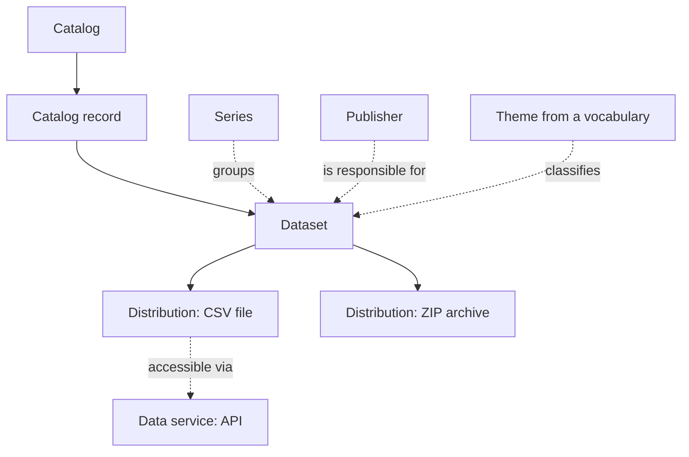

# Anatomy of a Catalog

A CKAN portal, a research repository and a geoportal call their parts by different names, but they are built the same way. A catalog holds records about datasets. A dataset has a description, someone responsible for it and one or more ways to get the data itself. Around the datasets there are organisations, themes and groups; inside the software there is a metadata database, a search index and file storage.

If you can tell these parts apart, you can compare any two catalogs, read their programming interface and see what your own is missing. This chapter describes the structure in the words of DCAT, the W3C vocabulary for describing catalogs. Most open data portals are built on it, and the other standards map onto it easily. At the end, one live dataset page is taken apart: almost all the parts are visible in it, along with the typical breakages between them.

## The overall picture



Read the diagram from top to bottom: the catalog keeps records, a record describes a dataset, and a dataset is served in one or more ways. Dashed lines are links that not every catalog has.

## Dataset

A **dataset** is what the user sees as one page and uses as one whole: a city budget, a cadastral layer, an indicator series, the data behind a paper. What counts as a dataset is decided by the catalog owner, and the decisions vary a lot: for a central bank a dataset is a time series, in a satellite imagery catalog it is a collection of thousands of files. See the chapter [on units of publication](../02-data/02-formats-and-units.md#what-counts-as-a-dataset).

A dataset page answers six questions. They make it easy to read any dataset page, even in an unfamiliar language.

| Question | Fields | What cannot be missing |
|--------|------|-----------------|
| What is it | title, description, keywords, theme | a title and a clear description |
| Who is responsible | publisher, contact, author | the publisher and a way to get in touch |
| What it covers and for what time | period, territory, update frequency | the period, for any data that changes |
| Under what terms | licence, access restrictions | the licence |
| How to get it | list of distributions | at least one that works |
| How to cite it | persistent identifier, version, citation line | a persistent address |

Which fields are mandatory for everyone and which are needed only in specific domains is covered in the chapter [on metadata completeness](../04-features/03-metadata-depth.md).

**A theme and a tag are different things.** A theme comes from a shared vocabulary: for European portals it is the list of themes of the EU Publications Office, for geoportals it is the ISO 19115 topic categories. A tag is a free word typed in by the publisher. By theme, datasets from different portals line up on one shelf of a shared portal. Tags do not: "transport", "Transport" and "транспорт" are three different words for a program.

**A publisher and an organisation in the software are not the same either.** The **publisher** is the party responsible for the data in substance and legally. An organisation in the software is an account inside which staff edit datasets. Usually they coincide. They diverge when the portal operator creates datasets on behalf of an agency, or when the catalog harvests other people's descriptions: the organisation is then the "harvester", and the publisher is the original agency.

## The dataset record and two pairs of dates

A **catalog record** holds information not about the data but about how the dataset got into the catalog: when it was added and when the description was last edited. DCAT has a separate class for this, and the specification explains it precisely through dates. The dataset's issue date is when the publisher first made the data available. The record's date is when this particular catalog learned about the dataset.

Most software does not distinguish these pairs of dates. Then the "updated" field shows the date of the last edit to the description, not to the data. Fix a typo in the title, and a five-year-old dataset looks fresh. Harvest descriptions from another portal, and every dataset gets today's date. That is why the freshness of data is checked against the file itself and the period field, not the date on the page.

## Distribution

A **distribution** is a specific file, link, API or map service through which a dataset is served. DCAT calls it a distribution. One dataset may have several: CSV for a person, Parquet for an analyst, an API for a program.

A distribution has its own fields: format, size, checksum, sometimes its own licence and its own modification date. DCAT draws a fundamental distinction between two links:

- a **download URL** (`downloadURL`): a program gets the data with a single request;
- an **access URL** (`accessURL`): a page or service through which the data can be obtained, though not necessarily with a single request.

If the download URL field holds a page on the agency's website, a person will figure it out, but a program will download HTML instead of a table. This is one of the common reasons why a dataset search engine shows a dataset but cannot determine its format and size.

A **data service** is a programming interface through which a dataset's data is obtained piece by piece: filter rows, request features on a map. In DCAT 2 it became a separate entity: a service has its own address and description, and a distribution refers to it. This makes it convenient to describe a map service that serves a hundred layers, or a table API shared by the whole portal.

## Series and versions

Catalogs most often confuse two links between datasets.

A **series** groups datasets of the same kind that are released one after another: budget execution for each month, a census every ten years. A separate class for series appeared only in DCAT 3 (2024), so most portals do not know about series and create each release as a separate dataset page. On the Greek national portal data.gov.gr, in October 2026, state budget execution is 131 separate datasets, one per month since 2014, with no common group. A person finds the whole series only by searching by title. Where the line runs between a series and inflating the counter is covered in the chapter [on anti-patterns](../09-practices/02-anti-patterns.md#fragmentation-to-boost-the-count).

A **version** is a fixed state of a dataset that can be cited. Research repositories need versions without fail: a paper cites the data the authors had, not the latest export. InvenioRDM, which runs Zenodo, has three levels for this. A parent record groups all versions and holds what they share: access rights, community membership. Each version has its own record with its own files and its own identifier. Minor edits to the description within a version are saved as revisions and do not create a new version. Open data portals more often just replace the file, and the previous state disappears. More on this in the chapter [on identifiers and versions](../04-features/06-identifiers-and-doi.md).

## Organisations, groups and the catalog itself

Catalogs build one more level on top of datasets.

- **Organisations** answer the question "who is responsible". In CKAN a dataset usually belongs to exactly one organisation, and editing rights depend on it.
- **Groups, collections, communities** answer the question "what belongs together". In CKAN a dataset can be in several groups. In Dataverse collections nest inside each other: university, faculty, lab. In InvenioRDM a community curates records: it accepts or rejects them.
- The **catalog** is also an entity with its own description: who runs it, which theme vocabulary it uses, on what terms the descriptions themselves can be reused. A catalog can include other catalogs. Portal federations work this way, and so does STAC, where catalogs nest inside each other like folders.

The structure of organisations and groups is worth thinking through before launch. Their short names often become part of page addresses. The Dataverse documentation warns explicitly: if you change a collection's short name, old links to it will break.

## The same parts under different names

| Where | Dataset | Distribution | How things are grouped | What to know |
|-----|-------|------------------|----------------|-----------------|
| DCAT | Dataset; series is DatasetSeries | Distribution; service is DataService | catalog, theme from a vocabulary | the common language for exchanging descriptions between portals |
| CKAN | dataset, in the API a package | resource: an uploaded file or a link | organisation, groups, tags | the word package is left over from early versions and means the same as dataset |
| Dataverse | dataset | file | nested collections | a collection can contain both datasets and other collections |
| InvenioRDM, Zenodo | record | file | communities | each version has its own record, plus a common parent for all versions |
| Geoportal on ISO 19115 | metadata record about a layer or service | online resource in the distribution section | keywords, topic category | one layer often has three distributions: a WMS image, WFS features, a file |
| STAC | collection, containing items | asset: an image file or another file | catalogs and subcatalogs | according to the STAC specification, a collection corresponds to a DCAT dataset |

Indicator and microdata catalogs fit the same scheme, but with a different main object: an indicator with breakdowns instead of a file, a survey with variables instead of a table. They are covered in the chapters [on indicator catalogs](../03-types/05-indicator-catalogs.md) and [on microdata](../03-types/06-microdata-catalogs.md).

## Where the bytes live

A catalog can store the file itself, only link to the file at the source, or harvest other people's descriptions and send the person to the original portal. A link is cheaper but breaks more often. A research paper needs a copy in a repository, not the hope that the agency's website will not move.

"The file is in the catalog" does not mean "on its server". Files uploaded to data.gov.gr open at the portal's address but are served from Microsoft Azure cloud storage. For the user there is no difference. For the owner it is a budget line and a question of who is responsible for backups. Storage options and their support in platforms are covered in the chapter [on storage](../04-features/05-data-storage.md).

## What is inside the software

From the outside a catalog is a website. Inside, almost any server platform has the same parts:

- a **metadata database**: dataset pages, users, permissions; usually PostgreSQL;
- a **search index**: a separate copy of the descriptions, built for fast search and filters. If the index drifts from the database, the dataset exists but cannot be found. After migrations and upgrades the index is rebuilt;
- **file storage**: the server's disk or cloud storage;
- **table storage**: a separate database into which table rows are loaded so they can be shown in the browser and served via an API;
- **background jobs**: harvesting other catalogs, loading tables, checking links, building archives. They are queued and run separately from the website;
- the **web interface and API**: what people and programs see.

| Platform | Metadata database | Search index | Files | What else |
|-----------|---------------|------------------|-------|---------|
| CKAN 2.12 | PostgreSQL | Solr 9 or 8 | server disk, cloud via an extension | Redis; the DataStore table storage is optional, a separate PostgreSQL database |
| Dataverse | PostgreSQL | Solr | disk or cloud storage | Payara application server |
| InvenioRDM | PostgreSQL 15 and later | OpenSearch 2.12 and later | network disk, S3 and others | Redis or memcached for caching, RabbitMQ or Redis for the job queue |
| Static site | none | none, or a small index downloaded into the browser | files next to the pages | a generator that builds the site |

Each part is a separate program that has to be upgraded, backed up and monitored. The number of parts is a good first estimate of how much maintenance costs. More in the chapter [on deployment and maintenance](../04-features/09-deployment-and-operations.md).

## Two entrances

A person needs search, filters, a dataset page and a "Download" button. A program needs the same in machine form. The same machine entrance is used by other catalogs that harvest descriptions on a schedule, and by dataset search engines. A good catalog serves each part both ways.

| A person sees | A program reads | How CKAN does it |
|---------------|------------------|------------------------|
| search and filters | a search API | core: `/api/3/action/package_search` |
| a dataset page | a record in JSON or DCAT | core: `package_show`; DCAT is the ckanext-dcat extension, the dataset page address ending in `.ttl`, `.rdf` or `.jsonld` |
| a "Download" button | a direct link to the file | core: the resource URL |
| a table with a preview | an API to table rows | core, DataStore plugin: `datastore_search` |
| a list of all datasets | a file with all descriptions | the ckanext-dcat extension: `/catalog.ttl` |
| the dataset in search engine results | schema.org markup on the page, a sitemap | the markup is also the ckanext-dcat extension |

Both entrances should say the same thing, but they often diverge: the page has a file that is missing from the export, or the export lacks a licence that is visible on the page. A person sees one thing, an aggregator another. Which programmatic entrances exist and how to check that they are open is covered in the chapter [APIs and Bulk Download](../04-features/04-access-interfaces.md).

## Taking apart a live dataset page

Take the dataset "Meteorological data of the Parnitha station" on data.gov.gr, the national open data portal of Greece on CKAN 2.11 (checked 12 October 2026). The page is simple, yet almost all the parts from this chapter are visible in it.

- **Dataset.** The publisher is the Hellenic National Meteorological Service; in the software the dataset belongs to the organisation of the same name. The theme is "Environment" from the EU theme vocabulary, there are eight tags in Greek and English. The licence is CC BY 4.0, the update frequency is "continuous". The dataset is marked as a high-value dataset under EU Regulation 2023/138, category "Meteorological".
- **Two distributions.** The first is an 18 MB CSV file with measurements every five minutes. It is loaded into table storage, so the rows can be queried through the API. The second is an "All data" ZIP archive that the portal builds itself with the ckanext-downloadall extension: inside are the same file and the dataset description `datapackage.json`.
- **Data service.** In the DCAT export, the CSV file has an access service: the table storage API with its own address. This is exactly the "distribution — data service" pairing.
- **Dates.** In the DCAT export the dataset's issue date is 13 May 2026 and its modification date is 11 October. Both are taken from the catalog record: when the page was created and when it was last changed.

If you compare the parts with each other, five discrepancies turn up.

1. **The two entrances say different things.** The page has two distributions, the DCAT export has one: the archive is missing. A person will see the ZIP, the European portal's harvester will not.
2. **The derived file lags behind.** As of 11 October 2026 the CSV contains measurements up to that day, but the "All data" archive only up to 14 August. The reason is described in the extension's documentation: a small archive is rebuilt when the dataset page changes, not when the file is updated. Anyone who downloaded "everything in one archive" got two-month-old data.
3. **The description and the contents disagree.** On the page the period starts on 7 April 2026, but the first row of the file is 1 April.
4. **There is no data dictionary.** In table storage all 57 columns are stored as text, including temperature and pressure, and none has a description. Names like `Temp_Dry_5min` make sense to a meteorologist but not to anyone else. Missing values are marked with slashes `/////`, and this is not mentioned anywhere.
5. **There is nothing for search engines.** The page has no schema.org markup, and the portal has no sitemap.

None of these discrepancies is visible on the page. All five turn up within ten minutes if you open the machine version of the same dataset page.

## How to take apart any catalog

Take one dataset and look at it in three ways: the page, the API record, the metadata export. For CKAN, substitute the portal address and the dataset name from its page address:

```bash
# the dataset record in JSON: fields, resources, organisation
curl "https://portal.example/api/3/action/package_show?id=dataset-name"
# the same dataset in DCAT, if the ckanext-dcat extension is installed
curl "https://portal.example/dataset/dataset-name.ttl"
# the first rows and column types, if the file is loaded into DataStore
curl "https://portal.example/api/3/action/datastore_search?resource_id=RESOURCE-ID&limit=5"
```

Other platforms keep the dataset record at similar addresses: Dataverse at `/api/datasets/:persistentId/?persistentId=doi:…`, InvenioRDM and Zenodo at `/api/records/RECORD-ID`. A STAC catalog itself consists of JSON files and can be read right in the browser.

Then answer five questions:

1. How many distributions are there, and do they all open?
2. Does the download URL lead to a file or to a page?
3. Do the page and the export contain the same things?
4. Which date is on the page: the data's or the record's?
5. Is there a data dictionary, and does the period in the description match the contents?

## What follows for your own catalog

- Decide what is a dataset and what is a series before creating the first pages. Converting hundreds of separate releases into a series later is expensive.
- Check whether the platform distinguishes a download URL from an access page, and data dates from record dates. If not, agree on what each field means and write it into the publishing rules.
- Think through organisations and groups in advance: their names become part of page addresses.
- Check derived files (all-in-one archives, previews, copies in table storage) the same way as the originals. They go stale unnoticed.
- Remember that each internal part of the software is a separate maintenance cost.

## Sources

- W3C, [DCAT 3](https://www.w3.org/TR/vocab-dcat-3/), Recommendation of 22 August 2024: catalog, catalog record, dataset, series, distribution, data service, download URL and access URL
- CKAN: [user guide](https://docs.ckan.org/en/2.12/user-guide.html): datasets, resources, organisations, the word package; [installing from source](https://docs.ckan.org/en/2.12/maintaining/installing/install-from-source.html): PostgreSQL, Solr, Redis, DataStore; checked 12 October 2026
- Dataverse: [collection management](https://guides.dataverse.org/en/latest/user/dataverse-management.html): nested collections, changing the short name breaks links; [installation prerequisites](https://guides.dataverse.org/en/latest/installation/prerequisites.html): Payara, PostgreSQL, Solr
- InvenioRDM: [records model](https://github.com/inveniosoftware/docs-invenio-rdm/blob/master/docs/maintenance/architecture/records.md): parent record, versions, drafts, revisions; [installation requirements](https://github.com/inveniosoftware/docs-invenio-rdm/blob/master/docs/install/requirements.md): PostgreSQL, OpenSearch, Redis, RabbitMQ, storage
- STAC, [specification overview](https://github.com/radiantearth/stac-spec/blob/master/overview.md): catalog, collection, item, asset; how a collection corresponds to a DCAT dataset
- [ckanext-downloadall](https://github.com/SDM-TIB/ckanext-downloadall): when the "All data" archive is rebuilt
- data.gov.gr, [Meteorological data of the Parnitha station](https://data.gov.gr/dataset/emy-station-189): [API record](https://data.gov.gr/api/3/action/package_show?id=emy-station-189), [DCAT export](https://data.gov.gr/dataset/emy-station-189.ttl); checked 12 October 2026
- [Built-in data storage](../04-features/05-data-storage.md), [APIs and bulk download](../04-features/04-access-interfaces.md)
