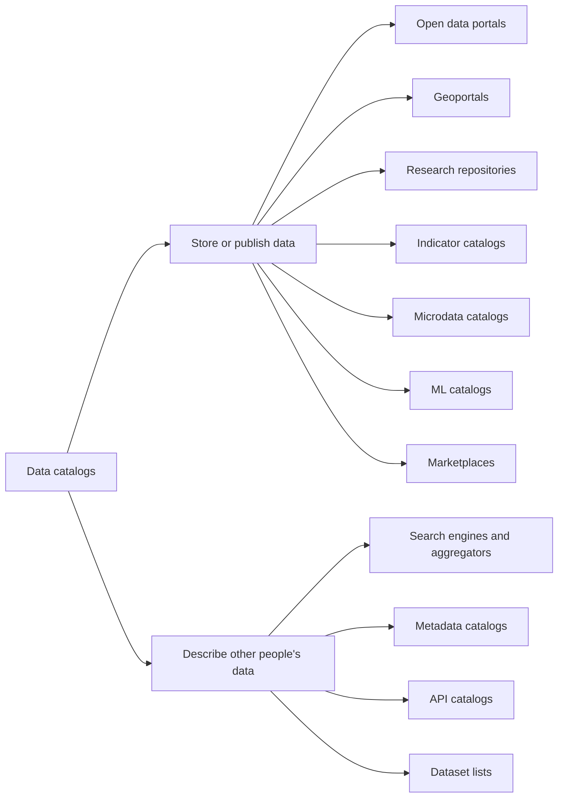
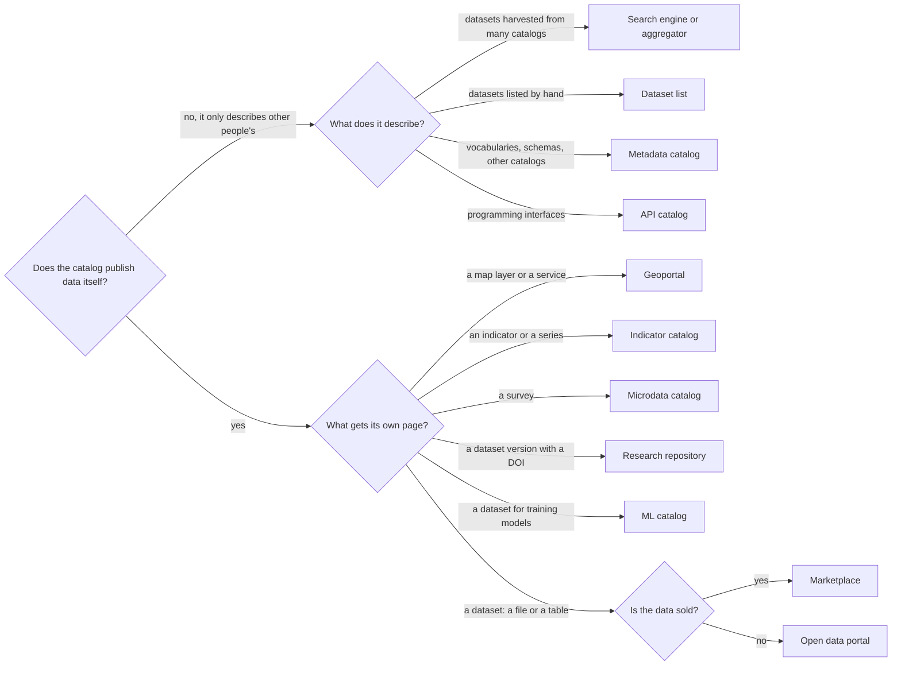

# How to Classify Catalogs

A data catalog is described by its answers to five questions: what it publishes, who runs it, where the data itself is, who can get it, and what it is built on. The answer to the first question is the catalog type. The type determines the description standard and the range of suitable platforms. The other four answers explain why two catalogs of the same type are still chosen and maintained differently.

Classification is not about tidying the shelf. It helps you find the catalogs to compare yourself with, the standard that aggregators expect, the platform class and the typical failures. A city's open data portal on CKAN and the same city's geoportal on ArcGIS Hub are both "about municipal data". But their standards differ, their platforms differ, and they send their descriptions to different federations. If you call both sites by one word, you will end up comparing the incomparable.

## Five questions

| Question | Possible answers | What follows from the answer |
|--------|-----------------|-----------------------|
| What is published | files and registers, map layers, research data, indicators, microdata, machine learning datasets, data for sale, descriptions of other people's data | catalog type, description standard, platform class |
| Who runs it and at what level | central government, region, city, university or research organisation, business, non-profit or international organisation, community | budget and team, legal obligations, whom the catalog passes its descriptions on to |
| Where the data is | in the catalog itself, linked at the source, the catalog only harvests other people's descriptions | whether a DOI can be issued, who is responsible for dead links, whether you need your own storage |
| Who can get the data | everyone without conditions, after registration, on request, for a fee; the description is open but the data is closed | roles and the release procedure, whether request tracking is needed, what to put in the licence |
| What it is built on | hosted service, ready-made platform on your own server, map server or protocol server, CMS website, custom build | who upgrades the software, whether a feature can be added, how much it costs to leave |

The answers are independent of each other. A research repository can belong to a university or a government, be open or request-based, run on its own server or in the cloud. So the classification is easier to record as a line rather than a single word: "district geoportal, layers on its own map server, open access, hosted ArcGIS Hub". Each part of the line points to its own chapter of the book. How to write such a line for your own catalog is shown [at the end of the chapter](#how-to-record-the-classification-of-your-own-catalog).

The figures in this chapter come from the dataportals-registry export (release 1.27.0 of 15 October 2026), which holds 43,614 catalogs. The registry is one source among others and sometimes gets the type wrong itself. Its limitations are discussed in the chapter [The World of Catalogs in Numbers](../01-basics/04-catalogs-in-numbers.md#what-the-numbers-do-not-show).

## What is published: the catalog type



The two branches differ in the main thing. Catalogs in the left branch publish data themselves. Catalogs in the right branch lead to other people's data and are responsible only for the description. Within a branch, the type is determined by the main unit: what gets its own page and its own persistent address in the catalog.

| Type | Main unit | Description standard | Example |
|-----|-----------------|-------------------|--------|
| [Open data portal](./02-open-data-portals.md) | a dataset: a file or a table | DCAT | [data.gouv.fr](https://www.data.gouv.fr) |
| [Geoportal](./03-geoportals.md) | a layer and a map service | ISO 19115, CSW | [Geoportal.de](https://www.geoportal.de) |
| [Research repository](./04-scientific-repositories.md) | a dataset version with a DOI | DataCite | [Zenodo](https://zenodo.org), [PANGAEA](https://www.pangaea.de) |
| [Indicator catalog](./05-indicator-catalogs.md) | an indicator and a time series | SDMX | [ECB Data Portal](https://data.ecb.europa.eu) |
| [Microdata catalog](./06-microdata-catalogs.md) | a survey and its files | DDI | [World Bank Microdata Library](https://microdata.worldbank.org) |
| [ML catalog](./07-ml-catalogs.md) | a dataset for training and evaluating models | Croissant | [Hugging Face Datasets](https://huggingface.co/datasets) |
| [Marketplace](./10-other-types.md#data-marketplaces) | a product: a dataset or a subscription under contract | no common one | [AWS Data Exchange](https://aws.amazon.com/data-exchange/) |
| [Search engine or aggregator](./09-search-engines-aggregators.md) | a record about someone else's dataset | whatever it harvests: DCAT, schema.org, DataCite | [data.europa.eu](https://data.europa.eu) |
| [Metadata catalog](./08-metadata-catalogs.md) | a vocabulary, a schema, a description of another catalog | SKOS, SDMX, ISO/IEC 11179 | [re3data](https://www.re3data.org/) |
| [API catalog](./10-other-types.md#api-catalogs) | a programming interface | OpenAPI | [api.gov.uk](https://www.api.gov.uk) |
| [Dataset list](./10-other-types.md#dataset-lists) | a link to a file | usually none | [awesome-public-datasets](https://github.com/awesomedata/awesome-public-datasets) |

Four large types (geoportals, research repositories, open data portals and indicator catalogs) account for 97.5% of the registry's records. The other seven types together amount to about a thousand catalogs. A small type is not unimportant because of that: there are only 326 microdata catalogs, but without them there is no access to the surveys on which social statistics rest.

### How to determine the type

Look not at the site's name or the buttons on the home page, but at what gets its own address in the catalog. If the series "euro to dollar exchange rate" has its own page with a chart and an API, and there are no files by year, it is an indicator catalog, even if the site calls itself an open data portal.



If a site does two jobs at once, the type is chosen by what a person sees and does first. A map and a layer catalog make a geoportal, even if a few tables sit next to them. A dataset list with an embedded map is an open data portal. The platform should be chosen the same way: not "as universal as possible", but for the main product. Sites that genuinely do two jobs, and hubs made of several catalogs, are covered in the chapter [on comparison and hybrids](./11-comparison-and-hybrids.md).

## Who runs it and at what level

The owner determines the money, the team and the obligations. The owner also often decides which platform the catalog ends up on and where its descriptions go: a city passes them to the region, the region to the country, the country to the European or another shared portal.

Owners in the registry are distributed as follows: local government 40%, universities and research organisations 22%, central government 14%, regional government 12%. Businesses own 4% of catalogs, non-profits 3%, international organisations 3%. Each type has its own main owner.

| Type | Most common owner |
|-----|----------------------|
| Geoportal | local government 58%, regional 14% |
| Open data portal | local government 48%, central 19%, regional 14% |
| Research repository | universities and research organisations 85% |
| Indicator catalog | central government 46%, regional 19%, international organisations 11% |
| Microdata catalog | central government 55%, universities and research organisations 32% |

What changes from level to level:

- **City.** Few datasets, one or two people. The platform is often not chosen by the city: in Russia it is often set by the state website platform Gosweb, in Poland by the market, where more than half of the gminas run on e-mapa. Passing descriptions upwards matters more than having a showcase of your own. See the [municipality example](../06-choice/08-worked-examples.md#municipality-dont-set-up-your-own-portal).
- **Region.** Harvests city catalogs and passes descriptions to the country. For a region, harvesting and export are two mandatory features.
- **Country.** Runs the national catalog of its type and is accountable under the law: the INSPIRE Directive for geodata, the EU Open Data Directive and the high-value datasets regulation, national lists. About 600 catalogs in the registry are flagged as national, although the flag is not applied consistently everywhere.
- **University or research organisation.** Requirements come from funders and journals: DOIs, versions, citation, harvesting of descriptions via OAI-PMH.
- **International organisation.** Publishes data about countries that have almost no catalogs of their own, and often keeps several catalogs of different types under one banner.
- **Business.** Opens data for the sake of a product, or sells it and closes access when it stops paying off. This is how data.world closed its open community in July 2026: more in the chapter [on cloud storage and hubs](../08-beyond-portals/04-cloud-storage-and-hubs.md).
- **Community and non-profits.** Sometimes build a catalog before the government does, like the Open Data Hub hubofdata.ru in 2010–2011, but rely on enthusiasts.

The owner does not set the type. 15% of the catalogs of universities and research organisations are geoportals, not research repositories. Nor does the owner set the coverage: an international organisation publishes data about countries, and a university about the territory where the research took place.

## Where the data is

This question divides catalogs into three groups.

- **Stores it itself.** The file is uploaded to the catalog and lives as long as the catalog does. This is the normal mode of a research repository. This is where issuing a DOI is most honest: the identifier promises that the same file will be found by it in ten years, and only whoever stores the file can keep that promise.
- **Links to the source.** The catalog stores the description and the address, while the file sits on the agency's website or a map server. Many open data portals and most geoportals work this way. The risk is dead links: in a full export of data.gov.uk in 2023 about 10% of file links did not open, and by 2026 more than a quarter.
- **Harvests other people's descriptions.** An aggregator or search engine is not responsible for the data, but it is responsible for not showing dead entries and not multiplying one dataset that the city, the region and the country all have.

A protocol server is a special case: THREDDS, ERDDAP, a STAC server. Data is served on request, and the catalog and storage coincide here.

The answer often depends not on the type but on the platform and the owner's decision. CKAN can both store a file and link to someone else's. Zenodo expects the file to sit with it. ArcGIS Hub shows layers that live on ArcGIS servers. The options and when to choose which are covered in the chapter [on data storage](../04-features/05-data-storage.md).

## Who can get the data

re3data, the registry of research repositories, offers a convenient scheme. It asks not one question about access but three:

1. Is the catalog itself open: can you search and read the descriptions?
2. Is the data open? Options: open, closed until a certain date (embargo), released with restrictions, closed entirely.
3. Who can upload data: everyone, only members, or no outsiders.

Restrictions are listed separately: a fee, registration, institutional membership. The scheme is not only for science. A portal can be open for reading and closed for uploading, and these are two different decisions with different consequences for roles and for reviewing publications.

In the dataportals-registry, 97% of catalogs are marked only as open. In 1.4% part of the data is open and part is released with restrictions, in 1.2% access is restricted only. But the difference by type is huge:

| Type | Share of catalogs with restricted access to at least part of the data |
|-----|------:|
| Marketplace | 91% |
| Microdata catalog | 49% |
| API catalog | 14% |
| Metadata catalog | 10% |
| Research repository | 6% |
| Indicator catalog | 4% |
| Open data portal, geoportal | under 1% |

Restricted access can be a feature of a type rather than a flaw. Half of the microdata catalogs release some files on request because surveys contain information about people. The description remains open, though: a person must know the data exists in order to request it. The UK Data Service and the catalog of restricted public sector data in Ireland work this way; they are covered in the chapter [on metadata catalogs](./08-metadata-catalogs.md#open-descriptions-of-closed-data). For an open data portal, on the contrary, closed access is a sign of trouble.

Access and licence are different questions. Access answers whether you can get the data. The licence answers what you can do with it. Data can be publicly available but not open: you can look at it, but you cannot download and reuse it. Examples are in the section [Publicly available but not open](./03-geoportals.md#publicly-available-but-not-open) of the chapter on geoportals, and the rules are in the chapter [on licences and access](../07-publishing/04-licenses-and-access.md).

## What it is built on

The software class answers the questions of who upgrades it, whether a feature can be added and how much it costs to leave. The classes are covered in detail in the chapter [on classes of software](../05-platforms/01-software-classes.md). Here is how they are distributed.

| Class | Share of catalogs | Most common |
|-------|---------------:|------------|
| Hosted service | 30% | ArcGIS Hub (about 3,500), e-mapa (about 1,900), OpenDataSoft, Figshare |
| Ready-made platform on your own server or a contractor's | 30% | CKAN, GeoNode, GeoNetwork, DSpace, Dataverse, PxWeb, NADA |
| Map server, protocol server or domain system | 20% | ArcGIS Server (about 4,700), GeoServer (about 1,500), GBIF IPT, THREDDS, ERDDAP |
| Custom build | 16% | — |
| CMS website | 4% | Gosweb, WordPress, Drupal |

With a specialised platform the type can be guessed almost for certain. CKAN accounts for 1,906 open data portals and only 39 research repositories. DSpace and Dataverse occur almost only among research repositories, GeoNode only among geoportals. A general-purpose program says nothing about the type: WordPress occurs in nine types out of eleven. The reverse does not work: the type narrows the choice of platform but does not choose it. How to get from the type and the required features to a specific platform is covered in the chapter [From Features to a Platform](../06-choice/03-from-features-to-platform.md).

## Other attributes

Some attributes do not change the type but matter when you are looking for peers to compare yourself with.

**Breadth of subject.** re3data divides repositories into disciplinary, institutional, multidisciplinary, project-specific, governmental and other. One repository can belong to several groups at once. PANGAEA is disciplinary, Earth sciences. Harvard Dataverse is institutional and multidisciplinary at the same time. Zenodo is classed as other. The division works outside science too. A domain catalog lives by the standards of its field: biodiversity data is described in Darwin Core and published through GBIF IPT, oceanographic data is served by ERDDAP servers. A country's general portal does not compete with them but harvests their descriptions.

**Territory.** The world, a group of countries, a country, a region, a city. Coverage does not coincide with the owner: the World Bank publishes surveys from dozens of countries, GBIF attaches an observation to the country where it was made, not to the country of whoever sent it.

**Official status.** The national catalog of its type is the one where a country's data is collected by law or by agreement. It is compared with the national catalogs of other countries, not with the portal of the neighbouring ministry.

**State.** Working, abandoned, decommissioned, kept as an archive. In the registry 868 catalogs do not open as working sites and 98 are officially decommissioned. Comparing yourself with a dead catalog is pointless, but it is worth learning from one: why catalogs close and how they are rescued is covered in the chapter [on archiving](../09-practices/04-archiving.md).

**What the descriptions are kept for.** This attribute explains why catalogs of the same type have such different depth of description. In 2021 I. Begtin identified five models of working with metadata:

- research: do it right and without haste, by the standards of the discipline, so that it is convenient for researchers in that field;
- archival: preserve it so that the data can be understood and reused in 10–20 years;
- civic and governmental: open as much as possible quickly; availability matters more than quality, descriptions are minimal;
- technological: connect information systems and impose exchange rules, as reference data portals do;
- commercial: help analyst teams exchange data and not lose their work; this is the world of enterprise catalogs.

Research repositories and microdata archives follow the first two models, open data portals the third. Hence the difference in how detailed the descriptions are. What of this is mandatory for your catalog is covered in the chapter [on metadata completeness](../04-features/03-metadata-depth.md).

## Borderline cases: is it a catalog

A site can be considered a data catalog if three conditions are met:

1. A dataset has a description: at least a title, a source and a way to get the data.
2. Datasets can be found, by search, a list or a programming interface.
3. The data can be obtained, or at least you can find out how to request it.

Without the first condition it is a file archive or a website section with attachments. Without the third, it is a showcase where the data can be viewed but not taken; this case is covered in the anti-pattern [Dashboard instead of data](../09-practices/02-anti-patterns.md#a-dashboard-instead-of-data). Below are cases where the answer is not obvious.

**A publications repository with almost no data.** Universities run archives of papers, theses and books on DSpace, ePrints or Pure, and sometimes datasets end up there. In December 2024 the open access archive of St Petersburg State University held 47,619 records, of which 17 were datasets, that is, 0.03%. DSpace does not filter search by record type out of the box, so to find those 17 datasets the descriptions of all records had to be exported. Such an archive is a research repository but not a data repository. It is worth including in lists, but not expecting from it what you expect from a data catalog. Why such archives are hard to harvest is covered in the chapter [on research repositories](./04-scientific-repositories.md#why-they-are-hard-to-harvest).

**A map server without a catalog.** ArcGIS Server and GeoServer serve layers but do not keep descriptions for search on their own. The registry counts them among geoportals: about 6,100 records. The book considers them services that a geocatalog relies on, not catalogs. More in the chapter [on geoportals](./03-geoportals.md).

**A reference data portal.** Portals of regulatory reference data resemble open data portals: many datasets, export, an API. But they have a single owner, uniform terms of use instead of a licence per dataset, and they are built for exchange between government systems. The deciding question is what a person does on the site: downloads a reference list as data or checks codes against it. See the section [Reference data portals](./08-metadata-catalogs.md#code-list-portals-a-borderline-case).

**An open budget website.** If the budget tables can be downloaded with a description and a date, it is a single-topic open data portal. If the site has only PDF reports and charts, it is a site with publications, not a catalog.

**A feed or an interface inside a catalog.** ATOM feeds, WMS endpoints, a separate API are ways to get a dataset, not new catalogs and not new datasets. In 2024 data.europa.eu had more than 141,000 ATOM feeds: this is how GeoNetwork serves geodata. Whether such an object counts as data is decided not by its form but by whether people working with data need it. What counts as a unit of publication is covered in the chapter [on units of publication and formats](../02-data/02-formats-and-units.md#what-counts-as-a-dataset).

**An enterprise catalog.** Collibra, DataHub and similar systems describe tables inside a company and are not visible from outside. They are data catalogs, but not public ones; the book does not discuss them, and the boundary is drawn in the chapter [What Is a Data Catalog](../01-basics/01-what-is-a-data-catalog.md#what-this-book-does-not-cover).

**A hub.** Several catalogs of different types under one banner are not a new type. Each catalog in a hub is classified and assessed separately; see the chapter [on hybrids](./11-comparison-and-hybrids.md#hybrids).

## Typical mistakes

- **Type by engine.** "We have CKAN, so it is an open data portal." For specialised platforms this is usually true, but research repositories also run on CKAN, and catalogs of nine types run on WordPress. The content determines the type, not the software.
- **Type by name.** The word "portal" or "geoportal" in the name guarantees nothing. A statistical office website becomes an indicator catalog when every table gets its own address and export, as at Statistics Canada, even though it is still called the office's website.
- **Type by owner.** A university runs not only a research repository but also a geoportal and an open data portal. A ministry runs not only an open data portal but also an indicator catalog.
- **Type by the most visible button.** A map on the home page does not make a site a geoportal if it shows tables that are already published.
- **Type by number of datasets.** Millions of "datasets" often turn out to be slices of one database or individual observation records. How this distorts the picture is shown in the chapter [The World of Catalogs in Numbers](../01-basics/04-catalogs-in-numbers.md#what-the-numbers-do-not-show).
- **One type for the whole hub.** A statistical office's indicators and microdata are two catalogs with two standards, even if the domain is the same.

## How classifications have changed

Division into types is a working tool, and it has changed along with how many catalogs could be found.

- **2020.** Three big families: open data portals, research repositories and enterprise catalogs. This frame still helps you quickly understand what you are dealing with; it is covered in the chapter [What Is a Data Catalog](../01-basics/01-what-is-a-data-catalog.md#three-big-families).
- **February 2023.** The catalog of catalogs datacatalogs.ru collected six categories: open data portals, research repositories, statistical indicator databases, geoportals, open budget websites, and portals of reference lists and classifications.
- **May 2023.** The Common Data Index had nine types: open data portals, geoportals, research repositories, microdata and indicator portals, machine learning data catalogs, dataset search engines, marketplaces and API catalogs. Reference data portals were not included: outside Russia there are almost no similar portals, and the type would have consisted only of Russian sites.
- **2026.** The dataportals-registry has eleven main types. Metadata catalogs and dataset lists were added, and generic research repositories and unsorted records are counted separately.

A type is introduced when there are enough catalogs that have to be harvested, described and assessed differently. So the book's classification is not final. If your catalog does not fit any type, describe it with the answers to the five questions: that is enough to find your neighbours and choose a platform.

## How to record the classification of your own catalog

Answer the questions of this chapter and write the answers down on a card. It is convenient to keep it next to the decision records from the chapter [Justifying a Decision](../06-choice/04-justifying-decisions.md).

```text
Type:                 what gets its own page
Owner and level:      who runs it, city / region / country / research / other
Where the data is:    stored / linked / descriptions only
Access:               to descriptions, to data, to uploading
Software class:       hosted / ready-made platform / server / CMS / custom build
Subject and area:     general or domain-specific, which territory
Compare with:         three to five catalogs with the same answers
```

Three examples based on the decision chains worked through in Part VI:

| | City | University | Statistical office |
|--|-------|-------------|-----------------------|
| Type | open data portal | research repository | two catalogs: indicators and microdata |
| Owner | local government | university | central government body |
| Where the data is | files in the region's catalog | files in the repository itself | indicators in the catalog database, survey files stored in-house |
| Access | everything open | descriptions open, some files closed | indicators open, microdata on request |
| Software class | the region decides: a ready-made platform | a ready-made platform on its own server, next to the publications archive | two ready-made platforms |
| Compare with | neighbouring cities in the same region | other universities' repositories in re3data | statistical offices of neighbouring countries |

The detailed decisions are in the chapter [Worked Examples](../06-choice/08-worked-examples.md). Next, the answers are used to choose the required capabilities and the platform: this is where the [route map](../06-choice/01-route-map.mdx) begins.

## Sources

- dataportals-registry export, [release 1.27.0](https://github.com/datenoio/dataportals-registry/releases/tag/v1.27.0) of 15 October 2026: types, owners, access modes, software classes and platforms by type. The queries are in the [appendix](../12-appendices/02-using-the-registry.md).
- [re3data Metadata Schema 4.0](https://doi.org/10.48440/re3.014) and [its XML schema](https://schema.re3data.org/4-0/re3dataV4-0.xsd): repository types, access to the catalog, data and upload, kinds of restrictions. The [Zenodo](https://www.re3data.org/repository/r3d100010468), [Harvard Dataverse](https://www.re3data.org/repository/r3d100010051) and [PANGAEA](https://www.re3data.org/repository/r3d100010134) records in re3data, checked 12 October 2026.
- GDS, [What's changing on data.gov.uk and why](https://dataingovernment.blog.gov.uk/2026/03/25/whats-changing-on-data-gov-uk-and-why/), 25 March 2026; I. Begtin, [Good and bad data publishing practices](https://begtin.substack.com/p/2ef) (in Russian), November 2024: broken links on data.gov.uk.
- I. Begtin, Telegram (in Russian): [three categories of data catalogs](https://t.me/begtin/2175), 14 October 2020; [five models of working with metadata](https://t.me/begtin/2817), 10 May 2021; [datacatalogs.ru categories](https://t.me/begtin/4603), 8 February 2023 (repost from the Infoculture channel); [reference data portals and Common Data Index types](https://t.me/begtin/4892), 22 May 2023; [what counts as a dataset: series, layers, ATOM feeds](https://t.me/begtin/6216), 25 November 2024; [the SPbU publications repository: 17 datasets out of 47,619 records](https://t.me/begtin/6302), 25 December 2024.
- [The World of Catalogs in Numbers](../01-basics/04-catalogs-in-numbers.md), [Comparing Types and Hybrids](./11-comparison-and-hybrids.md), [Classes of Software](../05-platforms/01-software-classes.md), [Capability Map](../04-features/01-capability-map.md)
