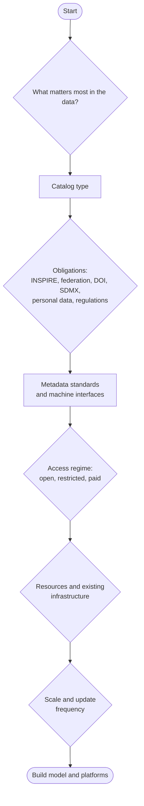
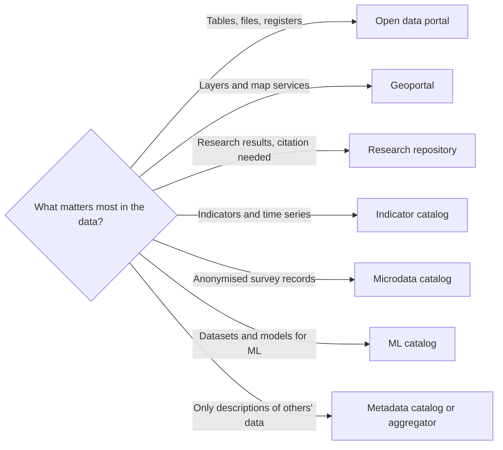
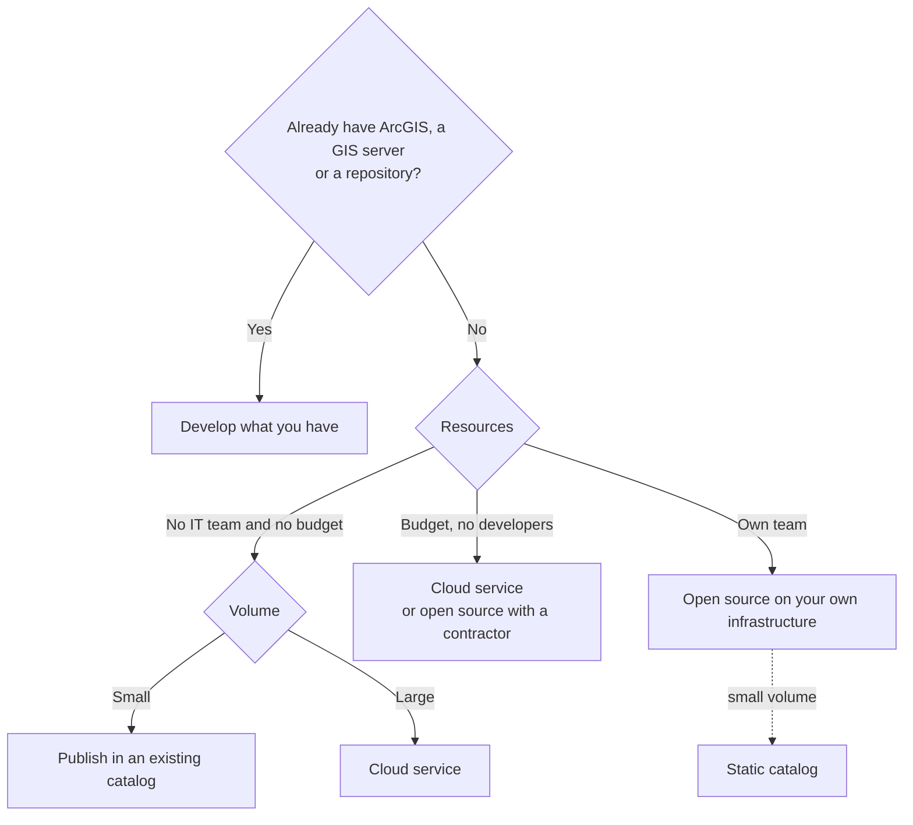

import RouteMap from '@site/src/components/RouteMap';

This chapter answers the book's fourth question: which data catalog to choose for its creator's tasks. The choice goes in three stages. First the contents determine the **catalog type**. Then obligations and the access regime set the **standards and interfaces**. Finally, resources, existing infrastructure and scale determine the **build model and platforms**. If the owner is already clear (a ministry, a city, a university, an agency), the chapter ["Typical Scenarios"](./06-scenarios.md) gives the starting row. The route below is for when the type is not yet clear or the scenario row did not fit.

## Take the route

Answer eight questions. The recommendation is a starting point for comparison, not a final choice. Every platform, standard and interface in the answer has a short justification. Marked capabilities come with a note on whether they live in the platform core or in an extension. The detailed method, from tasks to features and from features to a platform, with a justification for each decision, is described in the chapters ["Selecting Features"](./02-feature-selection.md), ["From Features to a Platform"](./03-from-features-to-platform.md) and ["Justifying a Decision"](./04-justifying-decisions.md).

<RouteMap />

## Route diagram

### Stage 1. Catalog type by contents

### Stage 2. Standards and interfaces

This stage has no diagram of its own: the standards follow from the catalog type and the owner's obligations, such as INSPIRE, harvesting by a higher-level portal, DOI, SDMX or personal data. Which standards and interfaces each type requires is summarised in the [capability map](../04-features/01-capability-map.md), and for typical owners in the [scenario table](./06-scenarios.md).

### Stage 3. Build model

## How the logic works

- The recommendation matches the diagrams above.
- One of the answer options is "don't build your own catalog". For small owners without an IT team this is often the best choice.
- Options worth comparing with the recommendation are shown next to it.

## Sources

- [Selecting Features](./02-feature-selection.md)
- [From Features to a Platform](./03-from-features-to-platform.md)
- [Justifying a Decision](./04-justifying-decisions.md)
- [Requirements Checklist](./07-requirements-checklist.md)
- [Typical Scenarios](./06-scenarios.md)
