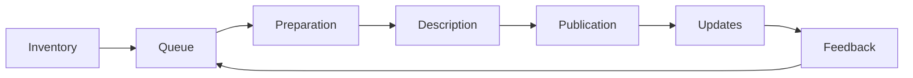

# The Publishing Process

A dataset is published when an outsider finds its page, opens the file or sees how to request it, reads the licence and can name who will answer for the rows. A file put up once alongside a report does not achieve this: the page exists, but nobody is there to update it.

The order is the same for a portal, a static site and a repository. What changes is the tool at the "publication" step. The life of the catalog itself (launch, change of platform, closure) is analysed in the chapter [on the lifecycle](../09-practices/03-lifecycle.md).

In brief:

- First write down what the organisation already has. Then decide what to publish from it and in what order.
- Publication means three checks: the page is in search, the file or service opens, the description is in the common dump.
- Each dataset has a named person who will answer an error in the rows.
- A dataset someone may already have cited is not removed silently: the address remains and explains what happened.
- A request for a missing dataset goes back into the queue.

## When a dataset can be considered published

| What is visible from outside | What must be true |
|-------------------|-------------------------|
| The page is found in search | what reached search is a released dataset, not a draft |
| The file has a date | the date refers to the rows and is no older than the promised frequency |
| Somewhere it says "free to use" | the licence is on the dataset as a link and goes into the dump |
| The site footer has an `info@` address | the dataset names the person and address of whoever will answer on substance |
| The dataset disappeared from the catalog | the old address opens and explains why the release is gone or what replaced it |

The address, the licence, an open file or an honest refusal, the date and the common dump are already in the [requirements checklist](../06-choice/07-requirements-checklist.md). Below is the order in which you arrive at that list.

## Seven steps

The data owner answers for the rows. The publisher puts up the file and the page. The editor runs the queue and the dump. The full division of roles, and what breaks when a role is empty, is in the table [below](#who-is-responsible-for-what).

| Step | Done when | Who closes the step |
|-----|---------------|-------------------|
| Inventory | there is a list of what the organisation already produces, including what must not be published | data owners together with the catalog editor |
| Queue | each item records why it comes before the others, and the list survives a year | the catalog editor |
| Preparation | the file opens without paid software, the columns are named, people are anonymised, the licence is agreed | the data owner and a lawyer |
| Description | the page minimum is filled in, plus the fields without which a dataset in your discipline cannot be understood | the publisher, following the owner's template |
| Publication | the dataset is in search, the file or service opens, the line is in the common dump | the publisher; with curator review, a second person |
| Updates | the frequency is recorded, a delay is visible, the address does not change when the file is replaced | the data owner |
| Feedback | an error report reaches the owner, and a request for a new dataset gets into the queue | the data owner and the editor |

### Inventory

An inventory is a list of what already exists and who holds it: registers, reports, layers, surveys, dumps from a records system. It is a list of assets, not a plan of "what we'd like to put up" and not the catalog itself. An empty list at this step is more useful than a portal without data: there is nothing to publish yet.

A few columns are enough: the name, where it currently lives, who answers for the rows, whether the data contains people, how often the rows change, whether the law or a grant requires publication, whether anyone has asked for this dataset. For a public authority, a starting point often already exists in a records system. For a university, in a grant's data management plan.

Under OMB memorandum M-25-05 of 15 January 2025, a US federal agency keeps such a list of all data assets except national security systems. A new asset is added no later than 90 days after it is created or found. The whole inventory is reconciled as work goes on and at least once a year. The file is published in JSON at `www.[agency].gov/data.json`, in the DCAT-US 3.0 schema. The inventory itself can be downloaded in full. Not every record has a data file: the decision to release data is made separately, and a closed asset stays in the inventory with a note on how to request it. The deadline to bring the inventory to schema 3.0 and include all assets passed on 30 September 2026; the example below shows what such an inventory looks like two weeks after the deadline.

On 14 October 2026 the General Services Administration (GSA) file at `www.gsa.gov/data.json` opened and redirected to `open.gsa.gov/data.json`. It has 344 records, and the schema is declared as DCAT-US 3.0. All 344 have a contact point filled in: a name and an email. 310 records are public, 33 are not for publication, and one is restricted. The closed record "Concur - Reporting Authorization Model" has no file, and its access conditions say the dataset is not intended for public release and you should write to the publisher. This is how an inventory differs from a download showcase: you can see that the asset exists, and you can see the refusal.

A licence link, meanwhile, is present in 320 of 344 records. In 24 public records the field is empty. The inventory already separates closed from open, but that does not make it a finished publication.

A deadline does not rewrite a file by itself. On 14 October 2026 the US Election Assistance Commission's `eac.gov/data.json` was still declared as DCAT-US 1.1 and contained 11 records. How the national catalog harvests such files is in the chapter ["When You Don't Need a Portal"](../08-beyond-portals/01-when-portal-not-needed.md#a-file-on-your-own-website-instead-of-a-portal).

### Queue

First, what the law, a grant or a higher-level portal requires, and what people are already asking for. The rest can wait. The queue is written down, otherwise every year starts from zero.

In the EU, [high-value datasets](../02-data/01-what-is-published.md#what-must-be-published) go to the front of the queue: six categories that since 9 June 2024 have been released free of charge, via an API and as bulk download. In the US an agency's open data plan must describe how a member of the public asks to move a specific asset up the queue. Among the reasons, the memorandum names a release already under way, direct benefit to people, frequent freedom of information requests, and data used to check calculations and models. A reference list nobody asked for comes last in this queue.

### Preparation

A format that opens without paid software. A data dictionary. Anonymisation, if the data contains people. A licence the lawyer agrees to. How to choose a format is in the chapter [on formats](../02-data/02-formats-and-units.md), how to choose a licence in the chapter [on licences](./04-licenses-and-access.md). A form or a script does not replace this step: they publish what a person has already decided.

### Description

The minimum from the chapter [on metadata completeness](../04-features/03-metadata-depth.md): title, publisher, licence, date, persistent address. Plus the fields without which a dataset in your discipline cannot be understood: period and territory, survey variables, a layer's coordinate system. In the Russian dataset "passport" under methodological recommendations 4.0, the responsible person and their contacts are part of the form itself. How the passport works is in the chapter [on metadata standards](./02-metadata-standards.md#a-passport-instead-of-dcat). An international harvester does not read this form. Someone looking for whom to write to still needs the field.

### Publication

The dataset is visible in search, the file or service opens, the description is served in the common dump. A draft does not get into search. Who has the right to press "publish" is set by roles. In a research repository this step is often taken by a second person: the author submits the dataset, a curator releases it. How drafts, roles and review work is in the chapter [on access](../04-features/08-access-control-and-workflow.md#implementation-options).

A page can be put up in three ways.

| Method | When it is enough |
|--------|-------------------|
| A form on the portal | dozens of datasets, edited by two people, and these fields are not in the records system |
| A script from the system where the data already lives | hundreds of datasets, and the page is built from the same fields a person would fill in by hand |
| A description file harvested by someone else's catalog | there is no portal of your own, or the national catalog itself fetches the file |

The data.gouv.fr guide recommends the programming interface when a dataset is updated regularly, and the form when it is published rarely. A script does not assign the licence or the "may be published" flag: a person fills in these fields in the system before launch. The udata platform that runs data.gouv.fr has a separate trap. A dataset created through the API becomes public unless the private flag is passed with every request. A draft is set explicitly in the script.

### Updates

The dataset states how often its rows change. The W3C's "Data on the Web" best practices tie this directly to the process: web publication is part of releasing a new version, and a specific person is responsible for the release. The check is short. The frequency is named, and the latest file is no older than the date that frequency promises. A catalog that counts the deadline itself and writes to the dataset owner is the Humanitarian Data Exchange. How the count works is in the chapter [on good practices](../09-practices/01-good-practices.md#file).

In the GSA inventory, the "quarterly" frequency is on 121 records. In the file this is the repeating interval `R/P3M`. For 112 of them the date in the `modified` field is 2020 or earlier. Another 89 records have no frequency at all. Twenty file links point to the host `www.asap.gsa.gov`, which did not open on 14 October 2026. Among them is the dataset "Networx Business Volume FY2013, 3rd Qtr": quarterly frequency and a modification date of 12 June 2019. The inventory itself is being edited: its own record was modified on 5 October 2026. Updating the records has fallen behind updating the inventory file.

A dataset someone may already have cited is not deleted silently. The GSA guide to DCAT-US 3.0 says the same: removal without explanation looks like concealment. The retention period is written in advance, in the description or the rights field. The record keeps a contact so that people can ask why the dataset was removed. If the format is outdated, a simple static file is tried before full removal. Three outcomes, and in each the dataset's address is kept.

- The file is replaced, and the date of the rows changes.
- A new version comes out, and the old one can still be found.
- The release is closed. The old address says why and what to use instead.

Silent deletion is analysed among the [anti-patterns](../09-practices/02-anti-patterns.md#a-showcase-for-a-deadline). The page that stays in place of a removed dataset with a DOI is in the chapter [on identifiers](../04-features/06-identifiers-and-doi.md#how-a-doi-works).

A "closed" mark without checking the link is leaky too. 14 of GSA's 33 closed records still give a download link in the description, although the access text says the dataset is not for public release.

### Feedback

There needs to be a place to report an error and a place to request a missing dataset. For a public authority's portal this is part of the job. The message reaches the data owner.

The W3C recommendations split this into two steps. The way to write is easy to find on the dataset page. Answers are visible to later readers, so the same error is not sent again. On data.gouv.fr this is the discussion on the dataset page. How the portal serves discussions in the common dump is in the chapter [on good practices](../09-practices/01-good-practices.md#a-catalog-that-can-be-harvested).

A request "please publish this" without a queue stays in the mailbox. It is written down as the next item in the queue, and the requester is told whether it has been taken on.

## Who is responsible for what

| Role | Responsible for | Does not | If the role is missing |
|------|-----------------|----------------|---------------|
| Data owner | contents, update schedule, answering errors on substance | choose the platform or lay out the page at random | the dataset was put up once, and nobody answers emails |
| Publisher | puts up the file and fills in the page from the template | assign the licence on the day of upload | the owner edits the portal themselves, and pages drift apart |
| Catalog editor | pages are structured the same way, the queue does not get stuck, the dump is alive | stand in for the data owner | the inventory starts from zero every year |
| Lawyer and personal data specialist | the licence and anonymisation before publication | appear for the first time after a complaint | the publisher writes the licence on the day of upload |
| Platform administrator | the server, software updates, roles, backups | decide which dataset to publish | the catalog opens until the version expires or the disk fills up |

In a small group one person can cover two neighbouring roles. They do not cover all five: whoever answers for the rows should not be the only one who can bring up the server. New York City's open data coordinators and the portal's own team are separated in this way. How this is written down is in the chapter [on the lifecycle](../09-practices/03-lifecycle.md#launch).

## What the catalog type changes

The seven steps stay. The type shifts one or two of them.

| Type | Which step is different | What changes |
|-----|------------------|--------------|
| Open data portal | inventory and queue | a list of what the agency already keeps; the law and requests come first |
| Research repository | publication and updates | a second person releases the dataset; editing a file means a new version |
| Geoportal | preparation | the coordinate system and an ISO description; the common catalog gets a link to that description |
| Indicator catalog | updates | a series comes out on a calendar, and the methodology sits next to the series |
| Microdata catalog | preparation and publication | the access level is decided before upload; the description is open even when the file is closed, and it says how to request it |
| ML catalog | preparation and description | the split into parts and provenance are fixed before publication |
| Publishing without a portal | publication | the same steps; at the last one, a page and a file |

The GSA guide for geodata asks not to rewrite a detailed ISO description inside DCAT. The catalog record links to the existing metadata file and the data dictionary. The threshold at which you need your own portal is in the chapter ["When You Don't Need a Portal"](../08-beyond-portals/01-when-portal-not-needed.md).

## Example: datasets already sit in a system

**Context.** A regional agency has about two hundred datasets. They already exist in a records system: title, date, department. The national portal harvests descriptions in DCAT. The form on its own portal is filled in by staff who have no time for a second record. The catalog lags behind the system by about a quarter.

**Options.** Keep filling in the form by hand. A script that creates and updates the page from the records system. A description file on the agency's website harvested by a harvester, like the US `data.json`.

**Criteria.** The catalog does not lag behind the system by a quarter. The script does not assign the licence or the "may be published" flag on its own. A person answers errors in the rows.

**Decision.** A script creates and updates pages from the system's fields. A person fills in the licence, the publication flag and the owner's name in the system before launch. The form stays for datasets that are not in the system.

**Why.** A manual form for two hundred datasets falls behind in the very first quarter. A file for a harvester covers the task when there is no portal of your own or the national catalog fetches the file from the agency's site. Here a portal with departmental roles is already in place, so the script writes into it directly: a harvester does not maintain these roles. A script without licence and owner fields will publish empty pages faster than people would. Such a script loses on the "a person answers" criterion.

**Consequences.** The records system gains three fields it may not have had: licence, publication flag, owner. A broken script is silent, so it gets the same deadline monitoring as a dataset. A delay is visible to the editor.

**When to review.** The national portal changes its profile, and the script starts serving a file it will not accept. The records system is replaced. Most new datasets stop passing through the system, and the form becomes the main path again.

How to write your own record is in the chapter ["Justifying a Decision"](../06-choice/04-justifying-decisions.md).

## One dataset: a bus timetable

The inventory finds the timetable in the transport system. In the queue it ranks above an album of bus stop photos: people already ask for it, and the regional portal may be waiting for it. Preparation: a CSV with columns from the dictionary, no merged cells, a licence the lawyer agrees to. Description: title, the operator as publisher, validity period, the licence as a link, the date of the rows, the name of whoever will answer for an error in a route. Publication: the page is in search, the file opens, the line is in the common dump. Updates: when a route changes, the file and the date are changed, and the page address stays. Feedback: a "timetable error" report goes to the operator. The same W3C recommendation walks through bus stops in a similar example: the frequency is written both in words and in a field a program reads.

If there are twenty such datasets and two people edit them, a spreadsheet and a static site are enough. If there are two hundred and twelve agencies edit them, a platform with roles is needed. The threshold is in the chapter ["When You Don't Need a Portal"](../08-beyond-portals/01-when-portal-not-needed.md).

## How to tell the process is alive

This can be checked from outside, without convening the editorial team.

- A dataset picked at random has a name or team and an address on its page, not just the whole portal's mailbox.
- The file date is no older than the promised frequency. An empty frequency means no update has been set for this dataset.
- A draft cannot be found by search.
- The address of a removed dataset opens and explains what became of it.
- There is somewhere to request a missing dataset. On a public authority's portal this request is visible as a queue or a public discussion.
- The inventory itself exists as a document (a table or a file like `data.json`), not only as the editor's memory.

The same list, shorter, is in the [checklists](../12-appendices/04-checklists.md#before-calling-a-dataset-published).

## Sources

- [Data on the Web Best Practices, W3C](https://www.w3.org/TR/dwbp/), 31 January 2017: best practice 21 (data is up to date, the frequency is named, a person is responsible for the release), best practice 22 (if data is not available, it says how to get it), best practices 29 and 30 (feedback can be left and is visible to later readers); the bus stop example with a frequency field
- OMB, [memorandum M-25-05](https://www.whitehouse.gov/wp-content/uploads/2025/01/M-25-05-Phase-2-Implementation-of-the-Foundations-for-Evidence-Based-Policymaking-Act-of-2018-Open-Government-Data-Access-and-Management-Guidance.pdf), 15 January 2025: an inventory of all assets except national security systems; a new asset within 90 days; reconciliation at least once a year; a `data.json` file in the DCAT-US 3.0 schema; deadline 30 September 2026; the open data plan describes how to ask for an asset to be moved up the queue
- GSA, [DCAT-US v3.0 Implementation Guide](https://resources.data.gov/resources/dcat-us-3-implementation/), version 1.1 of 9 September 2026: a contact is mandatory; removing a dataset comes with an explanation; for geodata, DCAT links to an existing ISO description rather than rewriting it
- GSA, [How to get your Open Data on Data.gov](https://resources.data.gov/resources/data-gov-open-data-howto/): the national catalog harvests the description file, the agency's files stay with the agency
- [guides.data.gouv.fr: publishing a dataset](https://guides.data.gouv.fr/jeux-de-donnees/publier-un-jeu-de-donnees) (in French): with regular updates the page goes through the API; for rare ones a form is enough
- Check on 14 October 2026: [`www.gsa.gov/data.json`](https://www.gsa.gov/data.json) redirects to [`open.gsa.gov/data.json`](https://open.gsa.gov/data.json), 344 records, DCAT-US 3.0 schema, a contact on all 344, access levels 310 / 33 / 1, a licence on 320, quarterly frequency on 121 and for 112 of them `modified` no later than 2020, empty frequency on 89, 20 links to `www.asap.gsa.gov` (the host does not open), the inventory's own record modified on 5 October 2026; [`eac.gov/data.json`](https://www.eac.gov/data.json): 11 records, DCAT-US 1.1 schema
- [Requirements Checklist](../06-choice/07-requirements-checklist.md), [good practices](../09-practices/01-good-practices.md), [metadata completeness](../04-features/03-metadata-depth.md), [licences](./04-licenses-and-access.md), [access and roles](../04-features/08-access-control-and-workflow.md)
