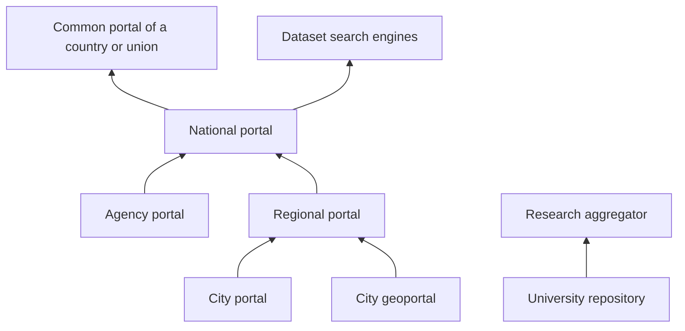

# Federation and Harvesting

A federation is a chain of catalogs. A city publishes datasets, the region harvests them, the country harvests from the region, and a common portal such as data.europa.eu harvests from the country. Dataset search engines stand to the side and read whoever serves descriptions to machines.

Fetching descriptions on a schedule is called harvesting. What is taken is not the data files but the records: title, licence, address, date. A person or a program downloads the file itself from the source.

## What the source does

- Serves all descriptions at one address: a DCAT file, an API, CSW or OAI-PMH. Pagination is fine too, if the order of records is stable and the end of the list can be reached. Search results ten at a time, with an order that changes from query to query, are no good for harvesting.
- Does not put this address behind a captcha or registration.
- Keeps the dataset address persistent. If a dataset is removed, its record says so rather than vanishing without a trace.
- Writes the licence on the dataset. An aggregator has no right to invent it.

The profile must match the one the higher-level portal expects. The higher-level portal silently skips "almost DCAT", and the city concludes that its data "wasn't taken".

## What the harvester does

- Visits on a schedule and does not take the whole catalog every ten minutes.
- Stores the source address and the harvest date.
- Does not multiply duplicates: a dataset from the city portal and its copy on the regional one are one record with a link to the original source.
- Removes or flags records whose source no longer opens.

In CKAN the harvesting framework is the ckanext-harvest extension, and RDF harvesting is part of ckanext-dcat. In Piveau, harvesting DCAT is the core's main job: Fraunhofer FOKUS built the platform around harvesting and checking the quality of descriptions, and data.europa.eu itself runs on it. Details on extensions are in the chapter [on CKAN](../05-platforms/03-ckan-and-extensions.md).

## What it looks like in practice

**Europe.** The state portal Open.NRW harvests descriptions from agencies and cities in North Rhine-Westphalia. Germany's national portal GovData harvests Open.NRW along with other states: in October 2026 GovData had about 10,600 datasets from Open.NRW. Descriptions flow in the German DCAT-AP.de profile. The pan-European data.europa.eu harvests GovData and other national portals, once a day by default, and itself translates titles and descriptions into all official EU languages.

**United States.** Every federal agency publishes a `data.json` file in the DCAT-US profile, and the data.gov harvester collects these files. The status of each source is visible on a separate site, harvest.data.gov. After data.gov moved to its own software in 2026, the harvester remained a separate program that writes to a shared database, which the showcase only reads.

**EU geodata.** Countries serve layer descriptions through CSW catalog services under INSPIRE rules. Until 1 July 2026 a separate INSPIRE geoportal harvested them; it is now closed, and data.europa.eu harvests national geocatalogs, translating ISO records into DCAT via the GeoDCAT-AP profile. The layers themselves stay in national services. More in the chapter [on geoportals](../03-types/03-geoportals.md#inspire).

**Research.** University repositories serve descriptions over OAI-PMH in the format set by the OpenAIRE guidelines, and OpenAIRE collects them into a common graph of research outputs.

**Thailand: one platform for all levels.** The central government data catalog gdcatalog.go.th runs on CKAN, and in October 2026 it held about 25,000 datasets. Provincial catalogs are not separate sites on different software but subdomains of the central one on the same platform, for example ranong.gdcatalog.go.th. In the central catalog the provinces appear as organisations, and geodata is shown by the geo.gdcatalog.go.th geoportal on TerriaJS. Profiles do not diverge because the source and the harvester are one system. The price: regions do not choose their own platform.

**Scotland: search first, then a portal.** For a long time Scotland had no national portal. Instead, the government built the find.data.gov.scot search engine: it harvests descriptions from the sites of agencies, councils and other data holders via their APIs, and where there is no API, it parses pages. In October 2026 it had about 26,500 datasets from 70 sources and 922 owners, with a page for each dataset. Only in 2026 did the data.gov.scot portal start working, still in beta and with 290 datasets: it is where those without a place of their own publish, and it serves descriptions in DCAT and schema.org. This order is useful when data is already scattered across a hundred sites: a search engine quickly shows what exists, and the portal is needed for the rest.

## Harvesting protocols

| Protocol | Who usually serves it | What the harvester gets |
|----------|-------------------|----------------------|
| DCAT file (RDF, `data.json`) | open data portals | all descriptions in one file |
| OAI-PMH | research repositories; data.europa.eu prefers it for DCAT-AP too | descriptions page by page, with the option to take only those changed since last time; a file list only if the description format itself contains one |
| CKAN API | portals on CKAN | descriptions in CKAN format; data.europa.eu accepts it only from legacy systems |
| CSW | geoportals | layer descriptions in ISO 19115 / 19139 |
| SPARQL | portals on graph databases | an answer to a query over descriptions |
| schema.org markup and a sitemap | any site | descriptions from pages; this is how dataset search engines read |

Being able to take only changes matters for large catalogs: the harvester does not re-download a hundred thousand descriptions every night.

## How to get harvested

A higher-level portal usually asks you to fill in a short questionnaire. data.europa.eu's is public: the address of the dump endpoint, the description profile (DCAT-AP, CKAN format or INSPIRE), the protocol, the date format per ISO 8601, whether a login is needed. The request is then sent through the feedback form. Once connected, the portal sees a quality score for its descriptions in MQA. It is useful to go through such a questionnaire before choosing a platform: it shows at once what is missing.

## Where the chain breaks

A municipality sets up its own portal that the region cannot read. The region copies records by hand. The national portal sees the region and not the cities. A search engine sees three copies of one budget.

The longer the chain, the more is lost along the way. data.europa.eu is an aggregator of aggregators: it harvests national portals, which themselves harvested cities and agencies. It shows clearly where exactly the chain breaks.

**The licence and the source get lost.** In August 2024 a dataset on environmentally hazardous facilities in the city of Malmö was on the city portal under a CC0 licence. Via Sweden's national portal dataportal.se, it reached data.europa.eu without a licence and without a link to the city page. By October 2026 the city had moved to a new portal, the CC0 licence now gets through, and the file links lead to Malmö. But the dataset page on the city portal is still not in the record: Sweden's national portal is recorded as the catalog. And the old record on data.europa.eu, which someone may have cited, disappeared when the city moved: its address returns a 404 error, because the aggregator builds the address from the source's address.

This is not an isolated case. By I. Begtin's count, in 2024 a licence was given for about 150,000–180,000 of 1.8 million datasets on data.europa.eu, i.e. no more than 10%. In October 2026 a licence as a link to a known text is present on about 775,000 datasets, less than half of the 1.73 million the portal showed that month. Things have improved, but more than half of datasets still arrive without a machine-readable licence, and a noticeable share of "licences" are values like "conditions unknown".

The lesson for every link in the chain: pass on the licence and the link to the dataset page at the source (in DCAT, the `dcat:landingPage` property), and do not change the dataset identifier when moving.

**One source outweighs a country.** In October 2026 data.europa.eu had about 1.73 million datasets, 850,000 of them German. 681,000 come from one catalog, the GDI-DE geocatalog, and almost 450,000 of those are development plans for individual plots (Bebauungsplan), each as a separate dataset, usually as WMS and WFS services. The national portal GovData provides another 169,000. In 2024 the picture was the same: 609,000 of 726,000 German datasets came from GDI-DE. So "Germany has half of Europe's data" says nothing about openness and everything about how a geocatalog slices data. When comparing countries in an aggregator, look at the number of sources and the types of data, not the total count.

**Only part of a country is visible.** In June 2024 data.europa.eu had 324 datasets from Estonia: the portal harvested only the national geoportal. By October 2026 the national open data portal had been connected too, and there were 8,700 datasets, 8,300 of them from that portal. How much of a country's data reaches the top depends on which catalogs it has registered. You can check this with the "catalog" filter in the higher-level portal's search: if your catalog is not there, neither are its datasets.

**The protocol does not transfer files.** OAI-PMH transfers only descriptions: the specification explicitly puts the nature of the resource itself outside its scope. The mandatory description format is simple Dublin Core, which has no field for a file list. So research aggregators that harvest repositories over OAI-PMH usually store a link to the dataset page, not to the files. A repository that wants its data to be downloadable straight from search should serve DCAT or an API with a file list alongside OAI-PMH.

**A home-grown harvesting format.** Russia's data.gov.ru harvested dataset lists that agencies kept in their own schema from the methodological recommendations. No foreign aggregator reads this format, so the chain broke at the very first step outside the country. More in the [anti-patterns](../09-practices/02-anti-patterns.md).

It is more honest not to set up a lower-level portal if the higher-level one already accepts publications from organisations. This is the usual conclusion for a small city: see the [municipality example](../06-choice/08-worked-examples.md).

## Sources

- [Metadata Export](../04-features/02-metadata-export.md)
- [APIs and Bulk Download](../04-features/04-access-interfaces.md)
- [ckanext-harvest](https://github.com/ckan/ckanext-harvest), [ckanext-dcat](https://docs.ckan.org/projects/ckanext-dcat/en/latest/)
- [Piveau](https://doc.piveau.io/) and [the data.europa.eu project at Fraunhofer FOKUS](https://www.fokus.fraunhofer.de/en/dps/projects/data-europa-eu.html)
- [How to get harvested by data.europa.eu](https://dataeuropa.gitlab.io/data-provider-manual/how-to-publish/request-harvesting/): the questionnaire, protocols, daily harvesting, machine translation
- [GovData](https://www.govdata.de/) and [the DCAT-AP.de profile](https://www.dcat-ap.de/); the number of Open.NRW datasets: a query to the GovData API, 11 October 2026
- [DCAT-US](https://resources.data.gov/resources/dcat-us/), [harvest.data.gov](https://harvest.data.gov/), [the data.gov catalog application](https://github.com/GSA/datagov-catalog)
- data.europa.eu, [INSPIRE datasets move to the European Data Portal](https://data.europa.eu/en/news-events/news/inspire-datasets-move-european-data-portal), 22 June 2026: the INSPIRE geoportal closing on 1 July 2026; [OpenAIRE guidelines](https://guidelines.openaire.eu/)
- data.europa.eu: the number of datasets by country, catalog, keyword and licence via the [search API](https://data.europa.eu/api/hub/search/search?filter=dataset&limit=0); datasets with a licence link via a query to the [SPARQL endpoint](https://data.europa.eu/sparql); the Malmö dataset record and the old record address (404) via the search API; all on 12 October 2026
- [Thailand's government data catalog](https://gdcatalog.go.th/) (CKAN 2.9.2, the `package_search` API), [the Ranong province catalog](https://ranong.gdcatalog.go.th/), [the geoportal](https://geo.gdcatalog.go.th/), 12 October 2026
- [find.data.gov.scot](https://find.data.gov.scot/): counters on the home page; [data.gov.scot, beta](https://data.gov.scot/about/using-the-beta-service), 12 October 2026
- [The OAI-PMH 2.0 specification](https://www.openarchives.org/OAI/openarchivesprotocol.html): the nature of the resource is outside the protocol's scope, the mandatory format is Dublin Core
- I. Begtin, Telegram (in Russian): [data.europa.eu as an aggregator of aggregators: Malmö and licences](https://t.me/begtin/5857), 4 August 2024; [GovData and the GDI-DE geocatalog](https://t.me/begtin/5938), 20 August 2024; [Estonia in the European portal](https://t.me/begtin/5681), 12 June 2024; [Thailand](https://t.me/begtin/5917), 15 August 2024; [find.data.gov.scot](https://t.me/begtin/6146), 3 November 2024; [why not to harvest OAI-PMH](https://t.me/begtin/5551), 2 April 2024
