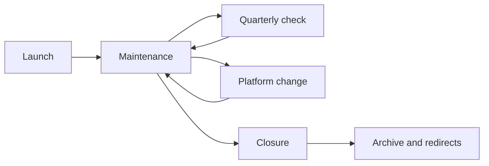

# Catalog Lifecycle

A catalog is launched in weeks and maintained for years. Most failures happen not on opening day but when the project has ended, the platform has changed or the only administrator has left.

## Launch

Launch is the day an outsider opens a real dataset, downloads the file and sees who will update it next year. The public address is the last step of that day. How long different approaches take to install is in the chapter [on deployment](../04-features/09-deployment-and-operations.md).

**A pilot is about ten real datasets, and one of them is awkward.** An awkward dataset is one whose source has no licence, whose file is large or whose updates are promised daily. The pilot shows who will add the licence, who will notice a broken link and whether the upper portal reads your dump. The vendor's demo datasets do not answer these questions. What to check on a test instance is in the chapter [on choosing a platform](../06-choice/03-from-features-to-platform.md#step-4-testing-on-real-data).

**Different people are responsible for the data and for the platform.** They are named, by name, before the public address.

This is how New York does it. The nyc.gov/opendata portal is run by the open data team in the Office of Technology and Innovation: strategy, standards, the site itself. Each city agency appoints its own open data coordinator. Through them the agency hands datasets to the portal, updates them at the frequency stated in the record, answers residents' questions and prepares its part of the annual report. If a coordinator leaves, the agency must appoint another and inform the portal team. This is written in the technical standards manual, edition of 12 May 2023. The scheme is alive: the annual report workbook for 2025 on the portal's site was updated on 23 June 2025.

Before the public address:

- [ ] The pilot has run on real datasets, including an awkward one.
- [ ] Two people are named: who updates the rows and who updates the platform.
- [ ] The address scheme is written down so that it survives the next platform. How to keep it is in the chapter [on identifiers](../04-features/06-identifiers-and-doi.md).
- [ ] A full dump of descriptions and files has been downloaded and opened once.
- [ ] A position and a budget are named for next year. A contractor who leaves on the day of sign-off does not fill these slots. What to put in the contract is in the chapter [on build models](../06-choice/05-build-or-buy.md).

**A site can open without a launch.** On 15 July 2025 the Russian Ministry of Economic Development reopened data.gov.ru. The previous version had been closed in March 2023 "for transfer to a new platform". The site came back. Through the API it had 5,826 datasets, about 100 MB compressed, and 84% of them were first published in 2019 or earlier. The snapshot of the previous version from 2 February 2022 (26,490 datasets, a 14 GB archive) did not return to the new portal. It is in the National Digital Archive; see [below](#if-someone-else-is-closing-it). An analysis by row count and by which agencies are missing from the portal is in the chapter [on self-audit](../10-quality/04-self-audit.md#substantive-check). Such an opening becomes a launch when fresh datasets with a named owner appear at the new address.

## Maintenance

From then on the catalog lives by checks. The number of datasets in a report does not replace them.

The schedule for links and for a full pass is already set in the chapter [on self-audit](../10-quality/04-self-audit.md): once a month a dozen known links are opened, once every six months the whole sample is walked through. It makes sense to add two rarer checks. They are done by the same two people named at launch: rows and records are checked by whoever is responsible for the data; the version, the copies and the bill by whoever is responsible for the platform.

| How often | What to do |
|-----------|-------------|
| Once a quarter | The licence on the dataset is filled in. The date in the file matches the promised frequency. The platform version is still supported. Both people from the launch are still in place. |
| Once a year | Someone tries to restore the copy. The full dump is downloaded again. The expiry date of the licence or contract for a commercial platform is in the calendar. |

**Links.** If the monthly check is skipped for years, you get the UK's data.gov.uk. The portal has been underfunded since 2017. By March 2026 at least a quarter of links led to an error page, and many datasets had not been updated for years by organisations that no longer exist. The platform, though, was kept: the previous catalog works, and a showcase of curated collections was built next to it. How this showcase works is in the section on platform change.

**Frequency.** The date in the record is the date of the rows. On the Humanitarian Data Exchange the overdue notice goes to the person responsible for the dataset, not to the portal's general inbox. How the deadline is calculated is in the chapter [on good practices](./01-good-practices.md). For your own catalog the same recipient is enough.

**Version.** The platform and extensions are upgraded while the version is still in the support window. For CKAN the latest minor version is fully supported, and the previous one gets bug and security fixes. On 14 October 2026 these are 2.12 and 2.11. A release older than the previous one is already outside the window, and the upgrade usually turns into a re-implementation: extensions, schema and the way files are stored change along the way. Other platforms' windows are in the chapter [on deployment](../04-features/09-deployment-and-operations.md).

**People.** A site can still open when nobody is left to answer. In New York, replacing a coordinator is the agency's duty. The other end of the same story can be seen in the registry. According to the dataportals-registry export (release 1.27.0 of 15 October 2026), 868 catalogs are not active and 98 have been decommissioned. The share of non-working catalogs varies widely: about 0.9% among indicator catalogs and about 18% among microdata catalogs. Behind the second figure are mostly abandoned installations: 47 of the 59 non-working microdata catalogs are old NADA catalogs of statistical offices, often on IP addresses and without HTTPS. They were installed under support programmes, and maintenance was not budgeted. Details are in the chapter [on microdata catalogs](../03-types/06-microdata-catalogs.md#where-it-breaks). A catalog without an owner and a maintenance budget dies with the project. The signs visible from outside years before shutdown are collected in the anti-pattern ["The portal was abandoned"](./02-anti-patterns.md#the-portal-was-abandoned).

The annual copy check is the same idea as in the chapter on deployment: a copy nobody has tried to restore does not count as a copy. The ArcGIS licence date at which the Arkhangelsk Region geoportal stopped shows why this date goes into the calendar in advance. The case itself is among the migration failures.

## Platform change

A change of platform is the main cause of dead links. Before the move, a dump of all descriptions and files is made, plus a table of old and new addresses. After the move, the old addresses are redirected. If everything cannot be redirected at once, the old system is kept at a separate address for a transition period. This is what data.gov did in April 2026: the catalog moved from CKAN to its own software, dataset pages stayed at the same addresses, and the old site was kept at catalog-old.data.gov. In the project description, updated on 23 July 2026, this address was still listed as working throughout the autumn. On 14 October 2026 the site no longer opens: the name catalog-old.data.gov still exists but points to an address that does not. The previous CKAN programmatic interface returns an error at the old path. The new interface lives at a different address and asks for a key, so programs that used CKAN had to be rewritten. How to estimate the cost of leaving in advance is described in the chapter [on build models](../06-choice/05-build-or-buy.md).

Moves go in both directions, and neither direction is a mistake in itself:

- **To CKAN.** Since 2019 Australia's data.gov.au ran on a mixed setup: Magda provided search and the showcase, with an outdated CKAN underneath. In June 2025 the portal was consolidated into a single CKAN with Drupal for pages; more than 100,000 datasets and harvesting from a thousand sources were preserved, and the CKAN programmatic interface remained the same. Greece's data.gov.gr moved to CKAN from its own software in 2025–2026 and, by harvesting other catalogs, grew from a hundred datasets to tens of thousands. On 14 October 2026 it is CKAN 2.11.3 with 22,762 datasets.
- **From CKAN.** Besides data.gov, Mongolia's opendata.gov.mn moved to its own engine, and the programmatic interface disappeared along with the old platform. On 14 October 2026 the old CKAN API path opens a site page rather than an interface response.
- **Without a platform change.** In 2026 the UK's data.gov.uk became the National Data Library: a new showcase with curated collections, while the previous catalog was kept as a separate section so there is something to compare against.

Typical failures recur too. When the Slovak portal moved to data.slovensko.sk in 2024, dataset addresses changed and links to them from the European portal stopped working. Malaysia, moving data.gov.my to a new engine, kept the old catalog at archive.data.gov.my. On 14 October 2026 a connection to this address cannot be established, so the temporary archive turned out to be temporary. The Arkhangelsk Region geoportal lost its layers when its ArcGIS licence expired: the catalog kept showing records for layers that no longer existed. Russia's data.gov.ru was closed in 2023 "for transfer to a new platform" before that platform existed, and for two years there was no portal at all.

Hence three rules. The old version is kept until the new one has taken over all addresses. The programmatic interface is as much a part of the address as the dataset page: if it changes, harvesters lose the catalog. The licence for a commercial platform is a date by which the migration plan must be ready.

## Closure

Closing a catalog is fine if nobody uses it or there is nothing left to run the platform on. Closing it by switching off the server on the day users find out is bad.

Before shutdown the catalog runs read-only for several months. The site, the files and the programmatic interface open, new edits are stopped, and the front page says why and until what date. A pause without a date is already an abandoned site. data.gov.ru skipped this stage: the portal was switched off "for the duration of the transfer", and for two years the old address offered neither reading nor an explanation of where the datasets had gone.

Before shutdown:

- [ ] The closure is announced in advance, months ahead. Until the announced date the catalog runs read-only.
- [ ] The data is handed over to another catalog or archive, or the old address states plainly that it has been withdrawn from publication.
- [ ] Old addresses redirect. If not everything can be redirected, for at least a year they say where the dataset has moved.
- [ ] A snapshot of the descriptions is saved: a dump through the programmatic interface or a DCAT file, not just site pages.
- [ ] Files that exist only here are saved together with the addresses they were taken from.
- [ ] The site is in Internet Archive or a national web archive, and the archive can reach it, including from abroad.
- [ ] The upper portal and the registries where the catalog was registered have been notified.

The same list is in the [checklists](../12-appendices/04-checklists.md#before-switching-off-a-catalog).

### How to take a snapshot

"A snapshot of the descriptions is saved" is not a screenshot of the home page. Archiving a catalog goes through four steps.

1. **Find everything that belongs to the catalog.** The main site, subdomains, old versions such as `old.` and `archive.`, separate map and API services. Old versions of a site disappear first: they are kept "just in case" and then switched off unnoticed.
2. **Set priorities.** First, what will disappear sooner and exists nowhere else: files that exist only here, services on a platform being shut down.
3. **Collect.** Site pages with a web archiver in WARC format, which Internet Archive and national libraries read. Descriptions as a dump through the API or a DCAT file. Files downloaded as they are, together with the links they were taken from. If data is served only through an API, a separate dump is needed, for example with the APIBackuper tool: a web archiver does not crawl APIs.
4. **Publish or deposit.** WARC files and dumps go into open storage, and their description into a catalog, so the archive can be found. At a minimum, deposit a copy in cold storage and write down where it is.

WARC can be viewed without a server in ReplayWeb.page. Sites with dynamic loading need a browser-based crawler, such as Browsertrix Crawler.

### If someone else is closing it

A catalog can be closed by its owners without asking the users. Then the data survives only in other people's archives. Russia's data.gov.ru was closed in March 2023 "for transfer to a new platform". A full snapshot of the previous version (26,490 datasets, 14 GB compressed) survived in the National Digital Archive: it was made on 2 February 2022. The version opened on 15 July 2025 did not bring this data back. How catalogs disappear, why the web archive preserves them poorly and how to take a copy of someone else's catalog is in the chapter ["Archiving and Rescuing Catalogs"](./04-archiving.md).

Catalogs that simply stopped being maintained are counted in the maintenance section. A separate case is when the product itself is withdrawn from support. Nesstar was declared obsolete in 2015 with version 4.0 and finally withdrawn by 2022. Canada's social survey archive ODESI chose Borealis, built on Dataverse with DDI descriptions and DOIs, for its move, and switched off Nesstar only after the transfer: in October 2026 the old address leads to the new site. The end of someone else's product is met with a migration plan while the old system still opens.

## Sources

- The dataportals-registry export, release 1.27.0 of 15 October 2026.
- [New York open data coordinators](https://www.nyc.gov/opendata/open-data-coordinators): a coordinator's duties; the annual report workbook for 2025 was updated on 23 June 2025
- [Technical Standards Manual](https://www.nyc.gov/content/dam/nycgov/opendata/downloads/open-data-coordinators/NYC_OpenData_TechnicalStandardsManual.pdf), edition of 12 May 2023: who runs the portal, who runs an agency's datasets, replacing a coordinator who leaves
- [Announcement of the new data.gov catalog](https://data.gov/blog/catalog-update/), 15 April 2026; [catalog description](https://github.com/GSA/data.gov/wiki/catalog.data.gov), updated 23 July 2026: the old address was listed as working throughout the autumn; [the new programmatic interface](https://resources.data.gov/catalog-api/): a different address and a key. catalog-old.data.gov being unreachable and the old Action API error: checked 14 October 2026
- Link Digital, [moving data.gov.au to CKAN](https://linkdigital.com.au/case-studies/upgrading-a-national-oecd-government-open-data-portal-to-a-full-ckan-environment/), 2025; GDS, [What's changing on data.gov.uk and why](https://dataingovernment.blog.gov.uk/2026/03/25/whats-changing-on-data-gov-uk-and-why/), 25 March 2026: underfunding since 2017, at least a quarter of links lead to an error
- I. Begtin, Telegram (in Russian): [data.gov.gr on CKAN](https://t.me/begtin/7588), 18 May 2026; [opendata.gov.mn](https://t.me/begtin/7737), 25 August 2026; [data.slovensko.sk](https://t.me/begtin/5703), 20 June 2024; [data.gov.my](https://t.me/begtin/5362), 19 January 2024; [the Arkhangelsk Region geoportal](https://t.me/begtin/5952), 21 August 2024
- Nesstar: [product history](https://en.wikipedia.org/wiki/Nesstar), [ODESI's move to Borealis](https://www.ocul.on.ca/odesi-migration)
- [The WARC format](https://www.loc.gov/preservation/digital/formats/fdd/fdd000236.shtml) as described by the Library of Congress, [ReplayWeb.page](https://replayweb.page/), [Browsertrix Crawler](https://github.com/webrecorder/browsertrix-crawler), [APIBackuper](https://github.com/ruarxive/apibackuper): dumping data from an API for an archive
- I. Begtin, [How to archive digital resources properly in archiving campaigns](https://begtin.substack.com/p/18) (in Russian), November 2021: the four stages of archiving; [Web archiving and its limitations](https://begtin.substack.com/p/783) (in Russian), February 2025
- I. Begtin, [The updated data.gov.ru portal](https://begtin.substack.com/p/datagovru) (in Russian), 16 July 2025: 5,826 datasets, about 100 MB, 84% first published in 2019 or earlier; the archive copy of 2 February 2022
- [Good practices](./01-good-practices.md), [self-audit](../10-quality/04-self-audit.md), [microdata catalogs](../03-types/06-microdata-catalogs.md)
- data.gov.gr: `status_show` and `package_search` on 14 October 2026: CKAN 2.11.3, 22,762 datasets. The opendata.gov.mn API path and the archive.data.gov.my address were checked the same day.
- [CKAN release support policy](https://docs.ckan.org/en/2.12/maintaining/releases.html): on 14 October 2026, 2.12 is fully supported and 2.11 gets fixes
- [Deployment Speed and Operations](../04-features/09-deployment-and-operations.md)
- [Persistent Identifiers](../04-features/06-identifiers-and-doi.md)
